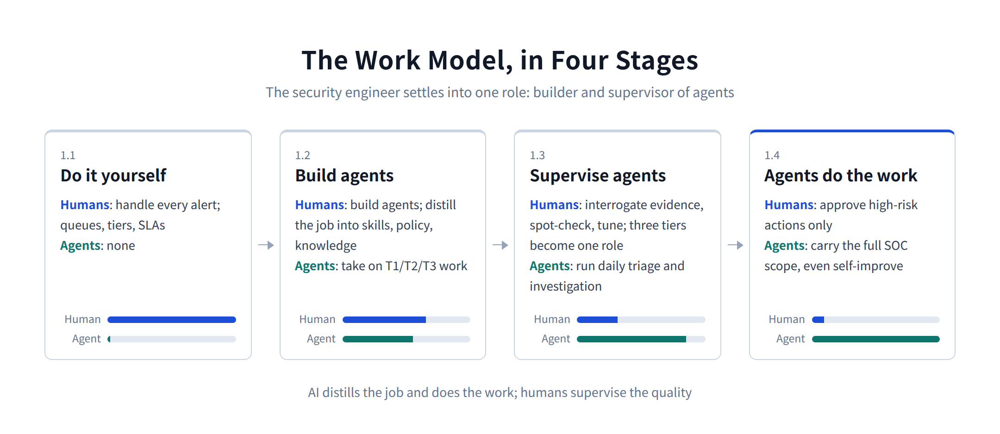
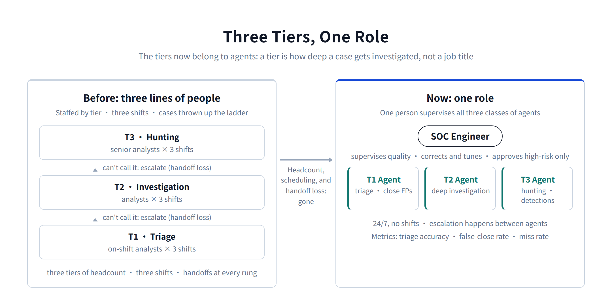
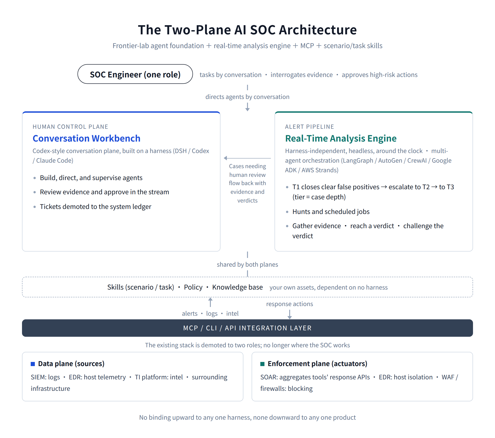

# What the Next AI SOC Looks Like: A Codex for Security Operations

[中文](../zh/01-ai-soc.md) | [English](../en/01-ai-soc.md) | [Article index](../README.md) | [Profile](../../README.md)

> **About the author**: Max Luo, Founder of Teloa, focused on AI Agent Engineering & Product Development and AI Native Security. AI Security Engineering Team Lead at a globally leading cryptocurrency exchange, with 13+ years in cybersecurity and former leadership roles across global application security, the AI Security Center of Excellence (COE), security BP, and red teaming at SHEIN. Author of the open-source book AISecOps: AI-Driven Enterprise Security.
>
> GitHub: [cybermaxluo](https://github.com/cybermaxluo) | LinkedIn: [max-luo](https://www.linkedin.com/in/max-luo) | Email: 186616@gmail.com

I've been chewing on a question lately: what does the next generation of the AI SOC actually look like?

There's no shortage of answers on the market. Some vendors bolt a chat window onto their existing platform. Some sell "AI analysts." Some are deep into multi-agent orchestration. My answer comes from practice plus a read on where the industry is heading: a Codex for the SOC. A conversation-driven security workbench.

I've spent the past few years building AI for security hands-on. The tooling went from LangChain in the early days, to Dify, to OpenClaw and Hermes, to Codex, Claude Code, and DSH today, with the architecture rebuilt at every step. What settled out of that is two threads of reasoning:

**One is the evolution of the work model: do the work yourself → build agents to do it → supervise the agents → agents do the work.**

**The other is the evolution of strategy: the labs' rapid iteration is the biggest tailwind you can get, and the right move is to build on their harnesses and participate deeply in their ecosystems.**

First, a term. Products like DSH (DeepSeek Harness), Codex, and Claude Code are what the industry calls agent harnesses: the runtime-plus-client layer a model company wraps around its base model to turn it into an agent that can actually do work. Session management, tool calling, MCP integration, skills, permission checks all live in this layer, and building it has a name of its own now: harness engineering. Codex and Claude Code started life as AI coding tools and generalized into full agent runtimes through MCP, skills, and subagents. The model is the brain; the harness is the body and the workbench. When I say "harness" below, this is what I mean.

## Thread one: the work model is evolving

### Do it yourself

The last generation of SOC ran on people. More alerts than analysts, so you queue them. Analysts vary in skill, so you tier the work: T1 triage, T2 investigation, T3 hunting. Things fall through cracks, so you add SLAs, routing, escalation.

Put those pieces together and you see what a ticket system actually is: a labor-scheduling system. It manages human attention and throughput. SIEM alert queues, SOAR playbooks, ITSM routing: every one of them is built on the same assumption, that the work is done by humans and there aren't enough humans.

The entire previous generation of security operations was designed around labor scarcity.

Now that system faces a different adversary: attack and defense have gone AI versus AI. Attackers moved first. Recon is automated, phishing comes out of a model at volume, exploit chains are orchestrated by agents. Attacks run at machine speed.

In November 2025, Anthropic disclosed the first documented AI-orchestrated espionage campaign: attackers jailbroke Claude Code and ran intrusions against roughly 30 organizations worldwide, with 80 to 90 percent of the attack actions executed autonomously and the operators stepping in only at a few decision points. Vulnerability discovery has gone even further. In 2026, Anthropic's Mythos model can autonomously find zero-day vulnerabilities in mainstream operating systems and browsers, and given a CVE ID and the corresponding commit, produce a working exploit within hours.

Defense is still running human triage and ticket routing, at human speed. At that differential, the human-powered ticket model is past being an efficiency problem. You're simply outclassed.

### Build agents

Agents can do this work now. With Codex plus MCP plus skills, T1 triage, T2 investigation, T3 hunting and detection engineering are all within reach, with no queue and no shift schedule.

So the security engineer's center of gravity shifts for the first time: from handling alerts to building agents and embedding them deep in the workflow.

Write your triage criteria as skills. Write your action boundaries as policy. Wire your data sources up as MCP servers. Put your experience into a knowledge base. What this stage really is, is distillation: you distill the T1/T2/T3 job capabilities into agents, and you distill human experience, intuition, and judgment into skills, policy, and knowledge.

Those capabilities used to live in people. They walked out the door with every resignation. Distilled into the system, they're copyable, improvable, durable. The operational capability finally belongs to the organization instead of to whoever happens to be on shift.

Changing a workflow on a traditional platform means a ticket, a sprint, a release. Changing a skill takes an afternoon. One-off requests and custom asks get handled same-day.

### Supervise the agents

Once agents are embedded in the workflow, the second shift happens: humans stop doing the work and start supervising the agents doing it.

The engineer's day becomes: interrogate the evidence, spot-check verdicts, correct bad calls, keep tuning skills and the knowledge base, using the agents' own quality data to make the agents better. The metrics change with it. Not how many tickets you closed, but triage accuracy, false-close rate, miss rate.

The org chart changes too: three tiers collapse into one role.

T1/T2/T3 used to be three lines of people (triage, investigation, hunting), with cases thrown up the ladder. Now the tiers belong to the agents. T1 can't call it, escalate to T2; T2 can't call it, escalate to T3. It describes how deep a case gets investigated, not anyone's job title. On the human side you need exactly one role: the SOC engineer, one person supervising all three classes of agents.

Three tiers of headcount, three shifts of scheduling, and every handoff up the ladder, all gone. That's where the labor savings actually come from.

### Agents do the work

The last step: agents carry the full scope of SOC work. Response, triage, investigation, containment, detection engineering, data integration, scheduled jobs, reporting, knowledge capture, even improving itself.

Humans keep exactly one thing: approving high-risk, high-blast-radius actions. Isolating a host, disabling an account, blocking an IP, deleting files. Low-risk actions execute automatically under policy. High-risk actions wait for a human, because isolating the wrong core server or disabling the wrong executive's account costs far more than the minutes automation would have saved. That approval line stays with people.

Four stages in, the role settles: the security engineer is the builder and supervisor of agents. And that role isn't limited to the SOC; it applies across security jobs.

## Conversation replaces tickets

The interface for "do it yourself" was the ticket queue, because queues are how you route work to humans. The natural interface for directing and supervising agents is conversation.

Assigning a task is a sentence. Checking on an investigation is a sentence. "Pull every similar alert on this host from the last 30 days and compare" is a sentence. Even approval doesn't need a context switch: you review the evidence in the conversation stream and click approve.

Tickets don't disappear. They get demoted to the system's ledger: case records, evidence chains, audit trails. They're just no longer where humans work.

So the end state of the AI SOC: the whole SOC team, eventually the whole security org, works on one centralized, Codex-style workbench, driving agents by conversation instead of driving cases by tickets.

There's a design principle underneath this: the architecture's first user is the agent, not the human. Data, interfaces, capabilities, all of it designed for agents to call, schedule, and operate. Humans don't operate the system; humans direct agents that operate the system. Once you see that, the interface question answers itself. You don't need elaborate UX, and you don't need the giant wall-of-glass dashboard every SOC seems contractually obligated to build. That thing belongs to the same generation as the ticket queue, the era of humans staring at systems. Humans need exactly two interfaces: a box to talk to agents, and a stream to review evidence and approve actions.

### You still need a real-time analysis engine

Tens of thousands of alerts a day can't each get their own session. A harness is conversational and human-in-the-loop by design; it's the wrong shape for a high-volume pipeline. So the system needs one more piece: a real-time analysis engine, independent of the conversation plane. Build it on the mainstream multi-agent frameworks (LangGraph, AutoGen, CrewAI on the open-source side; Google ADK and AWS Strands Agents from the cloud vendors), with triage flows orchestrated per alert type and multiple agents working each case: gather evidence, reach a verdict, challenge the verdict. Headless, around the clock.

And this engine isn't just T1. All three tiers run inside it: T1 closes the obvious false positives under policy, escalates what it can't call to T2 for deep investigation, then to T3. Hunts and scheduled jobs live there too. Only the cases that need human eyes come back into the conversation workbench, evidence and verdicts attached. The human never leaves the one interface.

The conversation plane is the human's console; the engine is the alert pipeline. The first rides the harness. The second is your own asset and depends on no harness at all.

Put it together and the architecture is:

**AI SOC = a frontier-lab agent foundation (the Codex-style conversation plane) + a real-time analysis engine (T1/T2/T3 autonomous triage, harness-independent) + MCP (your security stack and surrounding data sources) + scenario and task skills**

The foundation provides intelligence and the human interface. The engine digests volume. MCP connects the stack. Skills carry the domain knowledge and the workflows. Both planes share one set of skills, policy, and knowledge.

One more implication, this time for your existing security stack: every platform, appliance, and piece of surrounding infrastructure gets demoted to one of two roles, data plane or enforcement plane. The SIEM is a log source. SOAR is an execution channel that aggregates your tools' response APIs. EDR is host telemetry plus an isolation actuator. WAF and firewalls are blocking actuators. The TI platform is a data source. All of it connected over MCP, CLI, or API. Their built-in consoles, platform features, and workflows are no longer where the SOC works.

For buyers, the before-and-after is stark. Triage rules, response playbooks, and operating procedures used to live inside vendor platforms; switching vendors meant starting over, and security programs ended up bound to one vendor's product and ecosystem. Now the triage logic lives in your skills, the response policy lives in your policy layer, the experience lives in your knowledge base; swapping a device means swapping an integration. No binding upward to any one harness. No binding downward to any one security product. The brain stays yours.

## Thread two: ride the labs' harnesses

Look back at the tooling AI-for-security has run on. We're four generations in, and each one rode a jump in LLM capability. I have used all four generations in actual business work.

Generation one: plain-text chatbot assist. Paste the alert into the chat window, ask the model what it thinks. You ask, it answers.

Generation two: workflows plus RAG. Dify and LangChain pipelines, knowledge bases wired in, multiple data types. But every step was laid out by a human in advance; the model just worked its node.

Generation three: autonomous agent frameworks. Third-party harnesses like OpenClaw and Hermes: the model starts planning its own tasks, holding memory, executing multi-step work without a pre-drawn flow.

Generation four: the labs' own agent clients. Codex, Claude Code. They passed every third-party framework, and they improve every time the base model does.

Four generations, one pattern: each generation displaced the previous one as the primary work surface, and generation four is written by the labs themselves. That's also why we didn't build on OpenClaw or anything like it. Generation three competes on how well it understands and adapts to the models. Generation four is written by the people who make the models. Third parties have no real shot. And the labs are moving toward the business side themselves: fielding forward-deployed engineering (FDE) teams and standing up consulting arms to help enterprises put AI to work. The room for middlemen between the model and the business keeps shrinking. OpenClaw falling behind Codex and Claude Code is the signal, not an accident.

What gets displaced is the position of primary work surface, not the technology. The tech settles into the layer where it fits: generation two and three's orchestration and multi-agent machinery is exactly what the real-time engine runs on. Generation four becomes the human workbench.

Follow the trend line out and my industry call is this: the labs will absorb the middle layer entirely. Until AGI arrives, third parties live in the business layer.

If you're building in the business layer, that's a tailwind. Instead of building a traditional application platform, ride the labs' harnesses: participate in their ecosystems, build on their bases and their extension points.

Every step the labs take accrues to you. Stronger model, better triage. New harness capability, you use it that day. Their release velocity becomes your release velocity instead of your competition.

It also settles where the engineering effort goes: into the SOC business layer the labs will never build for you. Triage criteria, action boundaries, approval governance, knowledge. Intelligence and platform capability come from the ecosystem.

On selection: open-source bases. Open-source Codex, DeepSeek Harness. Controllable and self-hostable, which for security work is a hard requirement.

## Prove the loop, draw the lines, decouple the engine

Riding a harness has risks of its own. The harness can lose the race, get replaced by its own vendor's next thing, or just stop shipping. The answer is to design for decoupling from the very first architecture decision. Three pieces.

First, prove the loop. Build the MVP on something like DeepSeek Harness and validate the full chain: alert ingestion, multi-agent triage, deterministic policy checks, high-risk approval, execution, end-to-end audit. Ship it in shadow mode: agents produce verdicts but take no actions, you compare against what your analysts actually did, and you expand autonomy class by class on false-close and miss-rate data. The autonomy switch gets flipped by hard data, not by anyone's enthusiasm.

Second, draw the lines. Design for business decoupling from the start and lock in the constraints while you build: cases, evidence, approvals, and audit live in your own database; business APIs take no dependency on anything harness-private; the UI talks only to your API. Get the boundary right and upgrading the architecture or swapping engines later means swapping an adapter. Get it wrong and it's migration debt you will pay later.

Third, decouple the engine. The "engine" is really three layers with very different swap costs. The model layer should be multi-vendor routed anyway; models can be switched at any time. The agent runtime layer is different: DSH, Codex, and Claude each have their own agent machinery, mutually incompatible, so a swap means rewriting an adapter. The interaction layer couples deepest; swapping engines there is basically a rebuild. So the architecture needs one more abstraction above the vendors' interfaces: define adapter contracts in your own business terms instead of copying any one vendor's API. Otherwise you're swappable in name and stuck in practice.

And there's a backstop. Everything truly core to this system (the policy engine, approval governance, audit, the knowledge base, the real-time analysis engine) lives outside the harness to begin with. Whatever engine you move to, those assets remain yours.

## Last thing

Each thread in one sentence.

On the work model: do it yourself → build agents → supervise agents → agents do the work. The security engineer's job is to build agents deep into the workflow, supervise their quality, keep improving them, and keep approval authority over high-risk actions.

On strategy: build on the labs' harnesses and participate deeply in their ecosystems; their rapid iteration is the biggest tailwind on the way to an AI-run security operation.

What this means for you personally, if you work in security: alert-handling skill is depreciating, while the skill of building and supervising agents has become a real edge in the job market, and it's still appreciating. The triage judgment in your head works eight hours a shift. Written as a skill, it works around the clock. You don't need a platform or a budget line to start. Codex and a few MCP servers are enough. Take the alert class you know best and write your first skill this week.

Before AGI, this industry sits in a middle state, and the division of labor is getting clear. The labs do intelligence and absorb the middle layer along the way. The middle-layer companies get squeezed. What's left to security vendors and enterprise teams is the business layer: your context, your data, and the accountability and trust that come with taking action. Those three don't depreciate as models improve. However strong the model gets, it doesn't know which server is your crown jewel, what your false positives look like, or who signs when something goes wrong.

So the window is simple to play: leave intelligence to the labs, skip the middle layer, and spend the time distilling your context, your experience, and your data into the system.

Nobody knows how long the window stays open, but the effect on people is already visible. When ChatGPT landed, we said AI would replace people who don't use AI. For security work today, that line needs an update: AI will replace people who can't build AI agents. The industry has moved into standardized operations: no longer AI helping humans go faster, but AI distilling the job's skills and doing the job, with humans supervising the quality.

These are my working notes from the past year of building AI for security. If you're working on the same problems, reach out on LinkedIn or by email. I'd be glad to compare notes.

---

[Next](./02-appsec.md)
