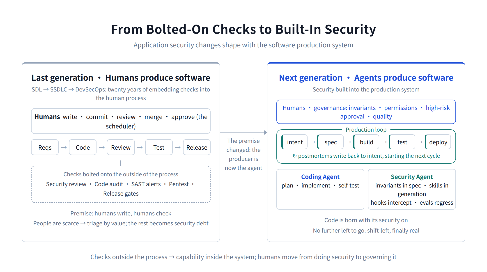
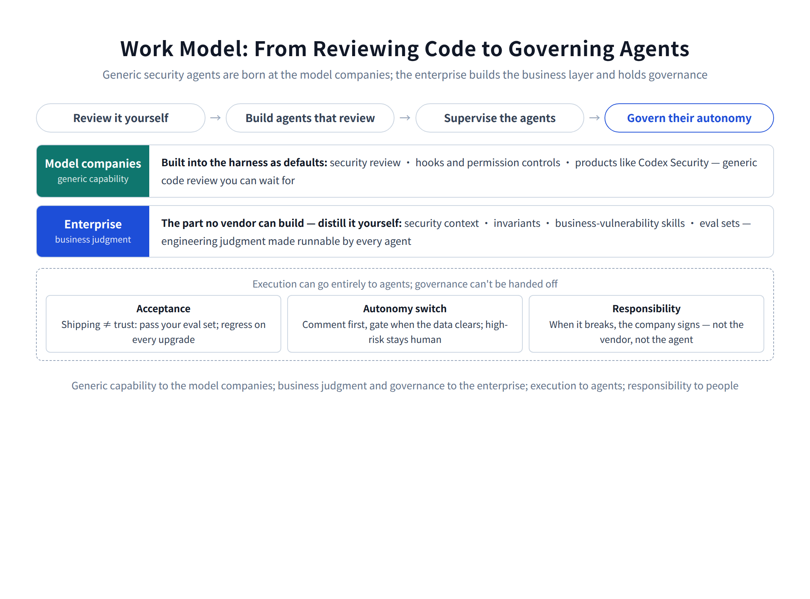
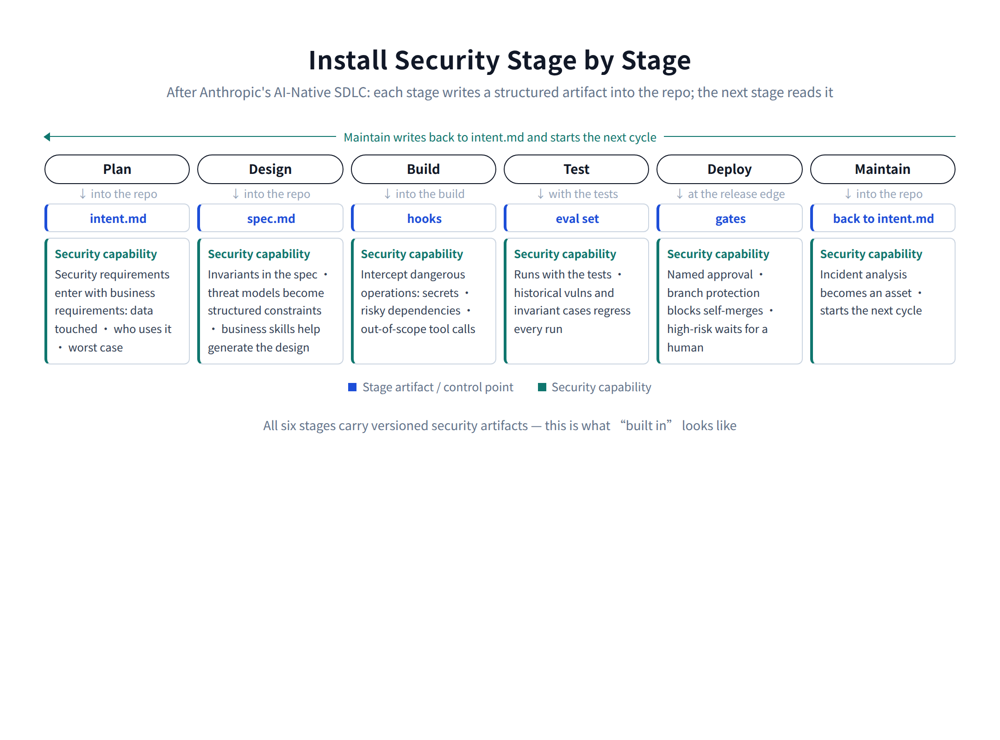
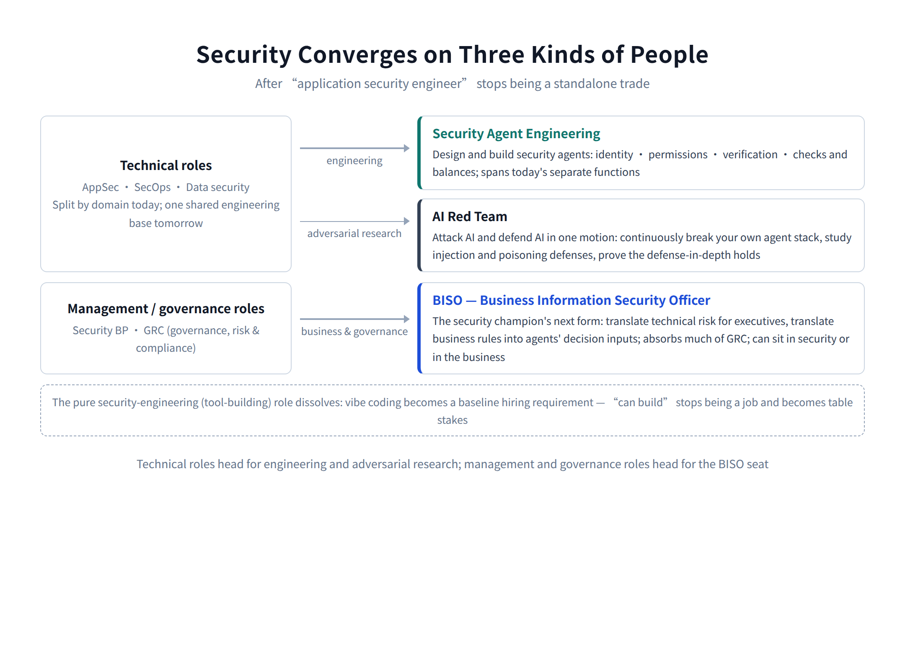

# Confessions of a Last-Generation AppSec Engineer

[中文](../zh/02-appsec.md) | [English](../en/02-appsec.md) | [Article index](../README.md) | [Profile](../../README.md)

> **About the author**: Max Luo, Founder of Teloa, focused on AI Agent Engineering & Product Development and AI Native Security. AI Security Engineering Team Lead at a globally leading cryptocurrency exchange, with 13+ years in cybersecurity and former leadership roles across global application security, the AI Security Center of Excellence (COE), security BP, and red teaming at SHEIN. Author of the open-source book AISecOps: AI-Driven Enterprise Security.
>
> GitHub: [cybermaxluo](https://github.com/cybermaxluo) | LinkedIn: [max-luo](https://www.linkedin.com/in/max-luo) | Email: 186616@gmail.com

Let me explain the title first. "Last generation" doesn't mean the people are finished. It means the job — the application security engineer as we know it — ends with us. I've spent years building AppSec programs, deploying SDL, DevSecOps, and the security BP model layer by layer inside real businesses, and last year I wrote the whole system up in A Guide to Application Security Architecture for Cross-Border Internet Enterprises, a reference architecture from the business-requirements layer down to operations. So this piece is a confession as much as a verdict: the thing I'm declaring finished is the system I practiced for years and only just finished writing down.

My previous piece, *What the Next AI SOC Looks Like: A Codex for Security Operations*, covered the operations side of this shift: conversation replacing tickets, three tiers collapsing into one role, agents doing the triage, humans keeping high-risk approval. This one is about the same shift on the engineering side.

The starting point is the same judgment: the primary producer of software is changing from humans to agents. For application security, the change doesn't touch the security team's own tools first — it moves the thing security is attached to, the software production system itself. When the foundation moves, the house on top moves with it.

Here's the conclusion up front: **the next generation of application security is not a series of checks bolted onto the outside of the development process. It's security capability built into the production system itself.** Security agents work in the production loop alongside coding agents, and humans move up a level, from doing security to governing it: setting invariants, managing permissions, approving high-risk actions, measuring quality.

The change propagates in a fixed order: the production system moves first, collaboration follows, then security's work model and the org chart, and the fate of today's tools falls out of all that. That's the order this piece follows, ending with what practitioners should do now and where they go next.

## 1. The last generation was designed around humans writing software

Take apart an AppSec team's daily work: security reviews need meetings, code audits need scheduling, SAST findings need human confirmation, vulnerabilities get ticketed, chased, and retested; you embed security champions in dev teams, run training, gate the releases. The rituals look different, but they all rest on the same unexamined premise: software is written by humans and checked by humans. From Microsoft's SDL through SSDLC to DevSecOps, twenty years of practice has been one long project of embedding security into the human software process.

Go a layer deeper and CI/CD sits on the same premise. It made human production faster — sound engineering for its era. Commit, branch, PR, approval: that vocabulary was born when humans collaborated on code. People write, people submit, people review, people merge, people approve the release. Machines execute plenty of steps, but a human schedules the whole system. DevSecOps pushed every check that could be turned into a rule into the pipeline — block high-severity findings, catch the leaked key — but it automated actions, not judgment. Should this endpoint carry this permission? Does this change break tenant isolation? Still a human's call.

Underneath it all, the scarce resource is people. A handful of experts, a few systems reviewed per day, hiring that never keeps pace with what engineering ships. So you triage by value: the crown-jewel systems get real reviews, scanners cover the middle, and the rest goes on the books as security debt. Nothing about that design was wrong — it fit its era. Software was made by people, so security had to be organized around people. What's changing now isn't the design. It's the premise underneath it.

## 2. Production: the pipeline gives way to the loop

One engineer now drives several coding agents in parallel, and code output stops being bounded by typing speed. Anthropic has published a number: as of May 2026, more than 80% of the code merged into their own repositories was written by Claude — still passing a review gate before merge.

That opens a speed gap: production runs at machine speed, review at human speed. Keep reviewing line by line and you're capping machine output at human pace; it ends with security becoming the delivery bottleneck that gets routed around, or review becoming theater. The way out isn't dropping human review — it's changing what humans review, and at what granularity: not every line, but invariants, evidence, and high-risk conclusions. More on that in the work-model section.

Review isn't the only thing that can't keep up; neither can the pipeline's shape. A pipeline is a pre-drawn path: build after commit, test after build, run B when A finishes. An agent gets a goal — "implement refunds" — then plans, tries approaches in parallel, tests, compares, throws work away and starts over. The pipeline answers "what always runs next." The agent answers "given the current state, what should happen next."

CI/CD doesn't die, though. Agents are good at understanding, planning, and judgment; pipelines are good at deterministic execution — build, test, sign, gate, deploy, the steps that must be repeatable and auditable. The division of labor writes itself: the agent is the brain, CI/CD the hands, the policy engine the reins, Git and the evidence store the ledger. CI/CD sinks from "the human release process" to "the agents' deterministic execution substrate."

None of this is speculation; there's a worked template. Anthropic again — their AI-Native SDLC playbook rearranges software production into six stages: Plan, Design, Build, Test, Deploy, Maintain. One thread runs through the whole document: each stage ends by writing a structured artifact into the repo, and the next stage reads it. Requirements become intent.md, design becomes spec.md, the implementation plan is plan.md, then code, then a PR carrying review conclusions, and production incidents are written back into intent.md to start the next cycle. Collaboration moves out of meetings, tickets, and hallway syncs into a chain of artifacts in Git; the commit chain doubles as the audit log — who asked for what, what the agent produced, who approved it, all in version history. The playbook's premise is blunt: code is no longer the bottleneck. The bottleneck has moved to either side of the code — planning, review, deployment — which still run at human speed.

Put the layers together: traditional AppSec isn't being optimized by AI. It has run its course. It still has demand and still delivers value today, because most organizations still run the old production system, and security can only keep patching the old model. But the value drains at exactly the pace the production system turns over. And the turnover won't happen in step: AI-native companies and the top internet firms will finish in two or three years, most tech companies need five, finance and government maybe ten — and large companies hold piles of legacy systems that will never enter the new loop, so old and new running side by side isn't a transition phase; it's the normal state for years. Every unit of investment from here on deserves one question: is this keeping the old system alive, or laying foundations for the new one?

The same verdict applies to security vendors, with the scope drawn carefully. The pressure lands on businesses whose selling point is detection: generic detection and repair keeps concentrating into harnesses, and products built around a human console get harder to sell. Businesses whose selling point is compliance attestation hold up far better: assessment reports and third-party certifications sell credentials and accountability, which no harness can produce. And the new structural opening sits inside the same shift: a harness's built-in security review is, at bottom, a vendor checking its own production system's output. Sooner or later the market wants an independent third party doing the checking — financial statements don't audit themselves, which is why the Big Four exist. Cross-harness independent verification, standardized evaluation, and audit is a natural third-party business. Feeding agents as a data source and executor is a transitional role; being the independent referee is a durable one.

## 3. Collaboration: humans coordinate through tools, agents through state

Jira, PRs, review meetings, weekly syncs — these exist because humans need to pass information and stay aligned. Agents no longer coordinate primarily through tickets and scheduling; they coordinate directly through shared context, state, evidence, and policy. The wall between security and engineering — you file, I schedule; you chase, I retest — falls before the org chart does.

Security's position in the loop changes with it. It used to be a stage on the pipeline, arriving after the code was written; in the future, it will be a resident of the loop. Design changed? The threat model rebuilds. Permissions changed? Authorization boundaries recheck. Dependency changed? Supply chain recheck. And here's the twist: after a decade-plus of shift-left, this is the step where it finally works. Shifting left used to mean moving checks and training earlier, and however early you moved them, security remained a stage outside someone else's process. Now invariants live in the spec and security skills participate in generating the code, so the code is born with its security on. Shifted all the way into generation, there is no further left to go. Security stops having a left and a right — it's simply built in. Secure by design, in the literal sense at last.

That playbook deserves a careful read from every AppSec team, because it's probably the embryo of the next production system, and its guidance for security is written into the artifact chain itself: security policy encoded as skills that help generate the spec at design time; hooks intercepting dangerous operations at build time; deployment gates requiring named approvers; branch protection stopping an agent from approving itself; operations agents acting only within pre-authorized tiers. Push that logic one step further and security's own inputs and outputs must become versioned artifacts on the same chain: invariants in the spec, context readable by agents, reviews producing structured evidence, incident lessons written back into intent.md to constrain the next cycle. Security deliverables that stay in meeting minutes and tickets can't plug into this system — from an agent's point of view they're far too slow to consume, nowhere near the speed of the loop.

## 4. Work model: from reviewing code to governing agents

AppSec's work model walks the same path every security function walks: **do the reviews yourself → build agents that review → supervise the agents → govern the agents' autonomy.** The unusual part is the middle: the generic security agent wasn't built first by enterprises, and not by security vendors either. It came from the model companies.

They're both the heaviest users of AI coding and the drivers of the production-system change, so they hit the AI code-security problem before anyone else. When 80% of your code comes from a model, "who reviews the agent's code" isn't a research question — it's Tuesday. So the capability grew there first and went straight into the harness: Claude Code ships with security review, hooks, and permission controls out of the box; OpenAI has made Codex Security a product direction — understand the whole codebase, find complex vulnerabilities, propose high-confidence fixes. Generic code review is becoming a default feature of the production tool.

What enterprises must build and supervise is the part no vendor can: your invariants, your context, your business's vulnerability patterns, your eval sets. Generic capability you can wait for; business judgment you distill yourself. (In China there's an extra constraint: data and compliance rules keep many companies off foreign harnesses, running private models plus domestic or homegrown harnesses whose built-in review may lag by a generation or two. The division of labor still holds, but the "wait for the vendor" half needs local supplementing in the short term — plan for it.)

### 4.1 Building the reviewing agent: distill the business judgment

A harness reviews SQL injection out of the box. What it can't review is your business: who may see whose orders, which fund states are irreversible, which roles must never combine. So what the enterprise builds isn't the agent — it's the business judgment the agent gets fed. The old lifecycle of an authorization bug: ticket, fix, close, and the experience stays in one person's head. The new one: fix it, extract the pattern into a skill, generate the matching tests, add them to the eval set, have an agent sweep the historical codebase, and every future coding agent avoids the pattern automatically. A senior engineer's value shifts from "I found a hundred bugs" to "I turned twenty classes of business vulnerabilities into something the organization prevents, detects, and fixes on its own." That's distillation: engineering judgment, taken out of one person's head and made runnable by every agent.

### 4.2 From finding bugs to setting invariants

Once agents write the code, security requirements have to be expressed at a higher level. "No SQL injection" is a bug rule. "User A can never read user B's orders" and "no single identity may both approve and execute a funds transfer" are security invariants — lines that hold no matter what the implementation looks like. An agent can implement a feature a thousand ways; you can't police every way, but you can police the line none of them may cross. Landing an invariant spans before, during, and after. Before: write it into the spec so every agent sees it, and back the high-risk domains with architecture — tenant isolation and centralized authorization are not things you trust a model to feel strongly about. During: the policy engine and hooks intercept in real time, blocking a crossing as it happens. After: a security agent audits continuously, finding violations and tracing them. Audit can find violations; it can never guarantee their absence. The real protection is up front.

### 4.3 Supervising: humans watch risk, agents watch code

Humans stop reading code line by line. They spot-check conclusions, correct misjudgments, and use quality data to sharpen the skills and the knowledge base; attention moves up to business intent, permission changes, trust boundaries, and maximum loss.

### 4.4 Governing autonomy: built-in still needs independent verification

Governance covers three layers: the agents producing the software — writing, testing, deploying; the security capability built into the harness itself; and the runtime carrying them all — identities, credentials, tools, MCP servers.

An agent that writes code must not approve its own release. Separating development, test, and operations was the last generation's control design; separating the generating agent, the verifying agent, and the approving principal is this generation's. This generation adds a wrinkle: if generator and verifier run on the same model family, their blind spots correlate — what one can't see, the other usually can't either. The mitigation is heterogeneity: models from different families cross-challenging each other's conclusions, or several models judging independently before a verdict is called. Prompt injection is a different animal; the defense there is deterministic checks and architectural constraints. For identity, permissions, funds, and multi-tenancy, run both — cross-model verification plus deterministic checks, with a human holding the final approval.

For anything the vendor built in, the rule is simple: shipping is not trust. A vendor's built-in review is the vendor checking its own system's output — the player can't also be the referee, so acceptance belongs to the enterprise. The harness's security review has to pass your eval set first, and every model or capability upgrade gets regressed against your historical vulnerabilities and your invariants before it earns more autonomy. You can choose not to build generic capability; the acceptance right and the autonomy switch stay in your hands regardless.

So execution can go entirely to agents; governance can't be handed off. When something breaks, the signature on the incident is the company's — not the model vendor's, and not the agent's. And because the signature is yours, the invariants must be yours to set, the acceptance yours to run, the autonomy switch yours to hold. Governance is what responsibility looks like once it's expressed in engineering.

### 4.5 Every line of the business changes shape

Walk through AppSec's businesses one by one and none survives unchanged. The change rhymes everywhere, too: generic detection, verification, and repair increasingly ship with the harness and the tools, while the enterprise feeds context, sets invariants, contributes business vulnerability patterns, and watches quality.

Threat modeling used to be a kickoff meeting and one data-flow diagram, rarely redrawn as the architecture drifted. In the future, agents will rebuild the model when the design changes and recheck trust boundaries automatically — threat modeling turns from an event into a state, its quality bounded by the context and invariants you feed it.

Security review used to judge design documents, with quality set by whichever expert showed up. In the future, the inputs will be invariants plus context, routine validation will run automatically, and experts will participate only in high-risk architectural decisions.

Code audit: scanners have long run full and incremental scans — the pain was noise, and blindness to business logic; humans understood the business but could only cover the few highest-value systems. In the future, agents will take both ends: full-coverage review, generic bugs on the harness's built-in capability, business bugs on your distilled skills, with humans double-checking only high-risk conclusions.

Tooling operations: SAST/SCA findings used to be confirmed, ticketed, and chased by hand. In the future, agents will deduplicate and verify findings, produce exploitation evidence for reproducible vulnerabilities, and draft patches for fixable issues before handing them to a verification agent; humans will review conclusions and quality data.

Penetration testing goes from one or two outsourced rounds a year to offensive agents running continuously, with a round that can be run for every significant change.

Vulnerability management: ticket flow demotes into a ledger, remediation closes agent-to-agent, and humans manage the escape rate and the wrongful-approval rate. The ledger itself gets more serious, not less — nobody stares at tickets all day anymore, but the records have to be more complete than ever, because accountability and compliance evidence both trace back to them.

## 5. Organization: from review team to governance team

The team's identity shifts from security review to security capability engineering. The object of that engineering isn't another security platform; it's the layer of business assets every agent consumes: context, invariants, skills, eval sets. The KPIs have to be rebuilt with it. Bugs found, tickets closed, projects reviewed — those measure human output. Capability coverage, autonomy rate, human-intervention rate, the share of historical vulnerabilities converted into skills and evals, high-risk wrongful approvals — those measure the system. Keep the old metrics and the team stays locked in the old model, producing numbers that no longer matter.

The security champion changes too. Whatever the local name — champion in the West, security BP in China — the essence was a person with some security sense embedded in a dev team. Agents now answer "how do I fix this" faster than any human, so the role's value stops being knowledge transfer and becomes curating the security intent of a business domain: the payments champion is the person who states which fund states are irreversible, which operations need dual authorization, which identities must never combine — and lets the agents enforce it.

Push further out: once security skills, invariants, and hooks are default behavior in coding agents, code gets written with its security problems digested on the spot, and the team standing guard at the edge of the process may simply stop existing. Not because security goes unmanaged — because "the person who reviews applications" stops being a shape that jobs come in. Two kinds of work remain: producing security capability (invariants, skills, evals, fed to every agent) and governing the agent system that produces software (identity, permissions, verification, responsibility). The title probably changes with it — application security engineer becomes agent application security engineer, or agent security architect — and the thing being protected shifts from the application to the agents that produce it.

It won't stop at the producing agents either, because applications themselves are becoming agents: much of what engineering ships next is business agents — handling support, approving credit, moving inventory. Security architecture and design for those agents becomes the core technical work of the job: how identity gets issued, how permissions get carved up, where tool and data boundaries sit, how agent-to-agent calls are controlled, how the damage is contained when something goes wrong. With code-level security digested inside the loop, human attention moves up one more level — from reviewing code to designing the security architecture and reviewing what the design produces. The last generation's premium skill was reading vulnerabilities out of code. The next generation's is designing a permission architecture that agents can't escape.

## 6. Tools: what sinks, and what grows

SAST, SCA, DAST, secrets scanning, IaC checks — none of it disappears, but it sinks, in two steps and along two paths. During the transition, the tools demote from platforms engineers log into every day to data sources and executors for agents: agents call the scans over APIs, read the results, drive the response, and the consoles stop being anyone's workspace. Once the turnover completes, one step further: the capabilities that are really understanding and judgment — SAST's semantic detection, code review, offensive logic — get absorbed into the harness's built-in security, and their meaning as standalone products drains away; the parts that must stay deterministic — secrets detection, dependency inventory, IaC policy checks, signing, gates — grow into the pipeline as hooks and policy, part of the execution substrate. The platform organized around a human console and alert operations declines from there.

Above what sinks, a layer of assets grows that genuinely belongs to the enterprise: security context (who owns this service, is it internet-facing, does it touch money, what's its incident history — an agent's judgment is bounded by what it knows, not just by how strong the model is), invariants, security skills, eval sets, agent identity and permissions, risk policy. One scene shows what context is worth. The same PR looks like three hundred changed lines to a context-free agent. The agent with context knows it's the refund endpoint of the payment system, internet-reachable, touching funds, called by merchant identities, in a module with a history of authorization bugs. Same diff; an order of magnitude apart in judgment.

The carrier for this layer isn't a security platform — it's the repository itself: invariants as constraints in the spec, skills and evals as files, committed, rolled back, and audited alongside the code. Models get swapped, harnesses get swapped; this layer stays with the company. One filing rule keeps it portable: keep sources and build artifacts apart. Vulnerability-pattern writeups, historical cases, and eval cases are source — they don't care about format. The concrete skill and hook files written for a particular harness are build artifacts — they follow the harness. Hold the sources, and switching harnesses is just a recompile.

One more thing lands on AppSec's plate: protecting the production system itself. An attacker who controls a coding agent — prompt injection, poisoned dependencies, contaminated context, malicious MCP servers, malicious skills — doesn't need to attack production at all. They attack the system that produces production. Agent identity, permissions, memory, tools, and credentials are all new attack surface, all inside the protection boundary. The harness and model supply chain counts too: the more capability concentrates at a vendor, the wider the blast radius if that vendor is breached — one more reason high-risk domains keep multi-vendor verification and deterministic backstops. Two spots get missed the most. First, verification itself can be injected: everything the security agent reads — code, comments, dependency READMEs — is attacker-controllable input, and payloads written specifically to talk a verifier into approving will show up. Second, once security assets live in the repo, write access to the repo is write access to security policy: an injected coding agent can quietly widen an invariant or poison an eval set. So policy changes must be harder than code changes — invariants and eval sets sit behind a separate protection path, and changing them always goes through a human.

## 7. What to do now

When the production system turns over, and which business line goes first, is engineering's call; security doesn't decide it. What security does decide is three things: what to stockpile before the turnover, what to build in during it, and how to hand over autonomy throughout.

Before the turnover, stockpile. Context graphs, structured security knowledge, eval sets built from historical vulnerabilities and red-team cases — none of these care which production system wins, and the earlier you start, the more assets you hold when the turnover arrives. Wrap the existing tools in APIs while you're at it; the transition still needs them as sources and executors. And run one test before building anything: in two years its main user will be an agent, not a person — does it have an API, is the evidence structured, can a machine identity plug in?

During the turnover, be in the room from day one, building the new system with engineering and pushing the architecture, with Anthropic's playbook as the reference, installing security capability stage by stage:

1. **Plan** — security requirements go into intent.md alongside the business requirements: what data it touches, who gets to use it, what the worst case looks like. Part of the requirement from the source.
2. **Design** — invariants go into spec.md, threat-modeling conclusions become structured constraints, and business skills join in generating the design, so agents know what's off-limits while designing.
3. **Build** — hooks intercept dangerous operations: secrets, risky dependencies, out-of-scope tool calls, blocked on the spot.
4. **Test** — the eval set runs with the tests; historical vulnerabilities and invariant cases regress on every run.
5. **Deploy** — gates demand named approval, branch protection prevents agents from approving or merging their own changes, high-risk changes wait for a human signature.
6. **Maintain** — incident and security-event analysis writes back into intent.md, starting the next cycle. Postmortems become assets.

Install that full circle and all six stages carry versioned security artifacts — that's what "built in" looks like in practice. Miss this step, and you're back to retrofitting security onto a finished system: the problem SDL was invented to solve twenty years ago.

Autonomy comes gradually, observation mode first: the review agent comments without blocking, its conclusions run against your engineers', and it graduates to gating only when its false-positive and miss rates clear the bar. Low-risk closes automatically; high-risk always waits for a human.

Pilot small: pick one line of business that's already adopting coding agents, turn its most common class of business vulnerability into a skill and an eval set, run the full loop, let the data speak, make it the showcase — then copy it to the second line.

And keep asking one question: how do you keep your information and your direction at the front of the industry? Watch what the model companies are doing about security. They started this shift, and their internal practice today tends to become the market default two or three years later. How Claude Code's security review and permission controls evolve, where Codex Security goes, the writeups they publish about how their own security teams use agents on their own code — read all of it as intelligence.

## 8. Closing

Back to the title: why the last generation? Because this job has no next generation. Application security won't be upgraded into a new product, and it won't grow into a stronger team: generic capability folds into the harness, deterministic checks sink into the pipeline, business judgment becomes an asset on the production chain, and what remains for humans is governance.

Go one step further and the premise for "application security engineer" as a standalone trade disappears entirely. Further into the future, vibe coding will become a baseline hiring requirement, the way nobody lists "proficient in Office" on a resume anymore. Everyone builds, and the boundaries between security jobs blur with it. The pure security-engineering role — the tool builders — goes first: teams used to keep a bench of people writing security platforms and tooling, and in the future anyone will be able to build those with an agent; "can build" stops being a job and becomes table stakes. Security work likely converges on three kinds of people. One is architecture and engineering: designing and building security agents — identity, permissions, verification, checks and balances — spanning what are today separate functions in appsec, secops, and data security, on one shared engineering base. One is business and risk governance: the security champion's next form — call it the Business Information Security Officer, BISO — fluent in the business, translating technical risk into language executives act on and business rules into decision inputs agents execute; much of today's GRC folds in here, and the seat can live in security or in the business itself. The rest is the AI red team, research-leaning, attacking AI and defending AI in the same motion: continuously breaking your own agent stack, studying injection and poisoning defenses, proving whether the defense-in-depth actually holds. Mapped to today's jobs: technical people head for agent engineering and the AI red team; security management and governance people head for the BISO seat.

Widen the lens once more. When detection and response complete their own agent turn, the path from attack found, to root cause, to fix, to verification, to post-release check closes into a loop that never touches a ticket, and every incident settles into detections, tests, skills, and policy. Security stops being a string of discrete checks and becomes a system that runs continuously.

For teams, the focus narrows to four things: completeness of context, which caps agent judgment; coverage of invariants — whether the high-risk domains have stated what must never happen; credibility of evaluation — whether there's data behind the autonomy you grant; and runtime security — whether anyone is defending the new attack surface of identities, credentials, tools, and supply chain. Point the budget and the headcount at those four.

For individuals: the old shape of the job is going away, and — no point denying it — there will be fewer seats. Governance and capability engineering need far fewer people than execution does today. But the new roles run on old experience. Only someone who has reviewed a few thousand vulnerabilities and been burned by real incidents in a real business can write the skills and set the invariants right. Experience left in your head depreciates with the job. Distilled out of it, it's your stake in the next one.

You don't have to wait for the new system, either. Inside the old one, take the auditing, reviewing, and testing you already do every day and build them into security agents attached to the current process, moving yourself from executor to builder and supervisor. Pure manual execution goes first — hand audits, checklist reviews, per-engagement pentests — though on the timeline above, most companies give you a multi-year window to move, not next year's layoff list. The people who build agents inside the old system carry their skills and evals straight into the new one, first through the door. Building security agents in the old system and governing agents in the new one are the front and back halves of the same road.

Three concrete moves, each tied to a judgment above. First, make a harness your daily tool, and don't stop at using it: learn its identity, permission, and tool-call machinery cold — once agents are the producers, this *is* the next generation's application architecture, and you can't secure what you can't read. Second, start distilling: the next business vulnerability you fix, don't just close the ticket — extract it into a skill and pair it with an eval case; you can do that inside the old system today. Third, move toward design: pick one agent use case shipping in your own business and run a full security architecture on it — identity issuance, permission boundaries, generation/verification separation, where the autonomy switch sits.

Those three moves lead to the two most defensible seats: the person who turns business security judgment into agent capability, and the person who designs the security architecture and checks and balances for an agent system. The question a security team ultimately answers is no longer "is this code safe?" It's "do we dare let a fleet of agents produce software autonomously and fast, inside the permissions, invariants, verification, and accountability we designed?"

**The producer of software changes from humans to agents, and security is rebuilt from a process wrapped around people into a control system wrapped around agents. Generic capability goes to the model companies; business judgment and governance stay with the enterprise; execution goes to the agents; responsibility stays with people.**

These are my notes on where application security goes in the AI era. If you're thinking through the same shift, find me on LinkedIn or by email — I'd be glad to compare notes.

---

[Previous](./01-ai-soc.md) | [Next](./03-security-organization.md)
