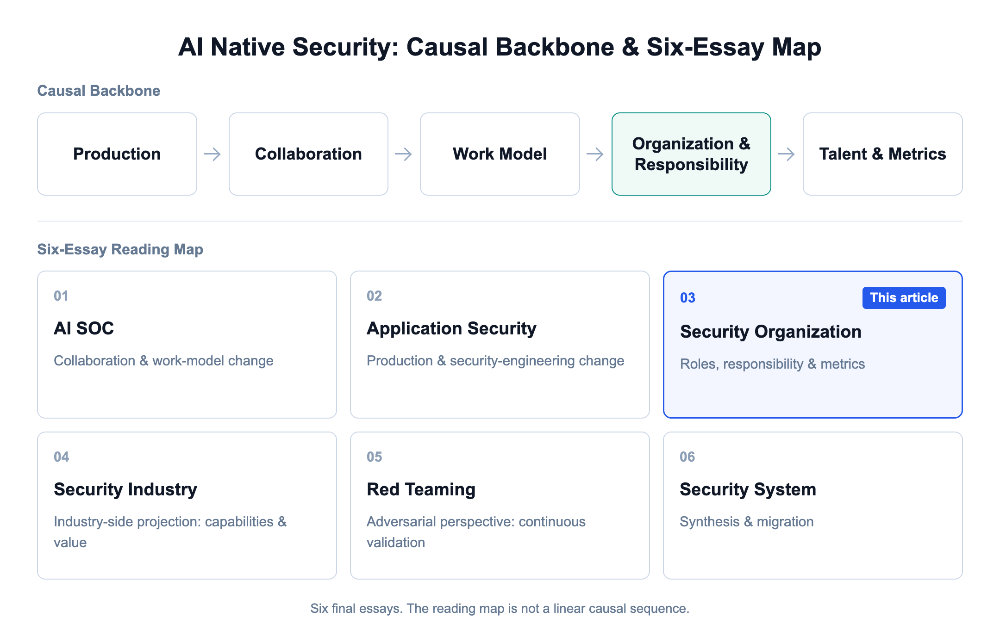
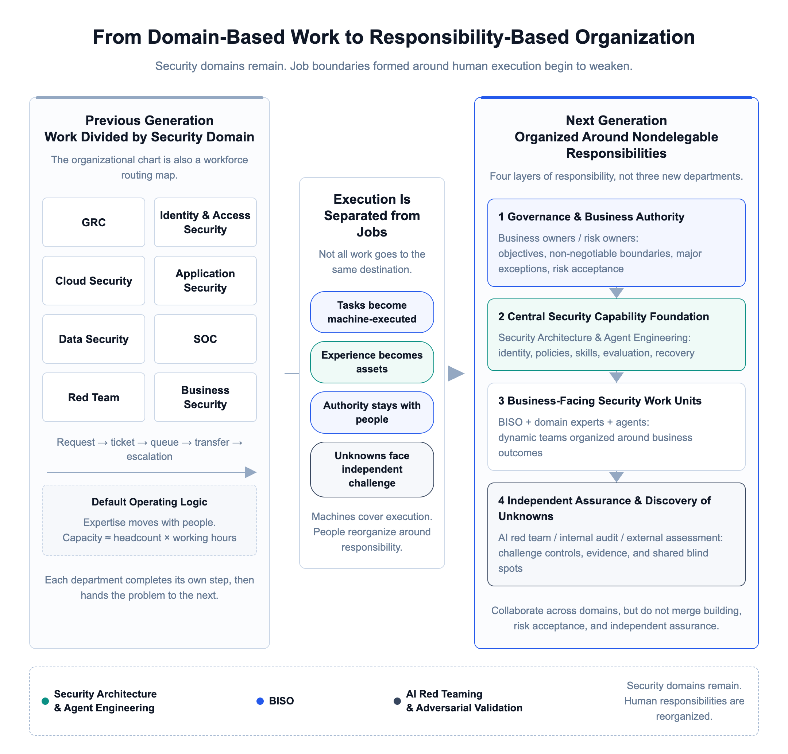
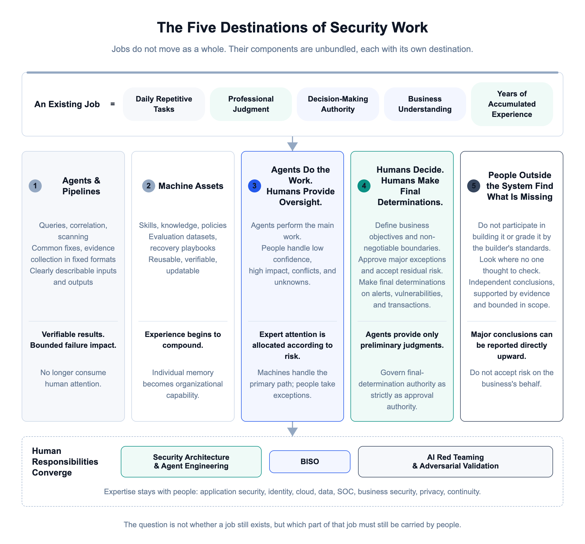
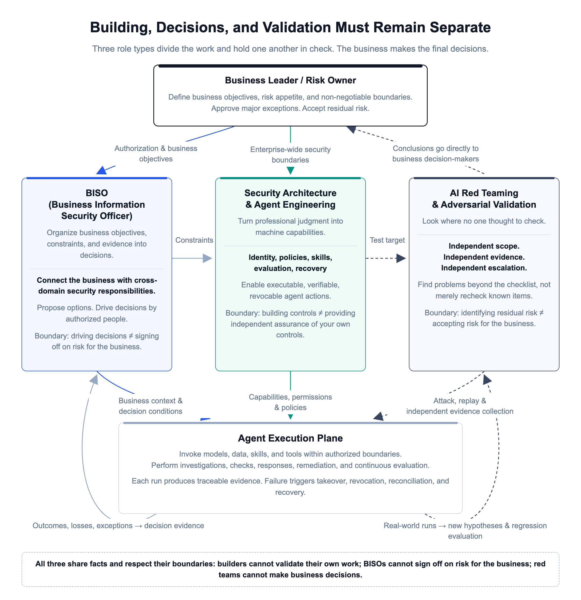

# Security Organizations May Ultimately Have Only Three Types of Roles

[中文](../zh/03-security-organization.md) | [English](../en/03-security-organization.md) | [Article index](../README.md) | [Profile](../../README.md)

> **About the author**: Max Luo, Founder of Teloa, focused on AI Agent Engineering & Product Development and AI Native Security. AI Security Engineering Team Lead at a globally leading cryptocurrency exchange, with 13+ years in cybersecurity and former leadership roles across global application security, the AI Security Center of Excellence (COE), security BP, and red teaming at SHEIN. Author of the open-source book AISecOps: AI-Driven Enterprise Security.
>
> WeChat Official Account: 白帽子罗棋琛 | GitHub: cybermaxluo

At the end of the previous article, "Confessions of the Last Generation of Application Security Engineers," I suggested that the core human roles in future security organizations might come down to just three types: Security Architecture and Agent Engineering, BISO (Business Information Security Officer), and AI Red Teaming and Adversarial Validation. That argument deserves an article of its own.

The previous two articles followed the same chain of change:

> The mode of production changes first: agents produce software, and agents execute security work. Collaboration changes next: conversations replace tickets, and state replaces handoffs. This then changes the way people work, from doing the work themselves to building, supervising, and governing agents. Finally, the changes reach organizational structures, job responsibilities, talent profiles, and performance metrics.

This article follows that chain further, focusing on those final four elements: how organizations are structured into layers, what remains of jobs, what kinds of talent are needed, and how performance should be measured.

Over the years, I have led multiple functions, including red teaming, application security, security business partnering, an AI security center of excellence, and security operations. I have also participated in building in-house enterprise security programs from the ground up. Seen from within each role, the work looks very different. Seen together, however, these organizational forms rest on the same premise: people perform most security work, so expertise must be grouped by people, tasks must move between people, and capacity must expand by adding headcount. Now that agents are taking over execution, that premise is weakening. This applies to application security and the SOC, as discussed in the previous two articles, and equally to other security domains. How departments are divided and how people are allocated will both change. Following that logic, my conclusion is that security domains will not disappear, but the job and departmental boundaries built around them will gradually weaken. Machines will cover execution across security domains, while people reorganize around responsibilities that cannot be handed to agents, ultimately converging on three types of cross-domain roles.

"Only three types of roles" does not mean cutting the organization down to three people tomorrow. It means something else. Once machines take over checks, investigations, configuration, remediation, and reporting, why does a company still need security professionals? After thinking it through, I can see only three reasons: someone must turn security judgment into machine capabilities; someone must organize business objectives and risks into decisions; and someone must independently challenge the entire system and find what all the people and machines have collectively failed to see. These three types describe where human responsibility ultimately resides, not a redistribution of security domains into three specialties. The daily repetitive work within each domain, such as alert triage, access-request tickets, and code audits, goes to agents and the AI security center of excellence. People are no longer assigned roles by domain, but by these three types of responsibility. A SOC engineer may do more than SOC work: they may build and operate SOC agents while also managing application security agents, working horizontally across other domains. Pure execution roles devoted solely to alert handling disappear, and that engineer's position may no longer sit within a security operations department.

## 1. The Previous Generation of Organizations: A Workforce Scheduling System

Today's common security organizational structures divide teams by professional domain and toolchain: SOC, red teaming, application security, data security, IAM, cloud security, and GRC, with further subdivisions within each domain as the organization grows. This structure suited the production conditions of the past twenty years, because expertise and experience resided in people. Code audits went to application security, anomalous logins went to IAM or the SOC, complex cases escalated from junior to senior staff, and cross-domain problems were handled through group chats, meetings, and ticket transfers. The organizational chart was therefore also a workforce scheduling map: which queue a problem entered, which group handled it, where it escalated if that group could not finish it, and how headcount requests were justified by ticket volume and per-person capacity.

Creating departments by domain and staffing each department made sense under the old model, but the calculations are now starting to break down. The assumption was that expertise could move only with people, and that replicating a senior engineer's experience required recruiting, training, and mentoring. Now, experience can be distilled into skills, policies, and evaluation datasets; replicating capability no longer requires replicating people. The assumption was that execution throughput grew roughly linearly with headcount: twice as many alerts meant more staff. Now, agents investigate, build, test, and replay in parallel, decoupling throughput from headcount. The assumption was that departmental boundaries naturally created separation of duties: putting teams in different boxes on the chart established checks and balances. Now, if two teams' validation agents share the same model, the same knowledge, and the same person in charge, drawing them in separate departments does not make them independent. The assumption was that a process meant a fixed path in a ticket: A finishes and passes it to B, who finishes and asks C for approval. Now, agents dynamically form execution paths according to context, leaving tickets with only recordkeeping and audit value. The assumption was that activity volume could stand in for security outcomes. Now, an agent can generate ten thousand rules and a thousand reports in a day, making the old KPIs entirely unsuitable for this new operating model. The whole operating model was designed around "not enough people." Once people are no longer the bottleneck, there is no reason for that model to continue existing.

## 2. What Happens When Jobs Are Unbundled

A job is actually a bundle of several things: daily repetitive tasks, professional judgment, decision-making authority, business understanding, and years of accumulated experience. When agents enter the picture, these components do not all move together. Each has its own destination.

Repetitive execution moves into agents, pipelines, and deterministic controls. Queries, correlation, scanning, common fixes, and evidence collection in fixed formats have no reason to occupy human attention over the long term, provided inputs and outputs can be described, results can be verified, and the impact of failure can be bounded. Stable professional judgment is distilled into machine assets. A SOC engineer's judgment about a particular type of intrusion, or the authorization-bypass vulnerability patterns accumulated by an application security expert, can become rules, skills, evaluation datasets, and recovery playbooks that all agents can repeatedly invoke. Work that requires substantial context but can be evaluated moves into an "agent does the work, human provides oversight" model. Agents perform most investigation and construction, while people handle low-confidence cases, high-impact situations, and unknowns, using real outcomes to calibrate the machines. Decision-making authority remains within the human organization. Who defines business objectives, approves major exceptions, and accepts residual risk does not shift to a model or platform vendor simply because an agent executes successfully. Unknown problems also remain with people. Machines are good at scaling capabilities that have been clearly articulated, but they will also scale problems that were never noticed in the first place. Some people must always remain outside the system, specifically tasked with finding what everyone else has missed.

One more thing can easily be handed over along with execution, even though it is actually a form of authority: the authority to make a final determination. Whether an alert ultimately counts as an intrusion or a false positive, whether a vulnerability remains exploitable after retesting, and whether a transaction ultimately counts as fraud must either be established by subsequent outcomes or decided by an authorized person. What an agent provides is only a preliminary judgment. There can be no ambiguity here, because the agent's next evaluation dataset, regression dataset, and skills are calibrated against final determinations. Treating its own preliminary judgments as final determinations amounts to letting it grade itself. Who can make the final call, how long it takes for a conclusion to be considered settled, and which conclusions an adversary can fabricate at scale, through mass appeals or mass reports, for example, must all be governed separately, just like approval authority.

Security domains therefore continue to exist. However jobs change, someone must still be accountable for account takeovers, data leaks, production compromises, and fraud losses. What changes is that a security domain no longer naturally equals a department. SOC work remains a category of professional responsibility, but it does not necessarily require a dedicated team watching an alert queue across three shifts. The same applies to application security. The U.S. NIST NICE cybersecurity workforce framework has long distinguished a Work Role from a Job: a work role is a grouping of work for which an individual or team is responsible and accountable, not a job title. It was not designed for agent-based organizations, but it provides a useful starting point. First describe the work an enterprise must accomplish and the responsibilities it must bear, then decide whether people, teams, or agents should take them on. Do not start with job titles. OpenAI has published an internal Harness Engineering experiment in which, after Codex took on substantial code, test, documentation, and tool development, people shifted their focus to designing environments, expressing intent, and establishing feedback mechanisms. Although these results came from OpenAI's own environment and may not transfer directly to ours, the direction is the same: once machines take over execution, human value shifts from "personally completing every step" to "building a system in which machines can work reliably."

Once execution is separated out, the remaining human responsibilities cut across today's security domains and cluster in three directions.

## 3. The Three Types of Roles in an AI-Native Security Team

These three types of roles were derived through reasoning, not arbitrarily chosen. The starting point was an observation in early 2025: SHEIN's Product R&D Center had begun using Claude at scale, and by the time Claude 3.7 Sonnet was released, some product and frontend development work could already be handed to agents. If development could become agent-driven, security execution would follow sooner or later. That trend was already visible then. I followed that line of reasoning: what responsibilities would remain with people after execution was handed over, and what would organizations become? Step by step, I arrived at these three types of roles. In 2026, harness capabilities surged, and Codex and Claude Code made agent-produced software a normal part of R&D. Combining industry changes with what was happening in development, I abstracted the chain of change described at the beginning: production changes first, collaboration follows, ways of working change next, and finally the changes reach organizations, jobs, talent, and metrics. The three types of roles sit precisely at the end of that chain. What I derived logically in 2025 was only the endpoint. I did not see the full trajectory clearly until 2026.

### 3.1 Security Architecture and Agent Engineering

This is neither a simple upgrade of today's "security development engineer" nor a matter of forming a team to build another all-encompassing AI security platform. Its work centers on the security boundaries and capabilities that all agents must reuse: identity, data, tools, policies, evidence, and recovery. Previously, these judgments were scattered across experts' minds, policy documents, and different vendors' product consoles. In the future, they must become assets that agents can use directly, systems can enforce, and organizations can continuously evaluate. The boundaries of every delegation, who initiated it, why, what it may do, how far it may go, and how it can be stopped, are encoded as task boundaries. High-impact actions such as "freeze an account" are encapsulated in capability interfaces, with the interface holding credentials on the agent's behalf to call the actual system. Policies, skills, evaluation datasets, evidence standards, and recovery mechanisms are added around them.

This role requires an understanding of both architecture and security engineering, as well as how agents operate. Knowing only LLM APIs makes it easy to mistake "the model can answer" for "the system is controllable." Knowing only traditional security architecture may produce beautiful diagrams that cannot be translated into how an agent actually calls tools and obtains permissions at each step. Ultimately, this role must answer two questions. First, after replacing the model, harness, MCP, or a particular security product, can the existing permissions and approval rules be reused directly, or must they be rebuilt? Second, when an agent makes a mistake, can permissions be revoked, losses contained, actions rolled back, and fallback measures activated as intended?

Its value is not measured by how much platform code it produces, but by how much human judgment it turns into shared capabilities reusable across business areas. There is one boundary, however: the people who build this control system cannot also determine business objectives on the business's behalf, accept risk for the business, or independently sign off on what they themselves have built. If all three responsibilities sit in one place, no one can hold the platform in check.

### 3.2 Business Information Security Officer (BISO)

The title Business Information Security Officer, or BISO, is not perfect. In China, "security BP," or security business partner, is more common. In the past, this role was often understood as a liaison assigned by the security team to the business. In the agent era, it needs to move up a level, from "coordinating the introduction of security work into the business" to "helping the business use agents to deliver outcomes within clearly defined boundaries."

The level of access an employee access-approval agent may approve autonomously cannot be determined by the model vendor or left to security platform defaults. The business owner defines the service and the maximum scope of permissions; the IT service desk defines the approval chain and revocation methods; legal and privacy teams assess applicable obligations; and each specialist team contributes its constraints. The BISO's job is to organize these inputs into consistent business rules, autonomy boundaries, and alternative courses of action, then drive decisions by those with authority. This is not a security sales role tasked with "maintaining good relationships with the business," nor is it a role that persuades security to grant clearance on the business's behalf. It requires an understanding of business models and operational constraints, as well as the ability to follow identity, data, tools, and the agent action chain. It must translate technical risk into terms a business leader understands, and translate business rules back into a basis for decisions that agents can execute.

The BISO drives risk decisions but does not automatically become the risk owner. This is the most important boundary. In many organizations today, the business is reluctant to sign off on risk, leaving a security BP or security leader to take responsibility, only to ask why security approved it when something goes wrong. That misalignment of responsibility becomes more dangerous when agents act at scale. A BISO can lay out alternative courses of action, stop work when risk-control requirements are not met, and track when exceptions expire. But the person who ultimately accepts business risk must be a business leader or risk owner formally authorized by the company. The core output of this role is therefore not the number of coordination meetings held. It is whether critical business activities have clearly defined owners, non-negotiable boundaries, and decision rights; who approved major exceptions and on what grounds; and whether incidents and customer complaints have led to corrective action.

### 3.3 AI Red Teaming and Adversarial Validation

AI red teaming is not traditional red teaming with "AI" added to the name, nor is it a specialty devoted to collecting jailbreak prompts. The target is the complete system assembled from models, harnesses, skills, MCP, context, memory, identities, tools, policies, business processes, and recovery mechanisms. It attacks AI with one hand and protects AI with the other. It uses agents to explore attack paths at scale and repeatedly attacks again after fixes, while also attacking the organization's own agent system. Can external content contaminate context? Can combinations of low-risk tools create a high-risk attack path? Do generation agents and validation agents make the same mistakes? Can attackers alter evaluation datasets, memory, and security policies so that every subsequent run produces a wrong answer? The objective is not merely to find a few more vulnerabilities. It is to discover what lies beyond the checklist and produce conclusions that are reproducible, explain business impact clearly, and rest on solid evidence.

Independent red-versus-blue exercises are a longstanding industry practice. The red team decides where and how to attack; success is judged by the actual state of the system; findings are reported directly upward; and conclusions do not change just because a release deadline is approaching. These principles still apply in the agent era. The participants change from people to agents, but success or failure is still determined by actual system records, not an agent's account of what happened. The agent era adds only one new problem: if both sides' agents use the same model and the same data, it is like having one person fight their own other hand. Little genuinely new is likely to emerge. The AI red team likewise cannot accept risk on behalf of the business. Its responsibility is only to state clearly what was found, within what scope, in which version, and on what evidence, as well as what remains unknown.

## 4. A Four-Layer System of Responsibility

### 4.1 The Four Layers of Responsibility

The three types of roles should not be drawn as three new departments. That would merely rename the old organizational chart. The next generation of security teams looks more like a four-layer system of responsibility. At the top is the governance and business decision-making layer: the board, executive management, business leaders, and risk owners define objectives, risk appetite, key constraints, major exceptions, and resource priorities. Security provides advice, and agents propose options, but authorized parties must decide why something should be done, which boundaries cannot be crossed, and which risks are acceptable.

The second layer is the AI security shared-services center, often called a COE, or Center of Excellence, outside China. At this layer, Security Architecture and Agent Engineering builds capabilities reusable across business areas: identity, delegation, data access, tool proxies, policies, skills, evaluation, evidence, and recovery. The shared-services model serves two core purposes: reducing the cost of duplicate development and bringing enterprise-wide boundaries under centralized governance. Each business still retains the authority to define the outcomes it needs. In 2025, while I was at SHEIN GSRM, the Global Security and Risk Management Center, the CSO authorized the establishment of an AI Security COE as this shared-services department. I led it, with responsibility for planning the entire security center's AI security strategy and technical preparation, exploring the path toward the next generation of AI-driven security organizations in advance. Looking back, that was an early move. Anthropic's published agent evaluation practices offer a useful division of responsibilities: a dedicated team maintains general-purpose evaluation infrastructure, while the domain experts closest to the product contribute and run evaluation tasks. Applied to a security organization, the shared-services team provides evaluation tools, replay of historical cases, and an evidence foundation. IAM, data, application security, SOC, and business experts define "what counts as correct in my scenario." The cases they have judged correct or incorrect are the most important assets, and evaluation datasets are built from them. The AI red team then checks whether the evaluations themselves have blind spots.

The third layer consists of business-facing security work units. These form temporary teams around a product line, a value stream, or a critical business capability. Participation depends not on departmental membership, but on the business outcomes and risks at hand.

The fourth layer is independent validation: AI red teams, internal audit, and external assessors where needed. They do not participate in the assessed party's self-approval process. They focus specifically on three questions: whether controls actually work, what evaluations have missed, and whether everyone could be making the same mistake.

Four layers do not mean four departments. A smaller company can have fewer people wearing multiple hats, but it must establish in advance which role each person is acting in and which responsibility they bear for each matter. Architects can test their own work, but self-testing cannot count as independent validation. Using the same model for both generation and validation can improve engineering quality, but it cannot prove that nothing has been missed.

Regulated industries face an additional practical constraint. Finance, payments, and listed companies have mandatory requirements for separation of duties, the three lines of defense, and security staffing. Those requirements do not change merely because agents achieve high triage accuracy. Combining three lines into a single role may be implemented directly in an AI-native company, but in a bank it must take another form: people hold the required positions under regulatory rules, agents perform execution, and job responsibilities are redefined around supervision and final determinations. The names on the organizational chart stay unchanged for now, while the work changes first.

### 4.2 Work Units

The delivery unit in this organization is no longer "a security group completing its own review," but a human-machine work system formed around a business outcome. Consider an IT service desk agent that approves employee access requests. Previously, after product development was complete, each domain would conduct its review in sequence, provide its own comments, and rely on tickets and project managers to drive closure. The new approach establishes a work unit from day one. The business owner defines the approval SLA, employee experience, and the maximum scope of permissions the agent may grant. The BISO brings the domains together to translate requirements into key constraints: which systems' administrator permissions must always undergo human review, for example, and how long temporary access may last before mandatory expiration and revocation. Architecture and Agent Engineering implements those constraints as approval policies, capability interfaces, evaluations, and revocation and recovery mechanisms. The AI red team focuses on impersonating requesters, forging approvers, and socially engineering the agent into loosening permissions. Finally, the business risk owner decides which permissions can be approved automatically and up to what level.

Going live does not mean disbanding the work unit. Actual approval outcomes, appeals concerning excessive access, incorrect approvals, human takeovers, and revocations continuously feed back into the system. Each case requires a root-cause review to determine which part failed: business constraints, capability interfaces, evaluation datasets, or takeover and compensating mechanisms. Corrective action then targets the cause. The most important output of a next-generation team is that, after each completed piece of work, the next similar problem depends less on people.

## 5. How Metrics Change

As organizational forms change with the way work is done, metrics must change too. Counts of vulnerabilities discovered, alerts closed, and projects reviewed measure human output. Now that agents handle execution, those numbers can easily double. Continuing to use them for performance assessment only pulls teams back into the old model, producing piles of rules no one maintains and reports no one reads. What needs to be measured is the system's capability, across four layers.

Business and risk outcomes: Are losses in critical business activities, customer harm, incorrect approvals, incorrect responses, and recovery times decreasing? Can the business deliver faster within clearly defined boundaries?

Machine capability quality: How much high-frequency work is covered by skills, policies, capability interfaces, and evaluations? What are agents' rates of boundary violations, human takeover, and repeated failure?

Human attention and decision quality: What proportion of the human queue requires expert judgment? Are high-risk exceptions decided promptly by the right people?

Organizational learning and independence: After a real incident, how quickly can it become a skill or evaluation case available for the next occurrence? Do these accumulated assets have owners and versions, and can they be retired when outdated? Are the people who build, operate, sign off on risk, and validate different people?

FTE savings can be used to measure cost reduction and efficiency gains, but cannot become the sole objective. Otherwise, teams will first automate the steps easiest to quantify, while leaving the real business bottlenecks untouched. Three questions matter more: which business activities were previously impossible because security could not keep up, and how far can they now go; what more valuable work people spend their freed-up time on; and what the new costs of models, evaluation, evidence, and vendors add up to.

## 6. What This Means for Individuals

For organizations, "only three types of roles" means a restructuring of responsibilities. For individuals, it means a divergence of career paths. Technical practitioners will broadly choose between Security Architecture and Agent Engineering and AI Red Teaming and Adversarial Validation as their primary direction. Those in security management, GRC, security business partnering, and business coordination are more likely to move toward BISO roles. A person's future competitiveness can be described as a combination: a horizontal direction of cross-domain responsibility × a vertical foundation of professional expertise × the ability to build and evaluate agents. The responsibility direction determines what you are accountable for; professional expertise determines the basis on which you make high-quality judgments; and agent capabilities determine whether you can scale those judgments. The future is therefore not about generalists replacing specialists. A "full-stack AI security expert" without a foundation of professional expertise can easily end up doing little more than drawing workflows and calling models. An expert who remains confined to manual work in one domain will have less and less work available to them. The path for a specialist in a single area will become increasingly narrow. Binary reverse engineering, for example, used to be a high-barrier specialty, and that one skill was enough to establish a career in the security labs of major enterprises and vendors. Now, agents can already reverse-engineer software to find vulnerabilities, with both quantity and quality increasing severalfold, delivering results quickly and with less human labor. That path will become increasingly difficult. A stronger competitive position comes from maintaining a firm foundation in your original specialty while expanding horizontally into other domains.

There is another question this series cannot avoid: if junior roles disappear, where do senior experts come from? I keep saying that only someone who has reviewed thousands of vulnerabilities can write a skill, while also saying that junior execution roles will disappear. So, ten years from now, who will have reviewed thousands of vulnerabilities? Research on automation reached a conclusion forty years ago: when people stop handling raw events, both their judgment and their ability to take over deteriorate. Some will say that agents can already learn from outcomes and iterate their own skills, so human deterioration does not matter. The problem is that their learning depends on final determinations, and those determinations come from people. If human judgment deteriorates, final determinations become inaccurate, and agents learn the wrong things, becoming more confident as they learn. People therefore cannot be completely removed from frontline work. This must be treated as a design principle: require humans to handle a certain proportion of randomly sampled cases, not for efficiency, but to preserve the quality of final determinations and the fallback ability to take over from machines at any time. It is also the only path by which newcomers can grow into experts. This human work may look like an additional cost, but it is actually training the next generation of experts.

You do not need to wait for your company to change its organizational chart to get started. First, break down your work from the past month: which parts are merely querying, summarizing, generating, and tracking; which depend on professional judgment; and which involve formal decision-making authority. Then proactively eliminate one repetitive task of your own. Use an agent for most execution, but complete the task boundaries, tool permissions, evaluations, evidence, human takeover, and failure recovery. The objective is to become the owner of that capability, not to build a demo. Next, turn a real experience into an organizational asset. After fixing a vulnerability, extract its pattern and create an evaluation. After handling an incident, encode the judgment as a skill. After resolving a business dispute, express the non-negotiable boundaries as enforceable constraints. Finally, cross into another security domain. Application security practitioners should understand Coding Agents' identities and tools; SOC practitioners should connect investigations to responses on the affected resources and business recovery; GRC practitioners should integrate compliance requirements into production, with policies enforced in systems and evidence generated automatically from them; and red teams should move from isolated vulnerabilities to complete agent action chains. The hardest problems ahead will span departments. People who stay within their own narrow territory will fail to see problems when they arise, and even when they do see them, they will be unable to take them on.

## 7. Conclusion

Returning to the title: why might security organizations ultimately have only three types of roles? The responsibilities of every security domain remain. Once agents connect them into a dynamic action chain, professional responsibility only becomes greater. What disappears is the job boundaries, queues, and handoffs formed around human execution. Three types of human responsibility remain: one turns professional judgment into machine capabilities that can be executed, evaluated, and recovered; one organizes business objectives, external obligations, and risks into decisions made by the right people; and one specifically looks for problems that neither builders nor machines have seen. These three types of roles span security domains, but cannot lose their professional depth. They collaborate closely, but cannot erase the separation of duties between building, accepting risk, and validating.

For a CISO, the next step is neither to add AI to every job title nor to start by establishing an AI security department. First choose a real business value stream and clearly separate the work, judgments, decision rights, and outcomes. Determine what goes to agents, what becomes shared capabilities, what must be decided by business owners, and who is responsible for independent challenge. Make one complete feedback loop work, then change the organization and its metrics. For individuals, the question is not "Will my job disappear?" Instead, ask: if one day I no longer handle routine tasks myself, why will the organization still need me? What value will I deliver? The answer cannot simply be "I've done this for many years" or "I have experience." Experience that stays in your head will depreciate along with the old job. Turning experience into capabilities the organization can keep operating, while taking on responsibilities machines cannot absorb, is the entry requirement for the next generation of security roles. AI has democratized knowledge. Years of service and career history are no longer the core competitive advantages that carry you through changing cycles.

**Security domains define what the enterprise must be accountable for; the three types of roles define why people bear responsibility; and agents increasingly take on how the work is executed.**

The next article examines the industry-side projection of this change: when people no longer organize their work around consoles, how do security vendors deliver capabilities, outcomes, and value? "The Next Generation of the Security Industry: From Delivering Outcomes to Delivering Value."

These are some of my thoughts on security organizations and talent in the AI era. You are welcome to follow my WeChat Official Account.

**References**

1. NICE Cybersecurity Workforce Framework: https://www.nist.gov/itl/applied-cybersecurity/nice/nice-framework-resource-center/resources/occupations-jobs-and-work
2. Harness Engineering: https://openai.com/index/harness-engineering/
3. Agent Evaluation Practices: https://www.anthropic.com/engineering/demystifying-evals-for-ai-agents

---

[Previous](./02-appsec.md) | [Next](./04-security-industry.md)
