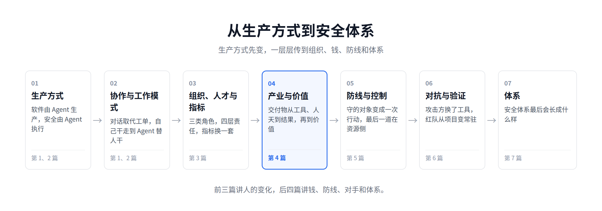
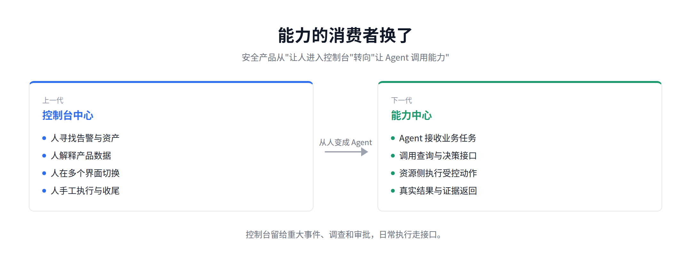
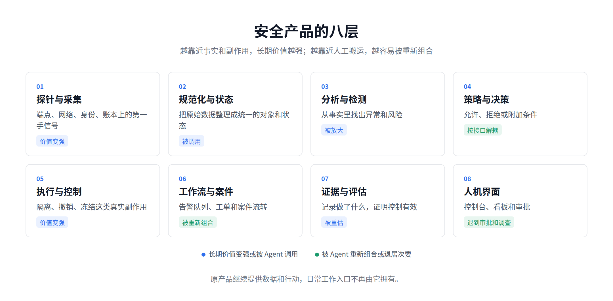
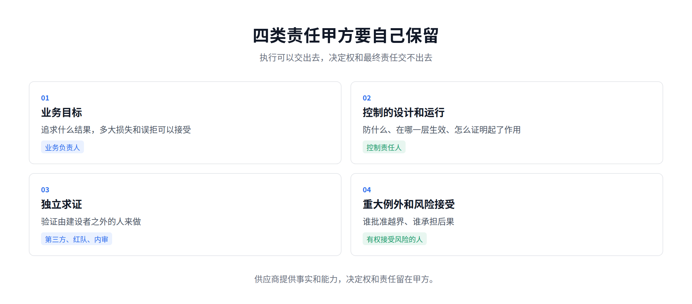
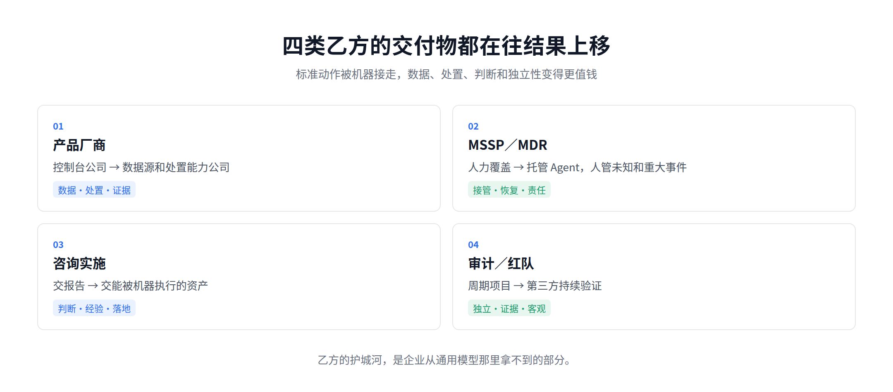
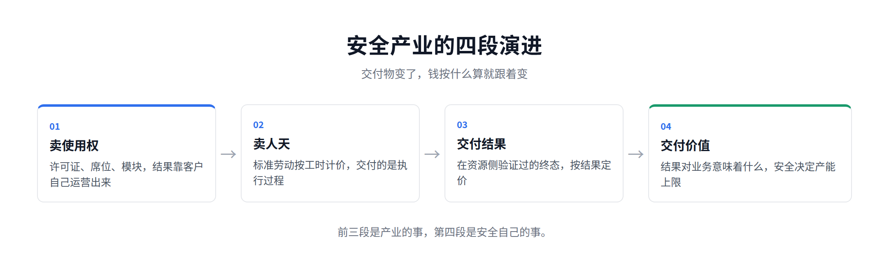

# The Next Generation of the Security Industry: From Delivering Outcomes to Delivering Value

[中文](../zh/04-security-industry.md) | [English](../en/04-security-industry.md) | [Article index](../README.md) | [Profile](../../README.md)

> English translation of the Chinese original. Some figures retain their original Chinese labels.

> **About the author**: Max Luo, Founder of Teloa, focused on AI Agent Engineering & Product Development and AI Native Security. AI Security Engineering Team Lead at a globally leading cryptocurrency exchange, with 13+ years in cybersecurity and former leadership roles across global application security, the AI Security Center of Excellence (COE), security BP, and red teaming at SHEIN. Author of the open-source book AISecOps: AI-Driven Enterprise Security.
>
> WeChat: neteyes | WeChat Official Account: White Hat Luo Qichen | GitHub: cybermaxluo

Looking at the security market from the enterprise buyer's perspective over the past few years, almost every vendor has been talking about AI, but few have changed what they actually deliver. Product vendors add chat boxes to their consoles. MSSPs (managed security service providers) give analysts access to model accounts. Consultancies use agents to produce reports faster. Audit platforms have models organize evidence automatically. All of these have value, but most only improve efficiency in isolated parts of the old production model. Customers still buy consoles that require ongoing human operation, people who follow playbooks, and reports that end up in archives.

Over the years, I have helped build and operate many security platforms, and have bought, used, and replaced quite a few security products. Each category has its own console: SIEM has alerts and queries, EDR has hosts and process trees, DLP has data leakage incidents, and SAST has vulnerability lists. In a security team of any meaningful size, it is not unusual to have a dozen or so consoles open in the browser at once.

We keep trying to integrate platforms, but in practice, people often remain the integration layer. An analyst copies an IP address from one page, looks up the host on another, checks the identity on a third, and finally pastes the results into a ticket. Half the difficulty of integration is organizational. Every team wants to protect its own systems and budget. Not long after integration, they decouple again, leaving people to connect the systems. Many security processes look digitized, yet people are still serving as interfaces, moving data, and reconciling records: three jobs that systems should automate.

Enterprise buyers have not fully thought this through either. In my years working in enterprise security, I have heard two completely opposite answers. One says that all core capabilities must be built in-house, and that private deployments are the only way to protect data. The other says that models and platforms evolve too quickly for enterprises to reinvent the wheel, and that the best capabilities should all be purchased or managed by a provider. Both answers have merit, and both oversimplify the problem.

This March, I wrote an article titled "Behind the OpenClaw Boom: Software Is Moving from Delivering Tools to Delivering Outcomes." It explored how the logic of software delivery is being rewritten across the industry: vendors are moving from delivering systems that people must operate to delivering actors that can take on work directly. That article stopped at delivering outcomes. My previous article, "Security Organizations May Ultimately Have Only Three Types of Roles," argued that when agents take over queries, investigations, configuration, remediation, and reporting, human work moves up to capability development, business risk governance, and adversarial validation. As organizations change, the industry changes with them. What vendors sell, what enterprises buy, and the units used to calculate payment may look like separate questions, but they are all part of the same shift. This article applies the argument from March to the security industry and takes it one level beyond delivering outcomes.

The shift has two roots. First, the consumer of capabilities is changing from a person to an agent. Interfaces are built for people; agents do not use them. As a result, things built around the interface lose value, while three things become priceable: the capability itself, the outcomes it produces, and who is accountable for those outcomes. Second, outcomes can be verified for the first time. In the past, whether a response action had actually succeeded was determined solely by the tool's own records. Now, every action must ultimately return to the business system to confirm the final state: was the account really frozen, and was the session really revoked? Outcomes must be verifiable before they can become the basis of delivery.

My view is this: **The security industry is moving from selling tools and person-days to delivering outcomes. But outcomes are not the destination. The next step is delivering value. For the first time, security can explain its value in positive terms, and determine how much business an enterprise is willing to entrust to agents. In other words, it determines how fast the business can run.**

## 1. The Consumer of Capabilities Has Changed

Over the past twenty years, consoles have solved several problems at once. People were the main consumers of security data. Alerts, vulnerabilities, permissions, policies, and evidence ultimately had to be read, filtered, configured, and approved by people, so products had to translate underlying complexity into tables, charts, and buttons. Business models were also designed around the console. Seats, modules, data volumes, and premium features defined product boundaries. The interface was both the entry point for work and a source of customer stickiness and upselling. Security products therefore competed by collecting more data, performing more analysis, incorporating more workflows, and building larger dashboards.

Agents have not eliminated any of these problems. What they change is that machines do not need to consume capabilities the way people do. An agent does not need to open "Host Details," click "Processes," copy a hash, switch to the threat intelligence page, and finally click "Isolate." It needs a set of clearly bounded capabilities: query a specified host's process tree for a given time window; verify a threat intelligence assessment of a hash and its sources; execute isolation with the task, delegation, target, validity period, and approval result attached; and finally return the actual state and evidence from the resource-side system. By resource-side systems, I mean systems such as ledgers, cloud control planes, and identity platforms, where the change actually takes place.

A security product can be broken down into at least eight layers.

1. Sensors and collection
2. Normalization and state
3. Analysis and detection
4. Policy and decision-making
5. Execution and control
6. Workflows and cases
7. Evidence and evaluation
8. Human-machine interfaces

Agents will not change all eight layers in the same way. The closer a capability is to facts and side effects, the stronger its long-term value. What processes an endpoint sensor observed, whether an identity platform actually revoked a session, and whether a payment ledger froze funds cannot be inferred by a model. The closer a capability is to manual data handling, the more readily it can be recombined. Cross-tool queries, alert triage, evidence correlation, and ticket completion can all be brought back into a single task chain by an agent. The original products continue to provide data and actions, but no longer own the entry point for everyday work. Different parts of the same SIEM will move in different directions: data collection and historical queries will be strengthened, manual alert queues will be absorbed by agents, and redundant case modules will be phased out.

Over the past two years, I have seen many security products take the first step toward becoming "AI-enabled" by adding a chat box on the right side of the existing console. It can explain alerts, generate queries, summarize vulnerabilities, and recommend responses. The experience is certainly better than manually hunting for buttons. But if closing the chat box leaves the underlying way of working entirely unchanged, it is closer to a Copilot wrapper. Over the past year, many products have taken a second step, wrapping their APIs in MCP and exposing them to external agents. Looking at the public documentation of several leading vendors, most of these wrappers are read-only: they query alerts, vulnerabilities, and assets, with actions extending at most to changing case status and adding notes. A few expose actions with real side effects, such as isolating hosts, changing policies, and disabling users. These either have no approval at all or display a confirmation dialog in the agent client, while the resource-side system still receives a call carrying the account's full permissions. Two very simple questions help determine whether a product is agent-native. Can an agent access the full set of capabilities without opening a page, rather than just query capabilities? Does a returned `success` mean that the API received the request, or that the resource actually changed and the business outcome was also confirmed?

Human interfaces will remain, but their purpose will change. Major incidents, crisis command, policy governance, and independent spot checks still benefit from charts, tables, and timelines. The console moves from the center of day-to-day production to a role in oversight, exceptions, and governance. The procurement test can be simple: remove this console and ask whether the enterprise loses a core capability or merely a familiar way of working.

## 2. The Industry's New Division of Labor

Once agents can invoke capabilities and outcomes can be verified, the industry's division of labor will be rearranged. A more likely structure is that upstream models and harnesses provide general-purpose intelligence; platform vendors provide the broadest coverage of data sources and response capabilities; specialist vendors focus on depth in individual domains; enterprises handle integration according to their own policies; service providers take responsibility for managed operations and backstop accountability; and independent organizations handle red-blue exercises and compliance audits.

### 2.1 Vendors' Competitive Moats

Next-generation security products need at least two equally important interfaces. One is for people, supporting major investigations, exceptions, governance, and independent review. The other is for machines, enabling enterprise agents to discover, read, propose, act, verify, and recover under controlled conditions. Automatically wrapping existing APIs in MCP does not yet constitute a machine interface. It must also establish capability boundaries, initiator identity and delegation, parameter constraints, idempotency, actual final states, evidence, and recovery. A machine capability embedded in an enterprise workflow may have only a handful of daily active human users, yet be invoked reliably by multiple agents every day and carry more central control responsibilities.

The most direct way to assess a vendor's moat is to remove the model brand and the chat interface, then ask what remains. If all that is left is prompts, orchestration, and a few connectors, the barrier to entry is thin. What remains will converge on five things. First, data others cannot obtain: what ran on an endpoint, the current state of an account, who changed a cloud configuration, or how far a payment has progressed. Only products with sensors positioned alongside the resources can collect this data. Second, response capabilities: isolating an endpoint, terminating a session, or blocking a payment still depends on products that can carry out those actions. Third, an understanding of the customer's environment. A general-purpose model knows what a vulnerability or permission is, but not which assets are connected in this enterprise, where its trust boundaries lie, or what historical exceptions remain. Fourth, evidence. An API returning `success` does not mean that the resource's state actually changed. Only products that can produce evidence can have their outcomes counted. Fifth, responsibility the vendor is willing to assume. Vendors cannot shoulder all of a customer's risk, but they must make commitments for the parts they can control. "The model may make mistakes" is a fact, not a basis for unlimited exemption from liability.

### 2.2 Four Responsibilities Enterprise Buyers Must Retain

Agent suppliers are different from traditional vendors. Traditional vendors sell tools or people, while the enterprise still does the work itself. Agent suppliers sell getting the work done. From understanding the task and making decisions to invoking tools, acting on business systems, and producing evidence, the supplier may perform every step. If an enterprise still manages this through the old outsourcing logic of "procurement review passed, contract signed, API connected," it will gradually hand over its business objectives, judgment criteria, authority to act, interpretation of facts, and recovery after failures. This transfer does not happen all at once during procurement. It accumulates as the scope of authorization expands after deployment.

NIST CSF 2.0 places supply chain risk within organizational governance. U.S. banking regulators' guidance on third-party risk explicitly states that using a third party does not diminish a bank's own responsibilities. Article 21 of China's Personal Information Protection Law requires the purpose and methods of entrusted processing to be agreed upon and the entrusted party to be supervised. These rules all predate agents, and point in the same direction. A supplier taking responsibility does not mean that the enterprise ceases to be responsible. Contracts can specify compensation and remediation, but cannot transfer customer harm, business losses, licensing obligations, or board accountability.

"Responsibilities that cannot be handed over" does not mean that enterprise buyers must do everything themselves. It refers to four things. First, business objectives: what outcomes to pursue, how much loss and how many false rejections are acceptable, and which scenarios permit autonomy. These are business decisions, unrelated to how intelligent a model is. Second, control design and operation. Identity platforms, detection engines, and model gateways can all be purchased, but every control needs an accountable owner within the enterprise. That person must be able to explain what the control protects against, at which layer it takes effect, whether it can be bypassed, and what evidence proves that it actually worked at the resource-side system. If a supplier holds long-lived administrator credentials, it can bypass enterprise policies and modify resources directly. The enterprise then has a contract, but no control. Human approval follows the same logic. If the approver cannot see the original facts, has no alternative options, and has no authority to veto, approval is merely a human step in the supplier's automated process, not a control.

Third, independent verification. Validation must be performed by someone other than the builder. A report the supplier produces using its own samples and logs is only self-attestation. Fourth, major exceptions and risk acceptance. The authority to change risk appetite, accept residual risk above a threshold, or permit irreversible actions on a large scale cannot be delegated to a model or supplier. A vendor's low-risk assessment and common industry practice cannot substitute for the enterprise's own acceptance of risk.

Everything else can be delegated extensively. The two opposing answers at the beginning actually address four questions: who builds the capabilities, who provides the products, who runs the day-to-day processes, and who independently demonstrates that they work. Build, Buy, Operate, and Assure are not four mutually exclusive options. All four need answers. The criteria are whether the capability includes objectives and decision rights unique to the enterprise, whether supplier failure would take away critical control, and whether the enterprise can independently validate and replace it. Building in-house is not inherently secure, and buying does not inherently mean losing control. Control comes from boundaries, assets, evidence, and the ability to exit.

### 2.3 Pricing: From Person-Days to Outcomes

There are four categories of providers: product vendors; MSSPs and MDR providers; consulting and implementation firms; and audit and red-team firms. Their deliverables are all moving toward outcomes. As discussed in the previous section, product vendors are moving from selling consoles to selling data sources and response capabilities. The economics of MSSPs and MDR (managed detection and response) have traditionally rested on the large amount of standardized labor required for frontline triage and reporting. Yet queries, correlation, summaries, and fixed playbooks are precisely the work agents are best at compressing. Analyst headcount and alert-processing volume are becoming increasingly difficult to present as proof of value. People will not leave security services; they will leave standardized actions. Unknown threats and major-incident command will still require experienced people, whose services will become more expensive. Consultancies' deliverables will shift from reports to machine-executable assets. Producing a structurally complete report is becoming cheaper, while the scarce resources have always been judgment about the customer's business and jurisdiction, and the ability to turn tacit experience into executable capabilities. The value of audit and red-team work lies in independence. Turning it into a continuous stream of evidence is the right direction, but independence comes from a third party. Assurance must be provided by a third party that did not participate in building the controls if its conclusions are to be objective.

The unit of pricing should be the outcome of a scenario: keeping the domain you protect free of incidents, with outcomes as the measure. If you are responsible for account security, in-scope account takeovers are resolved within the specified time, with no loss of funds. If you are responsible for intrusion prevention, attack paths are blocked before reaching the business, with no business interruption. If you are responsible for vulnerability management, assessments are accurate, what needs fixing is fixed, and what does not need fixing does not disrupt the business. Payment is earned only when the outcome is achieved. The definition of the outcome belongs in the contract. Whether it was achieved is determined by verified effectiveness in real business scenarios: did the business stop, and was money lost?

## 3. Beyond Outcomes Lies Value

Delivering outcomes is closer to what customers want than selling tools and person-days, but it has limits. Outcomes are the final states a supplier can control and prove: a session was revoked, an account was frozen, or a configuration was restored. It is right for suppliers to be accountable for these. But if a customer refuses to provide data, never remediates issues, or changes policies arbitrarily, the supplier cannot bear unlimited responsibility for incident rates.

The conclusion of the March article was that the ultimate destination of software delivery is not handing tools to people, but handing them outcomes. For industries such as advertising, sales, and customer service, that statement is already the destination. Their outcomes are directly reflected in sales revenue, return on advertising spend, and conversion rates. Outcomes and value are the same thing, and outcome-based pricing has already taken the lead in these industries. Security is different. Its outcome is "nothing went wrong," and between that outcome and its value lies an accounting problem that has remained unresolved for decades. Other industries can stop at delivering outcomes. Security must move one level higher.

In the past, there was only one way to express security's value: how much loss it prevented. That number is fictional. An incident that never happened cannot be assigned a loss amount, and an incident that did happen does not tell us what would have happened without a particular control. Security budgets have therefore always followed the logic of a cost center: allocated according to compliance requirements, peer spending ratios, or last year's renewal list, never according to output. This has also determined the security department's position within the enterprise. It provides protection alongside the business, which treats it as a mandatory checkpoint. Its value can only be demonstrated by the absence of incidents.

## 4. Delivering Value

This time is different, for three reasons.

First, final states can be checked. Every action ultimately returns to the business system to confirm what happened. Only with a confirmed final state can there be an attributable outcome.

Second, fully loaded costs can be calculated per outcome. Add together the costs of models, tools, human takeover, compensation for unintended harm, and switching suppliers, then divide by the number of verified outcomes that meet the required standards. This gives a real unit cost. In the past, security costs could only be allocated by department and license; the cost of an individual outcome could not be calculated.

Third, and most importantly, security can express its value in positive terms for the first time. How much business an enterprise can entrust to agents depends on whether it can prove that those actions can be authorized, verified, revoked, and recovered from. Without this, autonomy cannot advance, and the business remains at the stage where "agents make recommendations and people execute." The security agent framework we are building ourselves aims for agents to independently complete 80% of security tasks end to end, leaving the 20% of high-risk scenarios to people. That boundary is drawn according to this logic. Security determines how much authority to act an enterprise is willing to delegate, and therefore sets the upper limit of its operational capacity. When security moves from being the department that slows the business down to the department that determines how fast it can run, its position within the enterprise changes.

Once value can be calculated clearly, the economics change for both buyers and providers.

Enterprise buyers purchase on the basis of value. In the past, the easiest security metrics to produce were alert counts, vulnerability counts, ticket counts, and automatic closure rates. These help manage capacity, but are not security outcomes. A positive account of value needs only four measures, all directly obtainable from operational evidence. Which autonomous business actions have been enabled that the enterprise previously did not dare to enable? These can be counted. What is the fully loaded cost per qualifying outcome? It can be calculated. How long does it take from detecting an anomaly to stopping the action, revoking it, and containing its impact? This can be measured. What are the costs of unintended harm and compensation? These can be verified.

The budgeting sequence must also be reversed. Previously, it began with the renewal list: what did we buy last year, and how much will it increase this year? In the future, enterprises must first define business objectives and risk exposure, then ask what control outcomes are needed and at which layer existing capabilities fall short, and only then decide whether to build, buy, combine, or retire. Investing only in agents without boundaries and evidence will amplify errors. Investing only in platforms without real work will produce expensive infrastructure. Buying new tools without retiring old capabilities means replacing consoles with agents while still duplicating the same capabilities.

Providers sell on the basis of value. They used to promise how many alerts they would process and how quickly they would respond. In the future, they will promise which activities they can help customers confidently entrust to agents for automatic execution. In an account takeover scenario, for example, a provider could commit to having agents automatically revoke sessions for in-scope incidents, rolling back mistakes, and leaving people to handle only exceptions. The customer can then confidently let that part of the business run autonomously. Such commitments can be written into contracts. Whether they were met, how much they cost, and what happens when something goes wrong can all be checked. If providers use agents only to reduce their own staffing costs while continuing to charge the old person-day rates, customers will sooner or later demand a share of those savings. Even after the contract ends, customers should still be able to understand what happened previously and operate critical controls themselves. Only then does it qualify as a managed service.

## 5. Conclusion

As the consumer of capabilities changes from people to agents, and outcomes become verifiable for the first time, deliverables move from tools and person-days to outcomes. Enterprise buyers retain four categories of responsibility and delegate the rest. All four categories of providers move their deliverables toward outcomes. Product vendors' moats converge on five things, and payment is calculated by scenario outcomes. One level higher, what those outcomes mean for the business is value. For the first time, security can account for this value in positive terms, and determine how much authority to act an enterprise is willing to delegate to machines.

**Interfaces determine how people use products. Capabilities determine whether machines can use them safely. Outcomes determine the basis of payment. Value determines security's standing within the enterprise.**

These are some of my observations and reflections on the security industry in the AI era. They represent my personal views only and do not constitute legal advice for any enterprise. You are welcome to follow my WeChat Official Account or contact me on WeChat at neteyes to join our WeChat group for discussion.

**References**

1. Luo Qichen, "Behind the OpenClaw Boom: Software Is Moving from Delivering Tools to Delivering Outcomes," WeChat Official Account "White Hat Luo Qichen," 2026-03-09
2. MCP: https://modelcontextprotocol.io/specification/2026-07-28/architecture
3. NIST CSF 2.0: https://www.nist.gov/cyberframework
4. Interagency Guidance on Third-Party Relationships: Risk Management: https://www.occ.treas.gov/news-issuances/news-releases/2023/nr-ia-2023-53a.pdf
5. Personal Information Protection Law: https://www.cac.gov.cn/2021-08/20/c_1631050028355286.htm
6. SentinelOne Purple AI MCP: https://github.com/Sentinel-One/purple-mcp
7. Microsoft Sentinel MCP server: https://learn.microsoft.com/en-us/azure/sentinel/datalake/sentinel-mcp-application-card
8. Palo Alto Networks Cortex MCP Server: https://www.paloaltonetworks.com/blog/security-operations/introducing-the-cortex-mcp-server/
9. CrowdStrike Falcon MCP: https://developer.crowdstrike.com/falcon-mcp/modules/overview/
10. Okta MCP Server 2026 release notes: https://developer.okta.com/docs/release-notes/2026-okta-mcp-server/

---

[Previous](./03-security-organization.md) | [Next](./05-red-teaming.md)
