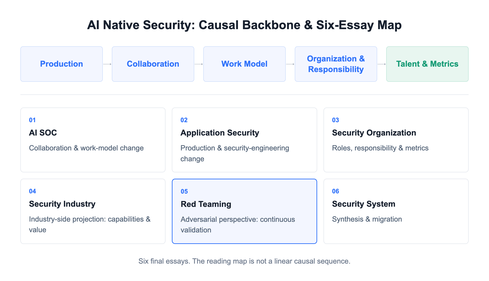
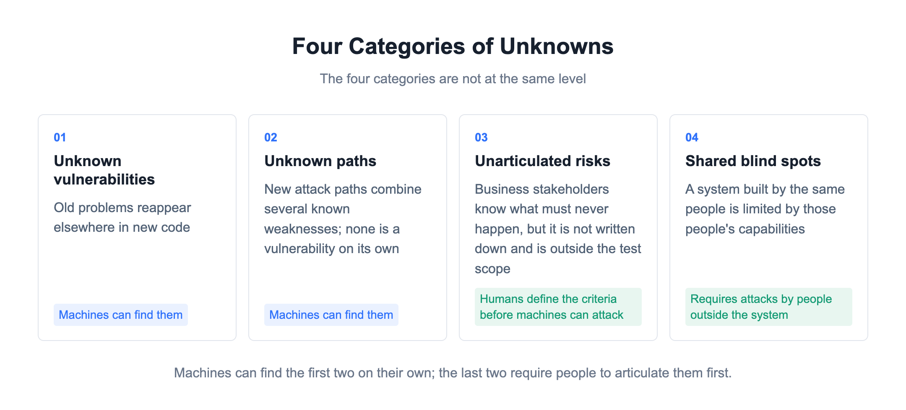
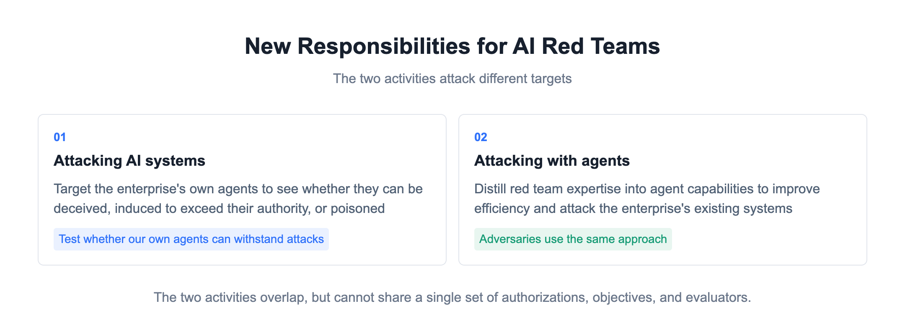
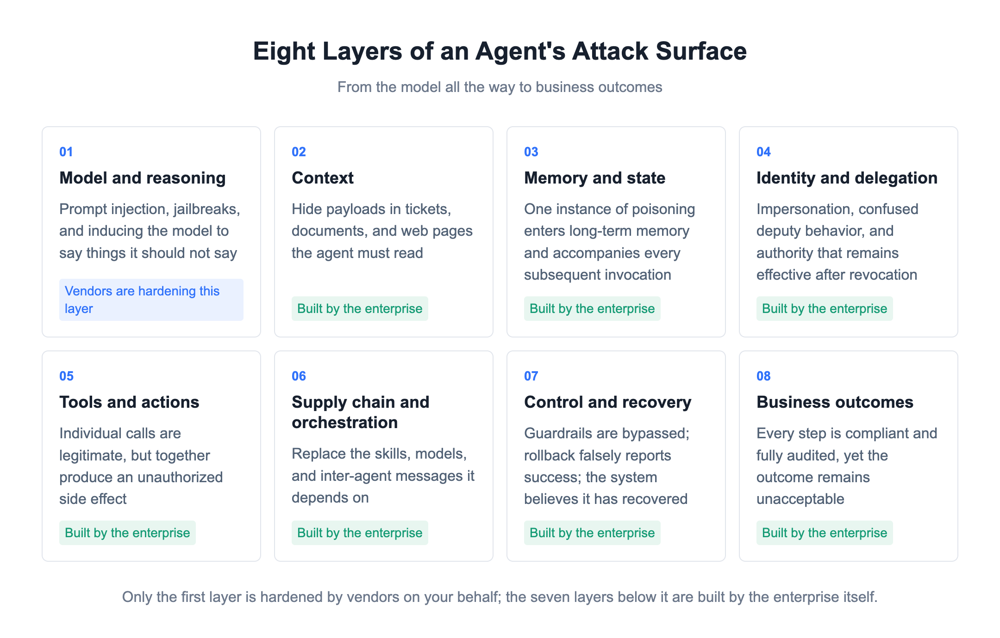
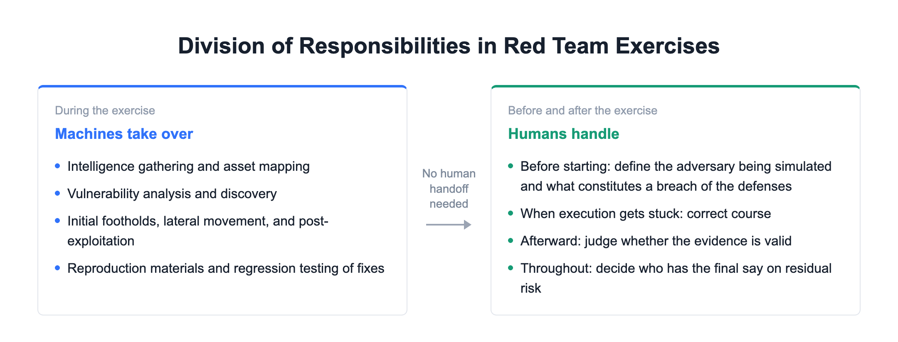
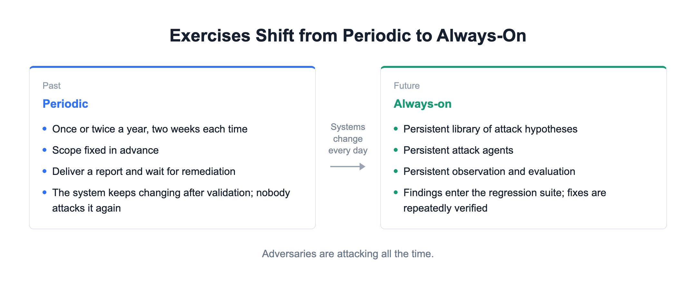
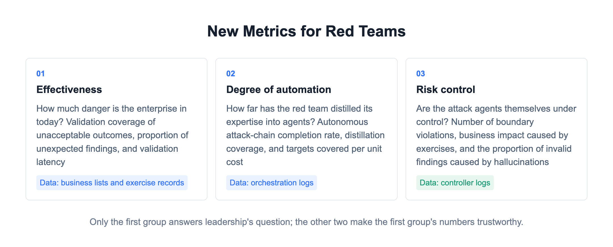

# Where Does Red Teaming Go When Attackers Become Agent-Powered?

[中文](../zh/05-red-teaming.md) | [English](../en/05-red-teaming.md) | [Article index](../README.md) | [Profile](../../README.md)

> **About the author**: Max Luo, Founder of Teloa, focused on AI Agent Engineering & Product Development and AI Native Security. AI Security Engineering Team Lead at a globally leading cryptocurrency exchange, with 13+ years in cybersecurity and former leadership roles across global application security, the AI Security Center of Excellence (COE), security BP, and red teaming at SHEIN. Author of the open-source book AISecOps: AI-Driven Enterprise Security.
>
> WeChat public account: White Hat Max Luo (白帽子罗棋琛) | GitHub: cybermaxluo

The industry has spent years exploring how to automate red teaming. Vulnerability scanners, breach and attack simulation (BAS), attack surface management, and automated penetration testing have improved with each generation, but they have all stopped at validating known risks.

Judging by several AI-automated intrusion incidents this year and research across the industry, agents on the offensive side are already approaching full automation.

But what changed my assessment was the cost on the attacker's side, not the tools on the red team's side. Every additional control costs defenders implementation effort, operations, and collateral disruption. Every control bypassed costs attackers people, resources, time, and repeated attempts. Security defenses often hold because an attack is not worth the cost, not because the defenses themselves are exceptionally airtight.

Agents are compressing those costs on the offensive side. Mapping assets, finding exploitation opportunities, writing PoCs and weaponizing them, and continuing to evade defenses after detection used to require people, time, and a team with specialized roles. Now, one person directing an army of intrusion agents can do these things in parallel.

Red teams exist to play the role of a real adversary before that adversary reaches the enterprise. In the past, red teamers and attackers were the same kind of people: both had to find paths and write tools, and both constrained their attacks because of cost. Now, adversaries have made their offensive operations intelligent: they work tirelessly around the clock, pursue dozens of avenues at once, and incur very little cost for trial and error.

In my first article on SOCs and my second on application security, my point was that defenders are still relying on manual analysis and manual reviews. Against this kind of adversary, they are already fighting at a fundamentally lower level of capability. If red teams do not make their own offensive operations equally intelligent, they will be next.

The central argument of this article is this: **The gap between offense and defense is no longer in technical details, but in the degree of intelligent automation. When adversaries use agents to attack at scale, red teams that still rely on the old approach of manually crafting tactics and techniques will be left on the receiving end.**

## 1. The Adversary's Approach Has Changed

In November 2025, Anthropic disclosed the first reported AI-led cyberespionage campaign. Attackers jailbroke Claude Code and launched intrusions against approximately thirty organizations worldwide. AI autonomously executed 80-90% of the attack actions, with humans making decisions at only a few critical points.

By the latest threat intelligence report in September 2026, there was more than one such case.

One group used agents to decompile approximately 1.8 million Android application packages and scan them for hardcoded secrets. In one intrusion, it took only about three hours to go from a token to cloud administrator privileges. Agents performed almost all the reconnaissance, privilege escalation, and data exfiltration; humans obtained the initial access credentials and handled the final monetization.

When another group's payload was detected by security tools, its agent rewrote and recompiled the payload itself, bypassed detection, and continued running. No human participated in the entire detection-evasion loop.

The techniques were still familiar. What changed was scale and speed. The report summed it up in one phrase: capability has become decoupled from resources. A lone hacker and a state-backed APT can now use the same approach to attack multiple victims in parallel, something that previously required a team with specialized roles.

Red teams used to classify adversaries into tiers: script kiddies, organized groups, and state-level actors. That classification is close to becoming obsolete.

## 2. The Vulnerability Factory

Another group in the same report deserves its own discussion. They integrated models into their reverse-engineering workflow to conduct continuous vulnerability research on a mainstream security product. They produced a dozen or so suspected zero-days in a month, with multiple subagents analyzing different targets in parallel. The report described the workflow as running 24/7 with almost no human intervention; people mainly performed a final review.

Think of it as a vulnerability production line. What it describes is continuous automated discovery, not a single successful discovery.

Defenders have always depended on a time advantage. In the past, there were weeks between a vulnerability becoming public and being exploited. Patching, mitigations, and incident-response exercises were scheduled within that window. That is precisely the window the production line compresses: rerun it on the day a new version is released, and weaponized tools targeting that version are already available before patching is complete.

Attackers are not the only ones with this capability. Google Project Zero's Big Sleep used an agent to discover a previously unknown stack buffer underflow in SQLite, although the research team also made clear that the results were still experimental. In 2026, Anthropic's Claude Mythos Preview autonomously discovered previously unknown vulnerabilities in mainstream operating system kernels and browsers.

The weaponization side is even more efficient. Given 18 Firefox patches, it produced 8 working exploits, the first within an hour. Given 21 Windows kernel CVEs, it produced 18 PoCs, the first in 31 minutes, at a cost of approximately $2,000 each. The success rate is not 100%, but the patching window has already been compressed.

Resources are asymmetric between offense and defense. Attackers need to find one entry-point vulnerability; defenders need to remediate every exposed surface associated with that vulnerability, at several times the attacker's cost. The same production line generates direct returns in an attacker's hands, but in a defender's hands it may generate a list that can never be fully remediated. Red teams sit in the middle: they must build that production line and also help defenders determine which defense-in-depth controls deserve the highest priority.

The next question red teams will face is this: now that machines can find vulnerabilities, can you find what AI cannot? That means first unpacking the word "unknown." There are at least four categories, and they do not exist at the same level.

Machines can already find the first two, and they will only get faster. One is unknown vulnerabilities: old problems appearing in different places in new code. The other is unknown paths: new attack paths formed by combining several known weaknesses, none of which qualifies as a vulnerability on its own.

The third is risk that nobody has articulated. Business stakeholders know which outcomes must never occur, but those outcomes have never been raised in reviews or requirements, so they are outside the scope of testing. This is not something machines cannot find; it is something nobody has written down. Once a security engineer turns it into a rule with a clear pass-or-fail outcome, a machine can test it through attack.

The fourth is shared blind spots. When the same group of people builds both the offensive and defensive systems, those systems are limited by that group's capabilities. Without sustained, high-intensity, high-caliber adversarial testing, security posture will gradually deteriorate. People inside the system cannot see their own limitations, as the Chinese saying puts it: "You cannot see Mount Lu's true face because you are standing within it." You cannot define something you cannot see yourself. This category requires attacks from people outside the system.

## 3. Red Team Pain Points

While adversaries are changing rapidly, none of the red team's longstanding problems has been resolved. Every one of them has become more acute.

The first pain point is delivery. Once the report is handed over, remediation becomes someone else's responsibility; the red team has no power to enforce it. The same root cause turns up again in the second year and is still there in the third. Reports grow thicker, but risk barely declines. Over time, a red team can become a report-producing department. Slow remediation used to be tolerable because adversaries were slow too. Now adversaries iterate on a daily basis. When remediation takes longer than the adversary's iteration cycle, a report is already out of date when it is delivered.

The second is scope. Critical systems are often excluded on the grounds that testing would "affect production." Most permitted targets are test environments and peripheral business systems, while testing of core business systems stops short of deeper exploitation. A report's "no high-risk findings" more accurately means "no high-risk findings within the permitted scope." Adversaries do not recognize that boundary. They can attack dozens of targets in parallel, and the excluded systems are precisely where they go first.

The third is value. Red teams do not lack concrete achievements: obtaining domain administrator privileges, accessing core databases, and exfiltrating target data all make a strong impression in a debrief. But when leadership asks how much the organization's security posture has improved, there is no clear answer. A successful attack proves that we can get in, not how much danger the enterprise is currently in. Change the team or the scope, and the results are no longer comparable. Red team budgets often become available only after a real incident. Attackers' agents evolve as large models improve, while the attack surface continues to expand. The proportion covered by two exercises a year will only shrink.

People are another problem. Red teamers take a long time to train. Once they have developed their technical skills, they either leave for another company or move into application security or the SOC, leaving the team continually replacing staff.

New pain points have also emerged. Adversaries have automated and scaled their attacks, while red teams still work to project schedules. Leadership asks teams to use AI for red teaming, but nobody can explain how to measure it, and the effort gradually turns into running tools.

Of these issues, this article can address delivery and value, but not scope and staffing. Whether critical systems may be tested, whom the red team reports to, and how much headcount and budget it receives are questions of authorization and governance. The red team cannot change them on its own; the CISO needs to intervene.

## 4. New Responsibilities for AI Red Teams

When the industry talks about AI red teaming, it is actually talking about two different things.

One is attacking AI systems: treating the enterprise's own agents as targets to see whether they can be deceived, induced to exceed their authority, or poisoned. The targets include models, memory, tools, identities, and the business actions those agents can take. The other is attacking with agents: distilling red team expertise into agent capabilities to improve efficiency, then using those agents to attack the enterprise's existing systems. Red teams do this, and so do adversaries.

The two can overlap. Using an attack agent to generate a supplier document containing an indirect prompt injection, attacking a payment agent with it, and then checking whether the SOC can detect the attack combines both. But the two cannot be evaluated using the same "number of injections found" metric, nor can they share a single set of authorizations, objectives, and evaluators.

The balance of investment differs too. Most enterprises' AI red teams do the first, and only at the shallowest level: testing prompt injection and jailbreaks. The second more often takes the form of adding agents to existing tool platforms to improve efficiency.

This article focuses primarily on the second. But we first need to lay out the attack surface of the first, or we will not understand the scale of what needs to be tested. Between receiving a task and producing a consequence, an enterprise agent passes through at least eight layers.

1. Model and reasoning. Prompt injection, jailbreaks, and inducing the model to say things it should not say. This is the easiest layer to test, with the largest number of tools and leaderboards.
2. Context. Agents read tickets, documents, web pages, and code repositories. An attacker does not need to persuade the model directly; placing a payload in material the agent must read is enough. The entry point is in the business workflow, not the chat box.
3. Memory and state. Once poisoned content enters long-term memory, it accompanies every subsequent invocation, across sessions and tasks, and in serious cases across tenants.
4. Identity and delegation. An agent operates under delegated authority. Whoever obtains that delegation can act in its name. Traditional IAM controls whether an account is eligible to act, but cannot control where a particular delegation is used.
5. Tools and actions. Each individual call is legitimate, but together they produce an unauthorized side effect. Defenders typically validate only individual calls. This is the layer where red teams can most readily produce findings.
6. Supply chain and orchestration. The skills, models, plugins, and inter-agent messages an agent depends on. If any one of them is replaced or poisoned, the work on the five layers above can be rendered useless.
7. Control and recovery. Can guardrails be bypassed? Does a stop command actually stop the agent? A rollback may report success without restoring the state, leaving the system believing it has recovered when something has gone wrong.
8. Business outcomes. Every step of a refund, payment, or production change may comply with policy and have a complete audit trail, yet the result can still be unacceptable. At this layer, there may be no technical vulnerability, only a business vulnerability.

Of these eight layers, the model layer offers the lowest return on effort. Model providers harden against jailbreaks and improve refusal behavior with every generation, and third-party vendors already offer mature products. There is still no general solution to prompt injection, but testing it in isolation yields limited value. The greater leverage lies in the layers below.

## 5. Changes in How Red Teams Work

Intelligence gathering, code review, vulnerability discovery, gaining an initial foothold, lateral movement, and post-exploitation have mostly had mature tools for years: scanners, C2 frameworks, and scripts of all kinds. But people had to make judgments and connect the stages: read the output, decide what to do next, and switch tools. At their current level, agents can already take over some of these stages, most clearly code review and vulnerability discovery.

Attackers are moving faster than red teams, not because they are more technically capable, but because they do not have to worry about destructive effects. Taking a target down does not undermine an attacker's payoff; taking production down makes the red team responsible for an incident. Given the same attack chain, attackers can let an agent run freely. Red teams cannot.

The same change is happening across the software industry. The mode of production changes first: execution is handed to agents, and roles shift from doing the work yourself to building agents and supervising their work. People set direction at the start, correct course when the agent gets stuck, and judge the quality of the results at the end. This is the same progression I described in my articles on SOCs, application security, and security organizations. Red teams are no exception.

Red teams have two additional responsibilities along this progression that other roles do not. One, mentioned earlier, is that every step must have an emergency stop and a contingency plan. The other comes before execution: someone must clearly define the adversary being simulated, what outcome constitutes a breach of the defenses, who would attack us, what resources they have, and what they want to achieve.

Red teams used to operate periodically, once or twice a year: define the scope, attack for two weeks, deliver a report, and wait for remediation. The underlying assumption was that the systems being tested would remain largely unchanged between exercises.

Business teams are now using agents for development too. Coding agents write the code, deployment agents push releases, and a system may go through more iterations in a week than it once did in a quarter. By the time remediation is complete, the system that was originally tested is no longer the same system.

The future requires continuous exercises. A persistent library of attack hypotheses, persistent attack agents, and persistent observation and evaluation. Findings enter the regression suite, and fixes are repeatedly verified. There is no longer a point at which an exercise is over. Testing is always underway because your adversaries are always attacking too.

In the past, red teamers spent most of their day running tools, typing commands, debugging exploits, reproducing issues, taking screenshots, and writing reports. Agents are taking over those tasks. The question used to be whether you could get in. Now it is whether you are attacking the right things and whether your conclusions stand up to scrutiny. The core skill is judgment.

## 6. The Red Team's New Position

In my article on security organizations, I wrote that once execution is handed to agents, only three core categories of human roles may remain: security architecture and agent engineering, BISO (business and risk governance), and AI red teaming and adversarial validation.

These are non-interchangeable responsibilities, not departmental boundaries. Architecture and agent engineering build the agent capabilities and define what agents may do, at which layer to block them, and how to stop them. BISO defines which business outcomes are unacceptable. The red team demonstrates whether the first two actually deliver what they intend.

The red team earns a distinct place through its ability to provide objective validation relative to the other two roles, and through the technical expertise required to mount attacks. Builders can demonstrate that engineering follows security standards, but not that it will stop an attack in practice. Business stakeholders can define what is unacceptable, but cannot quantify the current level of risk.

### 6.1 New Metrics

The old metrics measured activity: vulnerabilities found this month, systems covered, exercises conducted, remediation closure rates, and ATT&CK coverage achieved by the defenders' controls. In an era of limited human resources, these roughly equated to output and coverage. In the agent era, those numbers only reflect how many tokens were spent, not what changed in the enterprise's security.

The new metrics fall into three groups.

1. Effectiveness: measure how much danger the enterprise is actually in today. Validation coverage of unacceptable outcomes: how many outcomes that must never occur have business stakeholders registered, and how many have actually been tested through attack? If 20 are registered and 12 have been tested, coverage is 60%. The denominator comes from business stakeholders; the numerator comes from exercise records. Proportion of unexpected findings: how many high-impact findings in the current period were absent from the existing regression cases? A persistently low proportion means the team is repeatedly testing what it already knows. Validation latency: what is the median number of days between a system change being released and the system being attacked again? If it exceeds the business's own average iteration cycle, the team is falling behind.
2. Degree of automation: measure how far the red team has progressed in distilling its expertise into agents. Red teams will inevitably be slower than attackers. Every step must account for business continuity and avoid affecting stakeholders' KPIs. Autonomous attack-chain completion rate: the proportion of chains that run from initiation to a verdict without human intervention. Measure this using the number of human interventions in orchestration logs. Distillation coverage: how many of the red team's attack techniques have been converted into reusable agent capabilities? Targets covered per unit cost: how many targets can be attacked in parallel with the same budget, and how does this year's figure compare with last year's?
3. Risk control: measure whether the attack agents themselves are under control. Boundary violations: hitting excluded targets, exceeding the permitted impact budget, or acting on objects that should not be touched. Record every occurrence as an incident within the enterprise. Business impact caused by exercises: how many minutes of disruption occurred, and how many real tickets were affected unintentionally? Proportion of invalid findings caused by hallucinations: the number of reported findings that cannot be reproduced divided by the total number of findings.

### 6.2 New Capabilities

Attack-chain thinking, understanding vulnerability mechanics, bypass and evasion techniques, and traces and forensics remain core strengths. The capabilities that need particular development fall into two areas.

One is engineering. Learn to build automated attack agents and understand how to tune context engineering, tools, memory, and subagent orchestration. Learn to encode attack rules as constraints. This must be built around the enterprise's internal business scenarios and characteristics, but the architecture and methodology are generalizable and can be reused at your next employer.

The other is the attack surface of AI systems themselves. Resources already exist: free ones include OWASP's *GenAI Red Teaming Guide*, the LLM Top 10, and the Agentic Applications Top 10; paid options include OffSec's OSAI+ certification and HTB's COAE, among others. MITRE ATLAS organizes attack techniques against AI systems into an ATT&CK-style matrix that can be used to assess coverage.

## 7. Conclusion

There are three directions for the future of red teaming.

First, make the offensive side equally intelligent, while acknowledging that you will be slower than the adversary. Every step must account for business impact and stakeholders' KPIs. This is a structural difference between enterprise red teams and attackers, not a capability gap.

Second, turn exercises from periodic events into everyday activity. Business teams themselves are using agents for development, and a system may go through more iterations in a week than it once did in a quarter.

Third, keep learning. Attack-chain thinking and vulnerability mechanics remain the foundation. The new skills are building and tuning attack agents, and understanding the attack surface of AI systems themselves. A new model generation arrives every few months, and the ways attack agents are built and the techniques used in adversarial engagements are changing dynamically as well.

Offense and defense have always advanced in a spiral: one side takes a step forward, and the other follows. Neither side remains far ahead forever. Sustained adversarial engagement is itself the underlying dynamic that keeps this industry in balance.

So no matter how far digitalization and artificial intelligence progress, there will always be people who study them, challenge them, and protect them. I have confidence in the red team (opposing-force) role, because it represents the legitimate hacker spirit.

This article covers only the observations and judgments. I have put the fuller discussion of the four categories of unknowns, the complete components of continuous exercises, and the tiers of exercise realism into Chapter 16 of my new book, *AI Native Security*.

These are my thoughts on how red teaming is changing in the agent era. They represent only my personal views and do not constitute legal advice concerning any enterprise. You are welcome to follow my WeChat public account.

**References**

1. Google Project Zero's Big Sleep case study: https://projectzero.google/2024/10/from-naptime-to-big-sleep.html
2. OWASP Agentic Applications Top 10: https://genai.owasp.org/resource/owasp-top-10-for-agentic-applications-for-2026/
3. Anthropic Threat Intelligence Report (September 2026): https://www.anthropic.com/threat-intelligence-report-september-2026
4. Anthropic's disclosure of the first AI-led cyberespionage campaign (November 2025): https://www.anthropic.com/news/disrupting-AI-espionage
5. CSA's MAESTRO layered threat-modeling framework: https://cloudsecurityalliance.org/blog/2025/02/06/agentic-ai-threat-modeling-framework-maestro
6. Hack The Box AI Red Teamer path (in collaboration with Google, aligned with SAIF): https://academy.hackthebox.com/path/preview/ai-red-teamer
7. OffSec AI-300 and the OSAI+ certification: https://www.offsec.com/courses/ai-300/
8. AI red teaming initiative within the OWASP GenAI Security Project: https://genai.owasp.org/initiative/red-teaming-evaluation/
9. MITRE ATLAS: https://atlas.mitre.org/

---

[Previous](./04-security-industry.md) | [Next](./06-ai-native-security.md)
