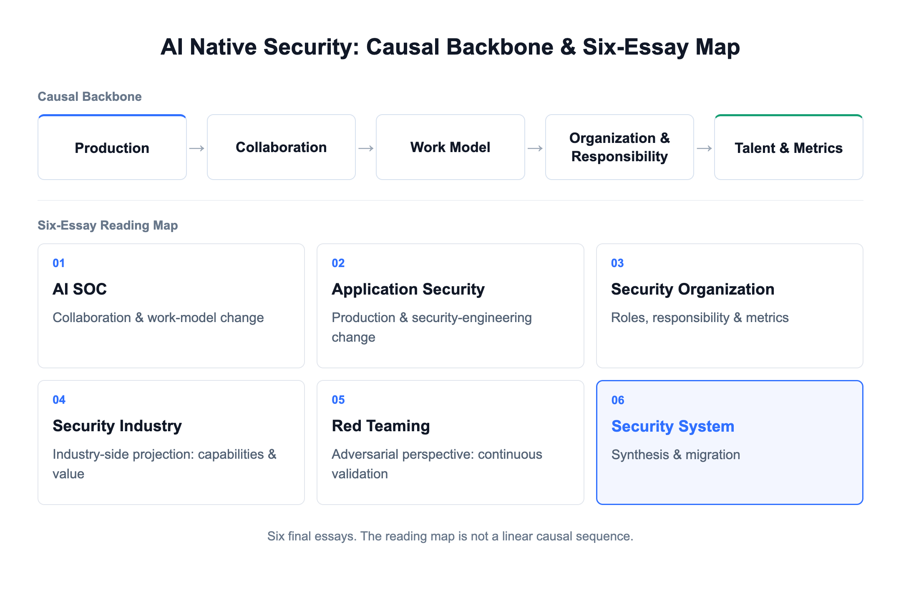
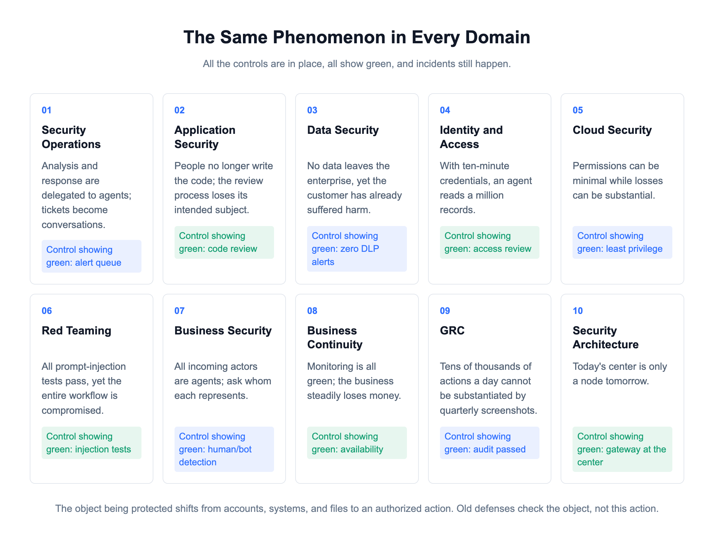
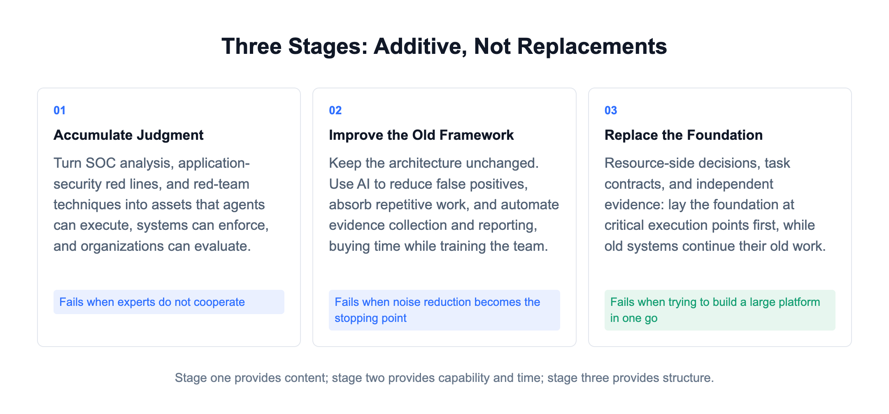
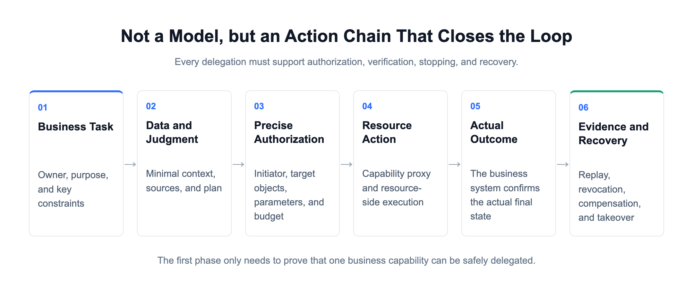
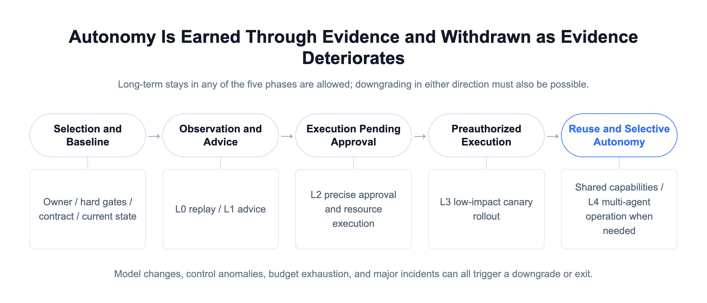

# AI Native Security: What Will the Security Framework Ultimately Look Like?

[中文](../zh/06-ai-native-security.md) | [English](../en/06-ai-native-security.md) | [Article index](../README.md) | [Profile](../../README.md)

> **About the author**: Max Luo, Founder of Teloa, focused on AI Agent Engineering & Product Development and AI Native Security. AI Security Engineering Team Lead at a globally leading cryptocurrency exchange, with 13+ years in cybersecurity and former leadership roles across global application security, the AI Security Center of Excellence (COE), security BP, and red teaming at SHEIN. Author of the open-source book AISecOps: AI-Driven Enterprise Security.
>
> WeChat Official Account: 白帽子罗棋琛 | GitHub: cybermaxluo

This is the final article in this series.

Each of the previous five articles focused on a different area.

The first covered security operations: conversations replacing tickets, and analysis handed over to agents. The second covered application security: once software is produced by agents, reviews designed around people lose their intended subject. The third covered organizations: once execution is delegated, roles are reorganized, ultimately converging on three categories: security architecture and agent engineering, BISO, and AI red teaming.

The fourth covered the industry: the consumers of capabilities shift from people to agents, and deliverables move from rights of use and person-days to outcomes and value, while four categories of responsibility remain nondelegable for enterprises. The fifth covered red teaming: once attackers become agent-driven, the offensive side must become intelligent too.

These five areas look like five separate issues, but underneath, they are the same issue. This article brings them together to answer three questions: what the security framework will ultimately look like, how to get there from where we are today, and how much that will cost.

The central argument of this article is: **The old framework assumes that people do the work. Once agents do the work, that assumption disappears. All the controls are still there, but none of them can prove security. From now on, only one thing can count: what this action actually changed in the end.**

## 1. Five Articles Along a Single Chain

The third article laid out this chain in full, so here I will give only the conclusion. The way things are produced changes first, followed by collaboration and working practices, and finally by organizations, roles, talent, and metrics.

Each of the five articles occupies a place along that chain.

The first, on security operations and conversations replacing tickets, sits at the level of collaboration and working practices.

The second, on application security and the shift from people to agents as the producers of software, sits at the level of production.

The third addresses organizations and people. The fourth is the industry's reflection of this chain.

The fifth describes adversaries completing this chain first, forcing red teams to catch up.

The endpoint of the chain is not the disappearance of a particular role, nor buying a few more AI products. It is a change in the premise on which the security framework rests. That is what this article is about.

## 2. The Old Framework Fails as a Whole

First, let us lay out the current framework. Enterprise security defenses have never been a single thing. They are an accumulation built up over decades, which I divide into roughly eight categories.

Network boundaries: firewalls, WAFs, segmentation, and bastion hosts. Endpoints: EDR, DLP clients, and access admission controls. Identity: IAM, SSO, MFA, PAM, and access reviews. Assets and vulnerabilities: inventories, attack surfaces, scanning, patching, and SCA. Data: classification, encryption, egress controls, and database auditing. Software production: SDL, DevSecOps, SAST, security gates, and artifact signing. Detection and response: SIEM, detection rules, analysis, incident response, and red and blue teaming. Governance and compliance: GRC, policies, audits, and risk assessments.

These eight categories look different, but they share one underlying premise: work is done by people, or by programs written by people whose behavior is fixed. Four assumptions follow from that premise. Every control in all eight categories depends on at least one of them.

First, volume is bounded. A single identity can do only so much in a given period, so rate limits, quotas, and anomaly thresholds can be calibrated to human speed.

Second, patterns are stable. People and programs both have routines, which is what makes behavioral baselines and anomaly detection viable.

Third, a person is present at critical points. Approvals, reviews, and analysis are all designed around this assumption.

Fourth, logs are trustworthy. Logs are passive records, not something written by a participant, so they can be used to reconstruct events afterward.

Once agents enter the picture, all four assumptions cease to hold at the same time. And they collapse from both ends: the enterprise's own agents are not adequately controlled, while adversaries' agents move faster.

On volume, a single identity on your own side can initiate tens of thousands of actions in ten minutes, making every threshold calibrated to human speed inaccurate. On the adversary's side, as the previous article described, one group can have agents hunt for vulnerabilities 24/7, producing a dozen or so suspected zero-days in a month.

On patterns, an agent on your own side can take a different execution path for the same task after a model version change, a different skill, or one extra sentence in its context. On the adversary's side, once a payload is detected, the agent rewrites and recompiles it on its own, with no human involved anywhere in the detection-evasion loop. Baseline-based detection cannot handle either side.

On human involvement, people cannot review tens of thousands of actions a day. What they see is a summary written for them by an agent, not the raw facts. An attacker does not need to fool the person; they only need to fool the agent writing the summary. OWASP's 2026 Top 10 for Agentic Applications lists this separately as item nine, Human-Agent Trust Exploitation, and explicitly requires mandatory confirmations to show the raw action itself, rather than only an agent-written summary.

The assumption about logs is hit hardest. Agents write their own logs, write their own memories, and generate their own evaluation results. Logs stop being passive records and become a participant's output. This is also where adversaries gain the most: change the evaluation set, and every subsequent run will pass; poison long-term memory once, and every subsequent invocation carries that conclusion. Whoever can alter the evidence can determine the conclusion.

So the current problem is not that one layer has broken. All eight categories still physically exist, and all still report green status. But the basis that made them valid has disappeared. Green no longer means secure.

This explains the new kinds of incidents appearing across domains at the same time. A customer-service agent writes a judgment of "suspected promotion abuse" into long-term memory. Not a single piece of data leaves the enterprise during the entire process, DLP raises no alerts, yet the customer has already suffered real harm. An agent with only project-level permissions and credentials that expire in ten minutes scales several services down to zero in parallel within those ten minutes. From IAM's perspective, it has not exceeded its permissions. A ticketing agent that has never gone down keeps incorrectly closing tickets because of an outdated policy. Every monitoring dashboard is green, while the business steadily incurs losses. Every checklist item passes; the incident happens between the checklist items.

## 3. Where to Build the New Framework

Since these four assumptions have collapsed, the new framework can only be built somewhere that does not depend on them. Replace them one by one.

If you cannot rely on bounded volume, cap impact instead. Stop asking how many actions an identity performed over a period. Ask how many objects a single task can change at most, how much money it can involve, and how long it can run. Stop it if it exceeds those limits. These limits must also be accounted for outside the executor, with subtasks drawing down the same shared ledger. Otherwise, a primary agent can spawn ten subagents, each compliant individually, while collectively exceeding the limit tenfold.

If you cannot rely on patterns, look at outcomes. Do not ask whether the pattern of calls is normal. Ask what this action ultimately changed, and whether that change falls within the permitted scope. Detection shifts from behavior to outcomes.

If you cannot rely on a person being present in real time, encode human judgment in advance. People define unacceptable outcomes once, and machines check against them every time. People move from real-time approval to advance definition and retrospective spot checks.

This point is easily read as saying that people no longer need to make judgments, so it needs clarification. The third article discussed the authority to make final determinations. Whether an alert ultimately counts as an intrusion or a false positive, or whether a vulnerability remains exploitable after retesting, is still a human decision. A certain proportion of randomly selected samples must also be handled manually. The purpose is not efficiency; it is to preserve the quality of final determinations and people's ability to take over at any time. What changes is that people no longer approve every action in real time. What does not change is that people decide what ultimately counts. Irreversible actions and those exceeding thresholds still require human sign-off.

If you cannot rely on logs, obtain evidence from systems that do not participate in execution. Read from whichever system receives the side effect. For a freeze, check the ledger; for configuration, check the cloud control plane; for session revocation, check the identity platform. A tool returning `success` only means that the API received the request. An agent's report does not count as an outcome.

The first article, on SOCs, made an argument: large vendors will take over the model and harness layer, while what enterprises should truly retain control of is their own data, judgments, and engines. This point bears that out. If decisions and evidence are embedded in a particular vendor's harness, MCP gateway, or security product, you have to change generations whenever it does.

These four principles point to the same place: where outcomes occur. In engineering terms, that means systems such as ledgers, cloud control planes, and identity platforms, where state actually changes in the end. Below, I refer to these collectively as the resource side.

The framework's center of gravity therefore shifts from the entry point to the outcome side. Previously, defenses focused on entry points: who could get in, what they could connect to, and what they could invoke. Going forward, the focus is on outcomes: what this action ultimately changed, and whether that change falls within the permitted scope.

This does not mean abandoning those eight categories at the entry points. They will continue to block most explicit attacks, manage eligibility and exposure, and control outbound data. Their workload will only grow, because adversaries are automating attacks too. What changes is their position. Previously, they were both entry controls and decision-makers. Going forward, they serve only as entry controls, while decision authority sits on the resource side. Their output changes from "I approved it" to "less, cleaner traffic reached the resource side."

This is what AI Native actually means: security is no longer a series of checks attached outside a workflow, but constraints built into the execution path. The SOC version of Codex discussed in the first article, and embedding security capabilities into skills so that shifting left actually happens, as discussed in the second, are manifestations of this same idea in their respective places.

One exception must be called out. The entire argument above rests on a premise: side effects land in systems the enterprise can observe. Agents used in business operations, development, and IT operations satisfy that premise. Endpoint agents do not. The agent on an employee's desktop inherits all of that employee's permissions: it reads local files, reads email, and uses already authenticated sessions. Many of its side effects never pass through any enterprise resource system. There is no resource side to be found. This category is currently a vacuum, and it is also the largest and fastest-spreading one.

The only available approach is to move back to the supply side: the enterprise provides agents centrally, along with a unified model egress channel, rather than letting everyone install their own. This is a management problem, not a technical one.

Beyond endpoints, there are three more gaps that the industry acknowledges remain unresolved. Five vendors released agent identity frameworks at RSAC 2026 at the same time, and none covered these three issues: how to detect at runtime that an agent has rewritten its own policy; how to establish trust for delegation between agents, for which OAuth, SAML, and MCP provide no primitive; and how to revoke credentials left behind by agents that are no longer used. Acknowledging these three gaps is closer to reality than presenting a perfect solution.

I am not alone in arguing for this direction. Europe and the United States are moving toward the same place, although the argument is being made in separate pieces. In 2026, Forrester proposed the AEGIS framework, centered on moving from protecting infrastructure to protecting intent. Its concept of least agency is the same idea as capping impact here. Gartner calls this layer Securing AI, and predicts that by 2029, more than half of successful attacks targeting AI agents will exploit access-control flaws and prompt injection.

But those who actually argue for moving decisions to where side effects take effect are in the minority, and each speaks only about the layer it sells. Policy-engine vendors say that making a decision only once at the gateway is too early: authorization must follow the request all the way to the data layer. Endpoint vendors say that observing actual actions is a solvable problem, while analyzing intent is not. Identity vendors say that authorization is a continuous decision during execution, not a one-time confirmation at login. These are three fragments of the same principle. None states it in full, because each sells only one layer.

Enterprises buying these capabilities do not have that constraint. The complete statement is: capabilities may be granted centrally, but decisions must move down to the resource where irreversible side effects are produced.

## 4. How Much Engineering Does This Require?

At this point, the first reaction from enterprise buyers is usually: how many systems will we have to change? Let us make the cost clear first; otherwise, there is no way to plan the path ahead.

This is not a system rewrite. Resource-side decisions do not require rebuilding payment systems or cloud platforms. The work is to add a validation step in front of their existing execution entry points, checking whether the initiator, target objects, parameters, and cumulative impact of an action fall within the scope allowed by the contract. The closest technical analogy is adding a layer of policy middleware to an interface, not refactoring business logic.

The work is concentrated in three areas. First, write the contract: who authorizes the action, how much it can affect, how the outcome is confirmed, and how it can be stopped. Second, integrate a validation step at the execution entry point. Third, change the source of outcome confirmation from the agent's report to the actual state of the resource system. The first two are engineering work whose scope can be estimated. The third is often the smallest, because those systems already have readable state; previously, no one was reading it.

The hard part is not the technology. It is getting answers from the business. The most important clause in the contract is "what outcomes are unacceptable." Only the business owner can define that, and most business teams have never been asked the question in this way. The first answer is usually "nothing can go wrong." Turning that into "these three things must never happen" is the most time-consuming part of the work, and it is why the BISO role discussed in the third article exists.

There is another, harder layer. The fifth article discussed four categories of unknowns. The last was shared blind spots: a framework built by the same group of people is limited by that group's collective capabilities. The unacceptable outcomes a business team lists will inevitably omit what it cannot see. A contract is therefore not something written once and finished. Red teams must keep attacking and probing it, turning risks no one has raised into documented clauses. This is also why, as the third article argued, the red-team role cannot be absorbed into the team building the framework.

The cost structure is therefore different from that of traditional security projects. Traditional projects spend most of their money on procurement and deployment. Here, most of the cost lies in cross-functional definition work. It cannot be bought or outsourced. That is what the fourth article's four categories of nondelegable responsibility refer to.

Finally, the benefits need to be stated, or this will not survive a budget meeting. As the fourth article argued, security can, for the first time, express its value in positive terms. How much business work an enterprise can delegate to agents depends on whether it can prove that those actions can be authorized, verified, revoked, and recovered from. Without that proof, autonomy cannot increase. The business remains stuck at the level where agents make recommendations and people execute them.

The security-agent framework we are building ourselves aims for agents to independently complete 80% of security tasks end to end, leaving the high-risk 20% to people. That boundary is drawn using this logic. The external case for resource-side decisions should therefore not be that they add another control, but that they raise the level of autonomous actions the business can permit. This can be accounted for in four ways: which autonomous actions the business has enabled that it previously did not dare enable; the fully loaded cost of each acceptable outcome; the time from anomaly discovery to impact containment; and the cost of erroneous interventions and compensation. All four can be obtained directly from operational evidence.

## 5. How to Navigate the Three Stages

With the direction and cost clear, the path must be taken one step at a time. I divide it into three stages. These are additive, not replacements for one another. Most enterprises will operate all three in parallel for a long time.

Stage one: accumulate judgment. Turn the judgments in people's heads into something machines can execute. SOC analysis logic, application-security red lines, red-team attack techniques, and risk-control response rules used to be scattered across experts' minds, policy documents, and vendors' product consoles. They now need to become assets that agents can use directly, systems can enforce, and organizations can evaluate continuously.

This stage is driven mainly by the security architecture and agent engineering roles discussed in the third article. Its most likely cause of failure is a lack of cooperation from experts. Frontline experts may see this as teaching something that will replace them. If performance evaluations do not recognize the work, cooperation will not reach the required level. The solution is to put "how much human judgment has been converted into reusable shared capabilities" directly into performance assessments. Rallying people in meetings does not work.

Stage two: improve efficiency within the old framework first. Leave the architecture unchanged, and use AI to reduce false positives, absorb repetitive work, and automate evidence collection and reporting. The value of this stage is not just reducing staffing needs. It buys time and trains the team. Here, the team learns how to build agents, supervise them, and determine whether their outputs count as valid. That experience is a prerequisite for stage three.

This stage is most likely to fail because the organization stops here and never moves forward. Noise reduction produces immediate benefits and looks good in quarterly reports. The other two stages do not yield visible numbers in the short term, so many enterprises stop here. Three years later, they still have the same old architecture with a few chat boxes added.

Stage three: replace the foundation. In new platforms and systems, security is built into the execution path. Resource-side decisions, task contracts, and independent evidence form the foundation of the new framework. This stage does not require tearing down old systems. Start by laying the new foundation at critical execution points. Old systems continue doing their old work; they simply no longer have the final say.

This stage is most likely to fail through an attempt to build a large platform in one go. The organization first launches a project for a unified control platform covering every agent in the company, spends a year and a half building it, and discovers at launch that the business has already gone through three generations of agents. The right approach is in the next section.

The relationship between the three stages is this: stage one provides the content, stage two provides the capability and time, and stage three provides the structure. Without any one of them, the path does not work.

Moving this forward requires all three parties. Security architecture and agent engineering build the capabilities and decision points. BISOs obtain the business's answer to "what outcomes are unacceptable." Red teams independently verify whether both actually hold up. The CISO's job is to bring these three parties together and ensure that the third party's independence is not absorbed by the first two. The third article discussed these three categories of roles. Here, they take the field together for the first time.

## 6. Start with One Action Chain

Do not start with a platform.

Start with one action chain that can be completed and verified end to end. There are three selection criteria: it has a clearly identified business owner, it has real side effects, and it can be stopped and rolled back. Examples include changing a supplier's bank account, deleting production resources, or freezing a user account. Choose whichever hurts most in your organization today.

A roughly 90-day schedule looks like this. In the first two weeks, establish the owner and work with the business to define which outcomes along this chain are unacceptable. Over the next month, integrate the chain with resource-side decision-making. Cover only this one action; everything else continues along the old path.

Run it for another month and collect evidence, tracking four metrics: how many high-impact actions actually passed through the resource-side check; how many outcomes were confirmed from business systems; how long it took from issuing a stop instruction to containing the impact; and how many times the check was bypassed during a quarter. Use the final two weeks for a retrospective, then decide whether to expand to a second chain or first strengthen the initial one.

Once one chain works end to end, the second will be much faster, because the contract format, decision placement, and evidence-collection method are all reusable.

For enterprises that have not yet deployed agents at scale, my advice is to start now, rather than wait. Gartner's 2026 research says only 17% of organizations have already deployed AI agents, while more than 60% expect to do so within two years. Most enterprises are still within the window.

There is a very practical timing difference here. Laying the foundation when there are only a few agents is not remotely the same amount of work as going back to lay it after dozens of agents are already live, each connected to different systems. The former is design; the latter is retrofitting. Retrofitting means changing other people's already-running business processes one by one. The judgments in stage one face the same issue. The people who know how to make those judgments are still here today. Once large numbers of junior execution roles disappear, that source will be gone. The third article was making the same point when it asked where senior experts would come from after junior roles disappear.

## 7. About the Book

First, let me clarify its relationship to *AISecOps*. That book is about bringing AI into security operations. Its subject is the existing framework, and its question is how to make it run faster and more accurately. This book is about what the framework itself is rebuilt into. Its subject is what needs to be reconstructed after the four assumptions discussed above collapse. One is about improving efficiency; the other is about replacing the foundation. This is not a revised edition.

The book contains three things these six articles cannot accommodate.

First, comparison tables for ten security domains. Data, identity, cloud, business security, business continuity, application security, security operations, compliance, architecture, and supply chain each receive a chapter answering the same three questions: what the old defenses check, what the new defenses must protect, and which resource hosts the decision point for that domain. These six articles offer only three examples. The book works through all ten domains individually.

Second, a complete action-authorization model and contract templates. The four questions in this article, who authorizes the action, how much it can affect, who confirms the outcome, and how to stop it, are expanded in the book into seven contracts and six shared control planes. Each includes fields, data-source locations, and failure modes. The contracts can be taken directly and adapted.

Third, a migration path and its acceptance criteria. The three stages are broken into five phases in the book, each with entry conditions, exit conditions, and criteria for downgrading in either direction. Autonomy is earned through evidence; when the evidence is insufficient, it must also be possible to withdraw it. The book treats this in much greater detail than this article.

How to read it: CISOs and security leaders need only Parts One and Six, which cover the judgments and the path forward. Engineers should read Parts Two and Three, where the ten domains and six control planes are covered. Red teams should read Chapter 16, which contains what the fifth article did not expand on. For those working on the industry and vendor side, Part Five covers deliverables and pricing.

## 8. Conclusion

From beginning to end, this series has described a single chain. Production changes first; collaboration, working practices, organizations, and people change with it; the industry's deliverables change with it; and adversaries change with it too.

At the end of the chain, the premise on which the security framework rests has changed. Beneath all controls is one premise: people do the work. From it follow four assumptions: bounded volume, stable patterns, human presence at critical points, and trustworthy logs. Once agents enter the picture, all four cease to hold at the same time. On one side, your own agents are not adequately controlled; on the other, adversaries' agents move faster. So every control remains in place, every status is green, and incidents still happen.

**If you cannot rely on bounded volume, cap impact. If you cannot rely on patterns, look at outcomes. If you cannot rely on people being present in real time, encode judgment in advance. If you cannot rely on logs, obtain evidence from systems that do not participate in execution. All four point to the same place: make the decision where the action ultimately changes something.**

The cost lies not in procurement, but in defining "what outcomes are unacceptable" across departments. The path has three stages: accumulating judgment, improving efficiency in the old framework, and replacing the foundation. They proceed additively, and each has its own failure modes. The starting point is not a platform, but one action chain that can be completed and verified end to end.

I will leave one question that still has no answer. If decisions have to be made at runtime, and people cannot keep up, then the entity enforcing those decisions is likely to be a machine too. Gartner predicts that by 2030, agents dedicated to oversight will account for 10% to 15% of the entire agent market. If we reach that point, the security framework will consist of agents governing agents. Everything in this article rests on one premise: the agent governing the others will not itself be compromised. That premise still holds for now, because it only checks against contracts written in advance rather than making judgments. I have no answer for what happens next.

One sobering point also needs to be made. After RSA in 2026, Google Cloud's Anton Chuvakin wrote that AI-driven acceleration would only kill security that relied on luck. No matter how powerful an AI attacker is, it cannot exploit a vulnerability that does not exist. Replacing the foundation, as discussed in this article, presupposes that the fundamentals of the old framework are already being done. Enterprises that have not covered the fundamentals should fix those first, rather than expecting a new architecture to make up for them.

With that, the WeChat Official Account portion of this series comes to an end. The six articles provide direction and judgment. The implementation details are in the new book, *AI Native Security*.

These are some of my thoughts on AI Native Security. They represent only my personal views and do not constitute legal advice for any enterprise. You are welcome to follow my WeChat Official Account.

**References**

1. OWASP Top 10 for Agentic Applications: https://genai.owasp.org/resource/owasp-top-10-for-agentic-applications-for-2026/
2. Anthropic Threat Intelligence Report (September 2026): https://www.anthropic.com/threat-intelligence-report-september-2026
3. NIST Zero Trust Architecture, SP 800-207: https://csrc.nist.gov/pubs/sp/800/207/final
4. NIST SP 800-53 Rev. 5.1, AC-6 Least Privilege: https://csrc.nist.gov/pubs/sp/800/53/r5/upd1/final

---

[Previous](./05-red-teaming.md) | [Related product practice](./07-teloa.md)
