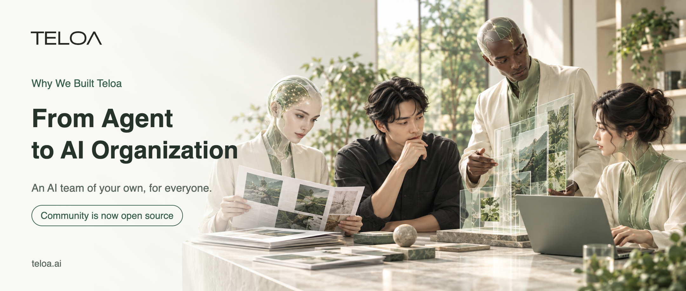
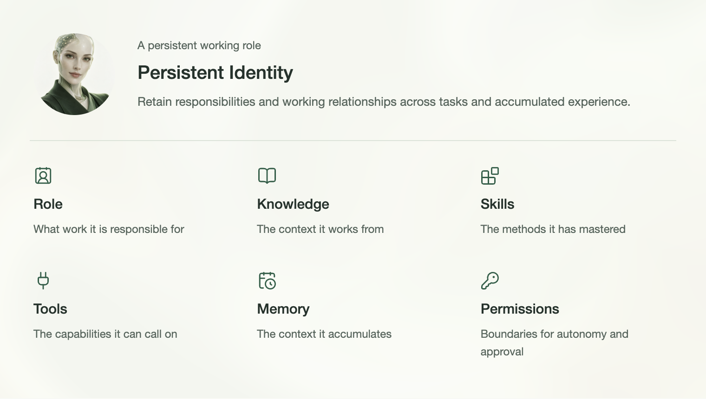
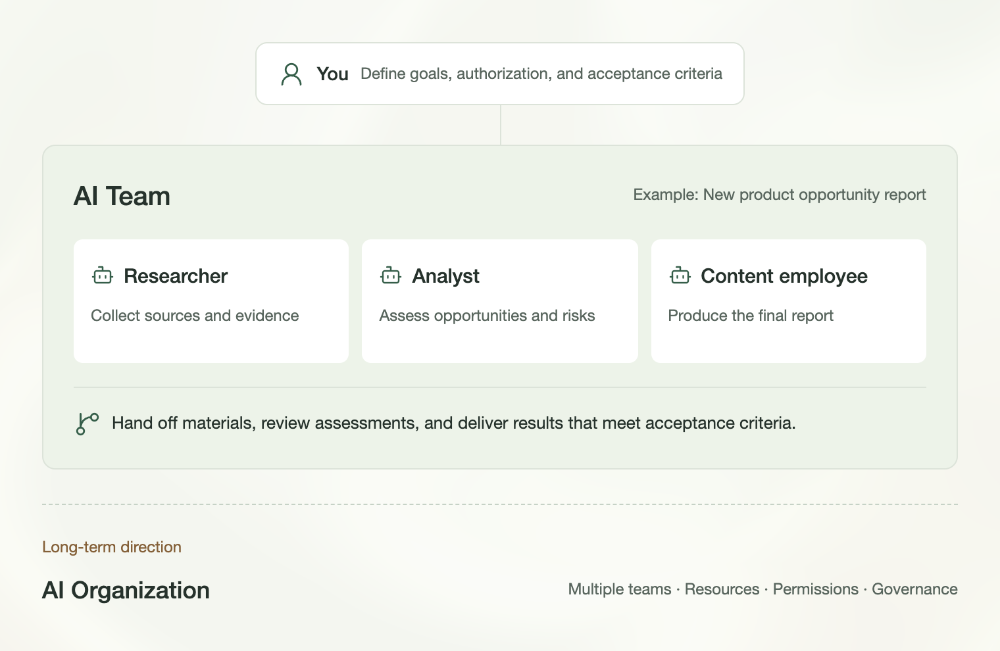
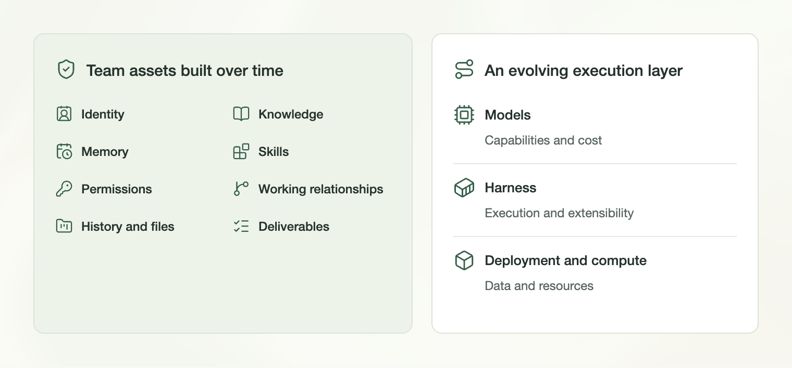
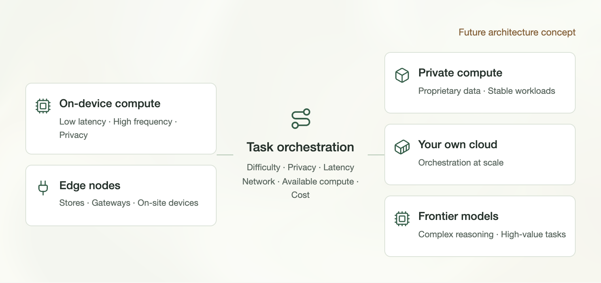
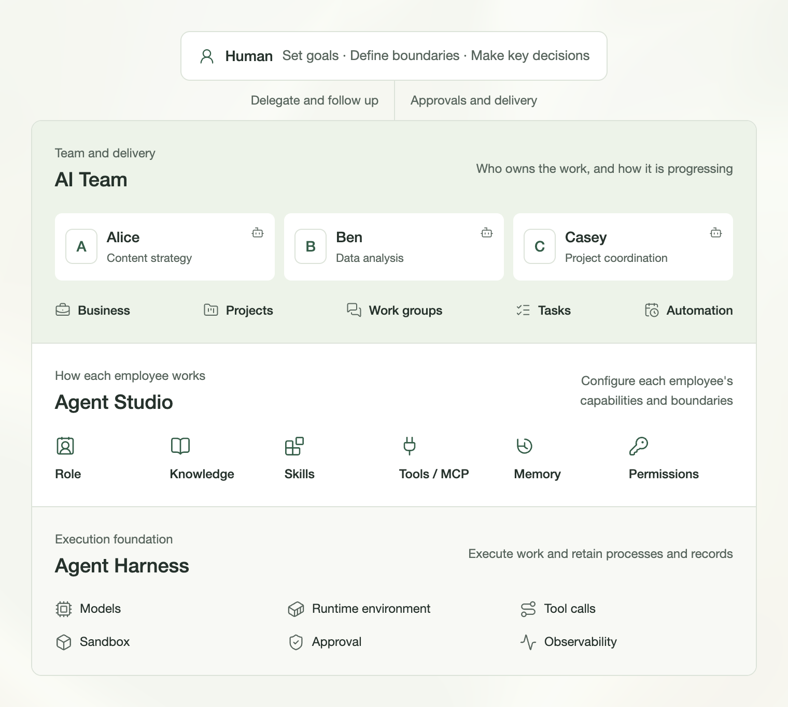
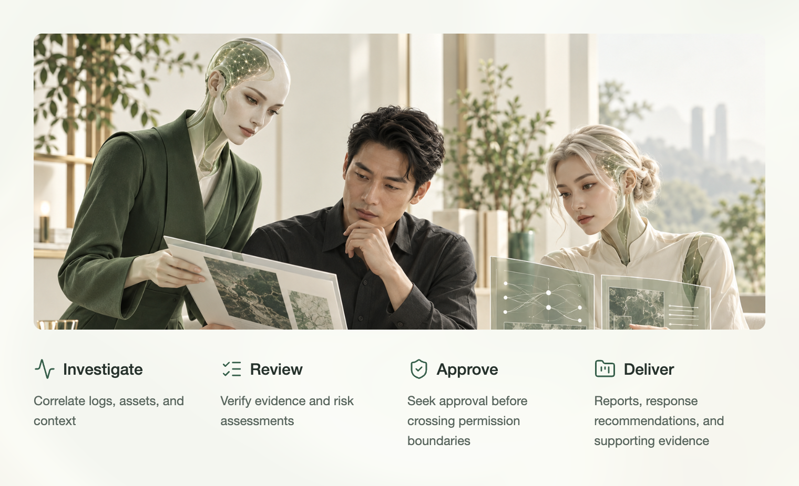
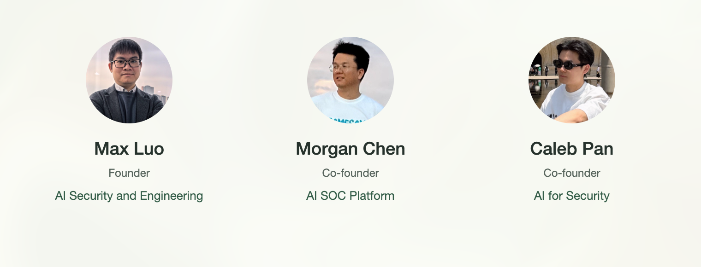
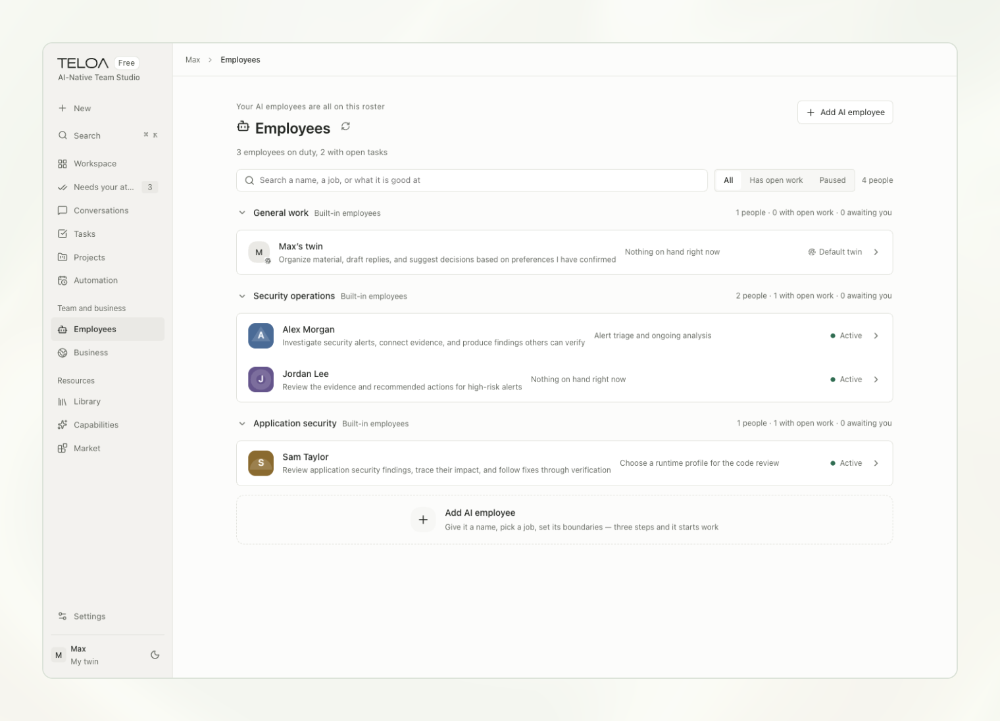

# From Agent to AI Organization: Why We Built Teloa

[中文](../zh/07-teloa.md) | [English](../en/07-teloa.md) | [Article index](../README.md) | [Profile](../../README.md)

**Teloa Community Is Now Open Source**

<!-- Cover image start -->

<!-- Cover image end -->

Looking at how AI products have developed over the past few years, an increasingly clear trajectory emerges: AI is moving, step by step, from answering questions to taking on work.

At first, our relationship with AI was a chat box. People asked questions, and AI provided answers. Then came Copilot, as AI began entering IDEs, Office, browsers, and all kinds of work software. People still controlled the actions, but AI had started working alongside them.

Next came workflows, such as Dify and n8n. People began handing entire processes over to systems, but those processes were still largely designed in advance: what to do next, which tools to call, and how to handle failures. Most of the logic had to be defined upfront.

Agents changed this. Instead of telling AI what to do in step one and step two, people began telling it directly: this is the result I want. The agent would handle the rest, breaking down the task, making a plan, calling tools, visiting web pages, working with files, executing code, and deciding what to do next based on intermediate results.

The real change is not just that models are getting smarter. More and more authority over task planning and execution is moving from people to AI.

## 01 | From Agent to Harness: AI Begins to Truly Take on Work

Running an agent for just a few minutes is not particularly difficult. But if it needs to complete a task that takes an hour, a day, or even longer, a single model call is nowhere near enough.

It needs to manage context, persist state, call tools, work with files and browsers, execute code, handle failures and retries, and know which actions it can take autonomously and which require human approval.

An increasingly important layer of infrastructure has therefore emerged behind agents: the Agent Harness / Agent Runtime.

> **The model determines how smart an agent is. The harness determines whether it can actually get the job done.**

Coding was one of the first areas where harnesses demonstrated their value at scale. Claude Code and Codex let developers delegate increasingly complete software engineering tasks to agents: understanding codebases, modifying files, executing commands, running tests, calling tools, and continually refining their work through feedback.

Coding is a natural environment for validating harnesses: tasks are complex, tools are plentiful, and mechanisms such as compilation, testing, and Git diffs provide continuous feedback. Coding agents can be seen as one of the first proving grounds where harnesses matured.

OpenClaw then brought this way of running agents beyond coding and into the broader personal computing environment. Agents no longer existed only in an IDE or terminal. They could remain active on a user's computer and in their communication channels, with capabilities such as Workspace, Session, Memory, Skills, and Automation, continually moving tasks forward.

If Claude Code and Codex demonstrated that a harness could enable agents to do real work in complex software engineering environments, OpenClaw showed more people that this approach was not limited to coding. It could also become the foundation for personal agents.

By 2026, harnesses themselves were becoming more explicitly defined and established as infrastructure. The emergence of the Codex harness, Claude Agent SDK, and DeepSeek Harness (DSH) all points to the same development: harnesses are gradually evolving from engineering implementations inside specific products into a software layer that can be independently selected, extended, and evolved.

DSH goes a step further, making the harness a standalone open-source project that brings together models, tools, sessions, file access, and the agent loop through a plugin-based approach.

We believe that, following large language models, the agent harness is very likely to become a critical layer in the next round of competition over AI application infrastructure.

Teloa currently uses DeepSeek Harness as its agent runtime. At the product level, however, we want AI employees to be as decoupled as possible from any specific model or harness. Models and runtimes can evolve, but the identities, memories, capabilities, and working relationships that AI employees accumulate over time should endure.

## 02 | From One-Off Agents to Persistent Working Roles

The next step for agents is not just to run longer, but to keep growing.

Products such as Hermes Agent are beginning to emphasize persistent memory, skills, and continuous learning. Agents can remember users, projects, and environments across sessions, and turn the process of solving a problem into a skill that can be reused in subsequent work.

This is beginning to transform agents from one-off task executors into persistent working roles that continually accumulate experience.

At the same time, AI is beginning to truly enter the workplace. Products such as Doubao Office and QwenWork are moving AI from a question-answering tool to an entry point for work: users describe their goals, and agents handle documents, spreadsheets, web pages, and code themselves, calling skills, connectors, and other tools to deliver the result.

Personal agents take this another step forward. Meta's Muse is beginning to understand users over time, connect to applications, and continuously work on projects and goals. WorkBuddy organizes work through Expert, Skills, Memory, permissions, and parallel tasks. Cue in Manus 2.0 goes further still, giving agents email addresses, phone numbers, wallets, and computers, and enabling them to divide work and hand off tasks in group chats, or even carry out some real-world services on behalf of users.

At this point, an agent is no longer just a program that can call tools. It is beginning to have an identity, communication capabilities, accounts, resources, and boundaries on its actions.

Muse Gadgets extends this trajectory beyond software into devices and physical environments. Through interfaces such as Raspberry Pi, ESP32, sensors, displays, and actuators, personal agents are beginning to gain the potential to connect to the real world.

AI's reach is expanding from the world of information into software, and then gradually toward the physical world.

## 03 | From Agent to AI Employee

At Teloa, we define these agents that work over the long term as AI employees.

That is because a digital role that truly participates in work needs more than a prompt. It needs a complete set of working attributes:

> Role + Identity + Knowledge + Skills + Tools + Memory + Permissions

Role determines what it is responsible for. Identity makes it a persistent entity. Knowledge provides the context and basis for its work. Skills are the methods it has mastered. Tools enable it to actually execute work. Memory lets it continually accumulate context. Permissions determine which operations it can perform autonomously, which require human approval, and when it needs to escalate to a human.

"Agent" describes a technical capability. "Employee" describes its place in an organization.

An agent that persists over time and has responsibilities, an identity, and permissions begins to resemble an AI employee. When multiple AI employees with different roles collaborate, they begin to form an AI team.

<!-- Image 01: The seven elements of an AI employee start -->

<!-- Image 01: The seven elements of an AI employee end -->

## 04 | The Next Step for Personal Agents Is the AI Team

When a person has just one persistent agent, we naturally think of it as a personal agent.

But when a person has multiple AI employees, such as a research analyst, product manager, software engineer, content operations specialist, and security engineer, each with its own responsibilities, knowledge, skills, tools, memory, and permissions, and able to discuss, collaborate, and hand off tasks to one another, the product begins to take a different shape.

It is no longer just a personal agent. It is beginning to become an AI team.

This is precisely the problem Teloa is working to solve today:

> How can one person truly own, manage, and run an AI team?

Today, Teloa is first and foremost an AI-Native Team Studio. We start with AI employees, defining persistent AI working roles through responsibilities, knowledge, skills, tools, memory, and permissions. Through tasks, projects, group collaboration, and automation, we then bring multiple AI employees together into an AI team that can genuinely work.

## 05 | Beyond the AI Team, There May Be an AI Organization

The AI team may not be the endpoint.

A real organization is more than many people working together. It also involves roles, responsibilities, hierarchies, resources, budgets, permissions, processes, governance, and organizational memory built over time.

As the number of AI employees grows, a group chat alone will struggle to support long-term collaboration. Task delegation, upstream and downstream relationships, resource allocation, approval chains, permission boundaries, and accountability will gradually develop among AI employees. Multiple AI teams may also form distinct functions, such as engineering, security, operations, sales, and customer service.

Group chat is only the visible surface of collaboration. A real organization also needs roles, permissions, resources, approvals, governance, and organizational memory.

Over the longer term:

> AI Employee → AI Team → AI Organization

The next stage of AI may extend beyond teams to organizations.

Future AI organizations will not exist only in chat boxes and office software. They will connect to models, data, SaaS, payment systems, and communication networks, and may extend further to devices, IoT, sensors, robots, and real-world services.

The digital world and the physical world may together become the environment in which future AI organizations connect and operate.

<!-- Image 02: From employees to teams to organizations start -->

<!-- Image 02: From employees to teams to organizations end -->

## 06 | The More Autonomous AI Becomes, the More Security, Identity, and Governance Matter

When AI is just a chatbot, our biggest concern is usually whether it will give the wrong answer.

But once an AI has an email account, a wallet, a browser, a computer, and access to business systems, the questions are entirely different: Who is it? Who authorized it? Whom can it represent? What data can it access? Which actions can it perform autonomously? Which require approval? If something goes wrong, how can it be stopped, isolated, and recovered?

The more useful an agent is, the more data it needs. The more autonomous it is, the broader the permissions it needs.

AI employees are therefore not just a matter of productivity. They are also a matter of identity, permissions, and governance.

For Teloa, the next generation of AI infrastructure must not only make agents more autonomous. It must also ensure that this autonomy always operates within clearly defined boundaries for identity, permissions, approval, and audit.

Security, identity, permissions, and data ownership are not capabilities to be added after the AI is built. They are the foundation for AI to truly enter production.

## 07 | Who Actually Owns the AI Team?

Switching chat models today is not difficult. Moving from GPT to Claude, or from Claude to DeepSeek, is usually just a change of model.

But if an AI employee has worked with you for a year, it may have accumulated long-term memory, business knowledge, skills, tool connections, historical tasks, files, account permissions, and collaborative relationships with other employees.

What you are migrating at that point is no longer a chat history. It is a digital employee that already understands you, understands the business, and knows how to work.

If you own an entire AI team, what needs to be migrated may even be a whole digital organization.

This is why Teloa pays close attention to one question: Who actually owns the AI team?

> **Models can be replaced, harnesses can evolve, deployments can be migrated, and compute can be chosen. But your AI team always belongs to you.**

What truly needs to endure over time is the identity, memory, knowledge, skills, tools, permissions, tasks, and collaborative relationships of the AI employees and AI team themselves.

Private deployment is just one way of achieving this. What matters more is ownership.

<!-- Image 03: Team ownership and choice start -->

<!-- Image 03: Team ownership and choice end -->

## 08 | From Token Dependency to Control over Compute

Today, the intelligence in the vast majority of AI products comes primarily from cloud model APIs. Every inference and every agent loop consumes tokens.

For chat products, that cost may not be very noticeable. But as agents begin running over the long term, and one person manages 5, 10, or even more AI employees at once, tokens will gradually become a significant operating cost for an AI team.

We believe a layered, hybrid intelligence architecture is more likely to emerge in the future:

> Device → Edge → Private Infrastructure → Cloud → Frontier Model

Small on-device models handle low-latency, privacy-sensitive, and high-frequency tasks. Edge nodes serve retail stores, factories, home gateways, in-vehicle devices, and robots. Local GPUs and private enterprise models handle proprietary data and stable workloads. The user's own cloud provides unified orchestration at a larger scale. Truly complex reasoning and high-value tasks call on the most capable frontier models as needed.

The harness's role is to dynamically choose models and runtime environments across these layers based on task difficulty, data sensitivity, real-time requirements, network conditions, available compute, and cost.

As open models, small models, inference optimization, and on-device compute continue to develop, more and more work that must be done through APIs today will gradually become runnable on personal computers, AI PCs, workstations, enterprise servers, or users' own cloud environments.

This change means not only greater control over data. It will also reshape the economics of AI.

Today, we continually buy inference capacity from model providers through tokens. In the future, more and more inference may run on compute we own, and the cost structure will gradually shift from continually purchasing tokens to owning and orchestrating our own computing resources.

> From renting tokens to owning intelligence.

This is another dimension of Teloa's understanding of ownership: control over data, models, harnesses, and compute.

<!-- Image 04: Future hybrid compute choices start -->

<!-- Image 04: Future hybrid compute choices end -->

## 09 | Teloa: Starting with the AI Team

Following this evolutionary path, Teloa's direction has gradually become clear.

Today, Teloa is an AI-Native Team Studio.

Our direction for the next stage:

> Open AI Team Infrastructure for the Real World

For individuals and enterprises, connecting the digital world with the real world.

Individuals, independent developers, one-person companies (OPCs), and small teams can have their own AI employees, assemble their own AI teams, and delegate large amounts of repetitive execution work to them.

For enterprises, AI teams will become further integrated with enterprise knowledge, identity systems, permissions, approvals, auditing, business systems, and organizational governance, gradually forming a new AI workforce.

Teloa starts with the AI team. Its long-term direction is open infrastructure that supports AI organizations:

> Open Infrastructure for AI Organizations

This means enabling AI teams to operate over the long term and providing a foundation for organizational orchestration and governance.

<!-- Image 05: Teloa's working architecture start -->

<!-- Image 05: Teloa's working architecture end -->

## 10 | The Value of an AI Team Is to Free Human Productivity and Amplify Human Creativity

As agents gain more ability to act, the human role will gradually shift from hands-on execution toward goals, rules, authorization, risk boundaries, and ultimate responsibility.

People do not need to watch AI complete every step. But certain critical questions should always remain human decisions: What is the goal? What risks are acceptable? Who can access which data? Which operations can run automatically? Which require approval? Which results can enter production? And who bears ultimate responsibility?

AI can take on more and more repetitive, time-consuming, execution-focused work, while people devote more attention to goals, judgment, creativity, and responsibility.

Teloa hopes AI teams will bring more than greater efficiency. We want them to expand the boundaries of human capability, enabling one person to draw on more intelligence, manage work at a larger scale, and put their time back into what truly requires human creativity.

> **Let AI free human productivity and amplify human creativity.**

## 11 | Cybersecurity Is Our First Demanding Proving Ground

Teloa chose cybersecurity as the first field in which to validate AI employees and AI teams.

Cybersecurity itself consists of highly complex operational systems that demand close collaboration and strict permission constraints. It spans key areas including security operations and threat response, application and software supply chain security, data security, cloud and infrastructure security, identity and access security, insider threats and data loss prevention, vulnerability and attack surface management, and security governance, risk, and compliance.

Different security roles need to continuously work with alerts, code, assets, identities, data, configurations, vulnerabilities, evidence, and risks, collaborating across multiple systems to assess situations, take action, and maintain governance.

For example, in security operations and threat response, AI employees can investigate alerts, enrich context, correlate evidence, analyze attack paths, and produce assessments and recommended responses. In application and software supply chain security, they can participate in code audits, vulnerability discovery, threat modeling, dependency and supply chain risk analysis, remediation recommendations, and remediation verification. In data security, cloud and infrastructure security, and identity and access security, they can continuously identify risks involving sensitive data, cloud assets, configurations, accounts, permissions, and anomalous behavior. In security governance, risk, and compliance, they can assist with control checks, evidence collection, risk assessments, remediation tracking, and continuous auditing.

Cybersecurity is both Teloa's first industry focus and a demanding proving ground for whether AI employees can truly operate in complex production environments: data is sensitive, permissions are complex, tools are numerous, incorrect judgments can create real risks, and critical actions must remain controllable and auditable.

If AI employees can work reliably in such an environment, this working model built around Role, Knowledge, Skills, Tools, Permissions, Approval, and Audit may also be transferable to more real business functions, such as engineering, finance, operations, and customer delivery.

<!-- Image 06: Deliverables and boundaries in security scenarios start -->

*An illustrative security work scenario.*

<!-- Image 06: Deliverables and boundaries in security scenarios end -->

## 12 | Why Us?

Teloa's founding team has long worked at the intersection of AI, machine learning, and security engineering. Coming from leading financial and internet companies, its members have led or contributed to building production systems for AI security, AI SOC, security engineering, and AI for Security.

That experience gives us a different perspective on agents from many teams focused purely on AI products.

We care not only about whether the model is smart enough or whether a task can be completed. We also keep asking: Under what identity does it act? What data can it access? What permissions has it been given? Which actions can it take autonomously? Which require human approval? How is execution recorded and audited? If something goes wrong, how can it be stopped, isolated, recovered, and returned to human decision-making?

That is because we have long worked with extensive privileges, highly sensitive data, and high-risk production environments.

For Teloa, security is therefore not a layer to add after an agent is built. It is a foundational part of designing AI employees for production.

From AI security and governance, to AI-driven security operations, to today's AI teams, we have consistently worked toward the same goal: bringing AI into real production while keeping it controllable and auditable.

Others first think about how to get agents to do more. At the same time, we think about how to get agents to do more in the real world, more safely and with greater control.

Teloa is the product that has gradually emerged from these engineering practices and reflections.

<!-- Founding team image start -->

<!-- Founding team image end -->

## 13 | Why Open Source?

AI agents, AI teams, and even AI organizations are all still evolving rapidly.

What should an agent runtime look like? How should memory and skills be accumulated and retained? How should multiple agents collaborate? How should identity and permissions be designed? Which operations should be automated? Where should people intervene? How should an AI employee that grows over the long term be migrated and truly owned by its user?

These questions do not yet have definitive answers.

We have therefore chosen to pursue this path through open source, inviting developers, AI builders, security engineers, entrepreneurs, and real users to use, discuss, and improve it together.

Today, we are officially making Teloa Community available.

The current version is 0.2.0-alpha.7, released under the Apache License 2.0. The Community edition is designed for individuals to self-deploy. A single user can manage multiple AI employees through a web workspace on their own computer, using model services and API keys of their choice.

Today, we are starting with foundational capabilities: AI employees, AI teams, tasks, knowledge, skills, tools, permissions, and automation. Persistent identity, communication capabilities, connections to real-world devices, and on-device model orchestration are directions we hope to explore next.

Teloa has chosen to keep moving forward along an open, extensible, privately deployable path.

<!-- Image 07: The actual Community workspace start -->

*The Teloa Community workspace, shown with sample data.*

<!-- Image 07: The actual Community workspace end -->

## 14 | Teloa Community Is Now Open Source

To explore this with us, start here:

- GitHub: https://github.com/teloa-ai/teloa
- Website: https://www.teloa.ai/en/
- Documentation: https://docs.teloa.ai/en/
- Teloa Market: https://market.teloa.ai/en/

We welcome stars, forks, issues, and direct code contributions.

In the future, we also hope to use Teloa Market to share AI employees, skills, connectors, task templates, business dashboards, and complete solutions that bring these capabilities together.

You may not need to build your AI team from scratch. In the future, you may be able to directly "recruit" an AI employee that already has the capabilities and working methods for its role, much as you install software today.

Teloa takes its name from the Greek word "telos": purpose, endpoint, and ultimate aim. We want AI to do more than answer questions. We want it to organize capabilities around goals, collaborate on execution, and truly get things done.

Over a longer timescale, this evolutionary path may be:

> Chat → Copilot → Workflow → Agent → Harness / Runtime → Personal Agent → AI Employee → AI Team → AI Organization

Today, Teloa starts with the AI team.

This open-source release marks the beginning of that path.

---

## Teloa

AI-Native Team Studio

**An AI team of your own, for everyone.**

**Models can be replaced, harnesses can evolve, deployments can be migrated, and compute can be chosen. But your AI team always belongs to you.**

---

### Contact Us

Email: [hi@teloa.ai](mailto:hi@teloa.ai)

---

[Previous](./06-ai-native-security.md)
