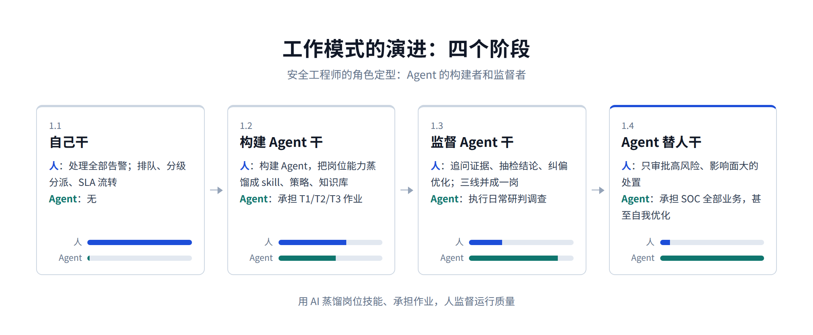
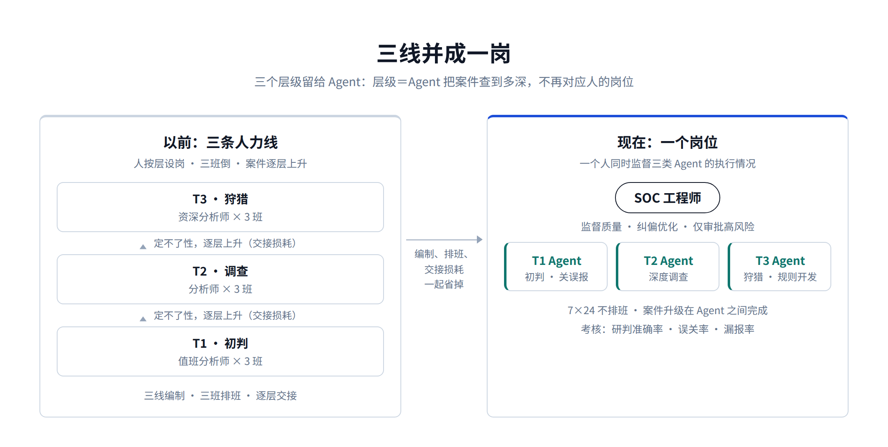
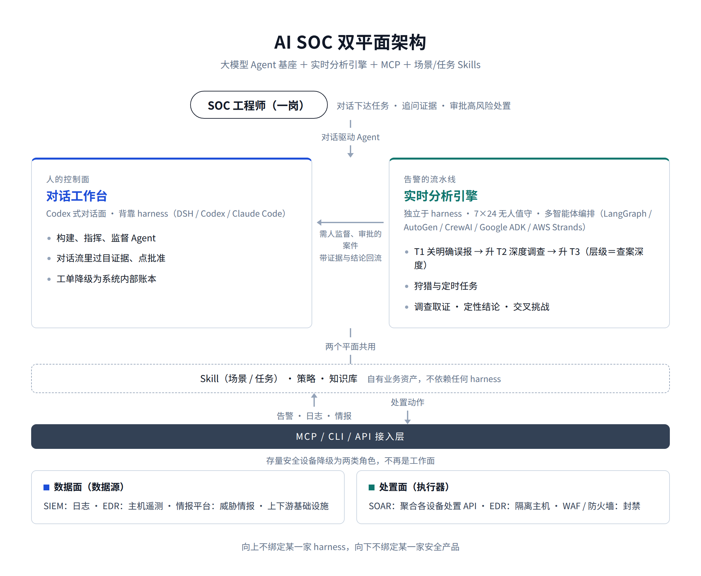

# 下一代 AI SOC 长什么样：SOC 版的 Codex

[中文](../zh/01-ai-soc.md) | [English](../en/01-ai-soc.md) | [Article index](../README.md) | [Profile](../../README.md)

> **作者简介**：Max Luo（罗棋琛），Teloa 创始人，专注 AI Agent 工程与产品开发、AI Native Security。现任某全球头部加密货币交易所 AI 安全工程团队负责人，拥有 13 年以上网络安全经验，曾负责 SHEIN 全球应用安全、AI 安全中台、安全 BP 与红队等职能。开源书籍《AISecOps：AI 驱动的安全体系》作者。
>
> 微信公众号：白帽子罗棋琛 ｜ GitHub：cybermaxluo ｜ LinkedIn：max-luo ｜ Email：186616@gmail.com

最近我一直在思考一个问题：下一代 AI SOC 到底长什么样？

市面上的答案不少：有人在老平台上加聊天框，有人在做"AI 分析师"，也有人在做多 Agent 编排。

而我基于实践和行业趋势判断得到的答案是 SOC 版的 Codex：一个对话驱动的安全工作台。

这几年我一直在一线做 AI for Security工程，工具形态从最早的 LangChain，到 Dify，再到 OpenClaw/Hermes，一路换到现在的 Codex/Claude Code/DSH，架构换了一轮又一轮。沉淀归纳得到了两条主线的判断逻辑：

**一条是工作模式的演进：自己干 → 构建 Agent 干 → 监督 Agent 干 → Agent 替人干。**

**一条是战略路线的演进：基础大模型公司的高速迭代是最大的红利，背靠 LLM 大厂的 harness，深度参与其生态。**

先统一一个叫法。DSH（DeepSeek Harness）、Codex、Claude Code 这类产品，行业里统称 Agent Harness（驾驭层，构建这层的工作业内称 Harness Engineering，驾驭工程）：模型厂把大模型包装成"能干活的 Agent"的那层运行时加客户端，会话管理、工具调用、MCP 接入、Skill 机制、权限审批都在这层。其中 Codex、Claude Code 从 AI 编码工具起家，靠 MCP、Skill、子代理这些机制泛化成了通用 Agent 运行时。大模型是大脑，harness 是身体加操作台。下文说的 harness 指的都是这类。

## 1、主线一：工作模式的演进

### 1.1 自己干

上一代 SOC 是"自己干"的模式：告警比人多，所以要排队；人的水平有差异，所以要分级分派：T1 初判、T2 调查、T3 狩猎；怕漏单，所以要 SLA、要流转、要升级。

把这些放在一起看：工单系统的本质是一套人力调度系统，管理的是人的注意力和产能。SIEM 的告警队列、SOAR 的剧本、ITSM 的流转，全部建立在同一个假设上：活是人干的，而人不够用。

整个上一代安全运营体系，都是围绕"人力稀缺"这个约束设计的。

现在，这套体系的对手变了：攻防已经演进成 AI 对抗 AI。攻击方先用上了 AI：侦察自动化，钓鱼由模型批量生成，利用链由 Agent 编排，攻击的速度和规模是机器级的。

2025 年 11 月，Anthropic 披露了首例由 AI 主导的网络间谍行动：攻击者越狱 Claude Code，对全球约 30 家机构发起入侵，八到九成的攻击动作由 AI 自主执行，攻击者只在几个关键节点拍板。漏洞挖掘这一侧走得更深，2026 年 Anthropic 的 Mythos 模型已经能在主流操作系统和浏览器里自主挖出0day，给一个 CVE 编号和对应的代码提交，几小时内就能产出可用的利用代码。

防守方还停在人力研判加工单流转，速度是人的量级。这个速度差之下，人力为主的工单模式已经不只是效率问题，是被攻击方降维打击的问题。

### 1.2 构建 Agent 干

现在，Agent 已经能承担这些基础的安全运营工作。用 Codex + MCP + Skills，T1 研判、T2 调查、T3 狩猎和规则开发都能胜任，不用排队，也不受工作时间限制。

于是安全工程师的工作重心发生第一次转移：从自己处理告警，变成构建 AI Agent、把它深度嵌入业务流程。

把研判的判据写成 skill，把处置的边界写成策略，把数据源接成 MCP，把经验沉淀进知识库。这个阶段的本质是蒸馏：把 T1/T2/T3 的岗位能力蒸馏进 Agent，把人的经验、直觉和判断蒸馏成 skill、策略和知识库。

以前这些能力长在人身上，跟着人走、随着人流失；蒸馏进系统之后，它可复制、可优化、可传承，运营能力沉淀在组织，而不是某个人身上。

传统平台改一个流程要立项、排期、开发、测试、上线；改一个 skill 半天就能上线，临时需求、定制化需求当天可支持。

### 1.3 监督 Agent 干

Agent 嵌入业务流程之后，重心发生第二次转移：人不再直接执行，转为监督 Agent 的执行。

安全工程师的日常变成：追问证据、抽检结论、纠偏误判、持续优化 skill 和知识库，用 Agent 的工作质量数据反过来迭代 Agent。考核指标也随之变化：从处理了多少单，变成研判准确率、误关率、漏报率。

组织结构也跟着变：三线并成一岗。

以前 T1/T2/T3 是三条人力线：初判的、调查的、狩猎的，人按层设岗，案件逐层上升。现在这三个层级留给了 Agent：T1 定不了性升 T2，T2 定不了性升 T3，指的是 Agent 把案件查到多深，不再对应人的岗位。人这边只需要一个岗位：SOC 工程师，一个人同时监督三类 Agent 的执行情况。

三线的编制、三班的排班、逐层上升的交接损耗，一起省掉，这是最直接的降本增效。

### 1.4 Agent 替人干

最后一步，Agent 承担 SOC 的全部业务：响应、研判、调查、处置、检测规则开发优化、数据对接、定时任务、分析报告、知识沉淀，甚至是自我优化迭代。

人只保留一件事：审批高风险、影响面大的处置动作，例如隔离主机、禁用账号、封禁 IP、删除文件。低风险按策略自动执行，高风险必须人来批：隔离错一台核心服务器、禁错一个高管账号，代价远大于自动化省下的那几分钟，这条审批线保留给人。

四个阶段走完，安全工程师的角色定型：Agent 的构建者和监督者，这个角色定位不局限于SOC团队，也适用于其他安全岗位。

## 2、对话取代工单

"自己干"的界面是工单队列，因为要排队、分派、流转；构建和监督 Agent 的自然界面是对话。

下达任务是一句话，追问调查进展也是一句话；"把这台机器 30 天内的同类告警拉出来对比"，还是一句话。审批也不用切界面，在对话流里过目证据、点一下批准。

工单不会彻底消失，但它降级成系统内部的账本：案件记录、证据链、审计轨迹，不再是人的工作界面。

所以 AI SOC 的终态是：整个 SOC 团队甚至是整个安全团队的工作在一个 Codex 式的集中化工作台上，以对话驱动Agent，取代以工单驱动案件。

这背后还有一条设计原则：整个架构的第一用户是 Agent，不是人。数据、接口、能力，全部按方便 Agent 使用、调度、操作来设计，人不直接操作系统，人指挥 Agent 操作系统。想清楚这一点，交互层的取舍就简单了：不需要酷炫的人机交互设计，也不需要传统 SOC 标配的态势大盘，那些是给"人自己盯系统"的时代设计的，跟工单是同一代产物。人真正需要的界面只有两个：对 Agent 说话的输入框，和看证据、批动作的对话流。

### 2.1 还需要一个实时分析引擎

每天上万条的告警，不可能每条开一个会话去处理：harness 是会话式的，要人发起、要人跟进，不适合海量流水线。所以体系里还需要一个独立于对话控制面的实时分析引擎：用主流的多智能体编排框架（如开源社区的 LangGraph、AutoGen、CrewAI，云厂商的 Google ADK、AWS Strands Agents等），按告警类型编排研判流程，多智能体协作研判：调查取证、定性结论、交叉挑战，7×24 无人值守地跑。

这个引擎不只做 T1。第 1 节说的三层研判都跑在它里面：T1 先把明确误报按策略关掉，定不了性的升 T2 深度调查，再定不了性的升 T3，狩猎和定时任务也由它承载。三层跑完，需要人监督、审批的案件才带着证据和结论回流到对话工作台，人处理的还是同一个对话面。

对话面是人的控制台，分析引擎是告警的流水线；前者背靠 harness，后者是自有业务资产，不依赖任何 harness。

整个平台完整的架构是：

**AI SOC = 大模型 Agent 基座（Codex 式对话面）+ 实时分析引擎（T1/T2/T3 自治研判，独立于 harness）+ MCP（安全设备 + 上下游数据）+ 场景/任务 Skills**

基座提供智能和人机交互，分析引擎消化海量告警，MCP 接入安全设备和数据，Skill 承载 SOC 的场景知识和业务流程。两个平面共用同一套 Skill、策略和知识库。

这个架构对存量安全建设还有一层含义：所有安全平台、设备、上下游基础设施，在这里都降级成数据面和处置面两类角色。SIEM 是日志数据源，SOAR 是聚合各设备处置 API 的执行通道，EDR 是主机数据源加隔离执行器，WAF 和防火墙是封禁执行器，情报平台是数据源，全部通过 MCP/CLI/API 接入。它们自带的控制台、平台功能、工作流，不再是 SOC 的工作面。

对甲方来说，以前研判规则、响应剧本、运营流程都长在厂商平台里，换一家等于推倒重来，安全建设很容易被绑定在某一家的产品和生态里；现在研判逻辑在 skill 里，处置策略在自己的策略层，经验在自己的知识库里，设备换哪家，只是换一套 MCP/CLI/API 接入。向上不绑定某一家 harness，向下不绑定某一家安全产品，大脑始终在自己手里。

## 3、主线二：背靠 LLM 大厂的 harness

回顾这几年 AI for Security 的工具形态，已经换了四代，这四代我都在业务里实际用过，每一代都踩着 LLM 能力的一次跃升：

第一代，纯文本 Chatbot 辅助分析。把告警、日志贴进对话框让模型帮着分析，人问一句它答一句。

第二代，工作流加 RAG。用 Dify、LangChain 把分析过程编排成工作流，接上知识库和多种数据源，能做多模态分析。但每一步都是人预先编排好的，模型只在节点里干活。

第三代，自主 Agent 框架。OpenClaw、Hermes 这类第三方 harness，模型开始自主规划任务、带记忆、多步执行，不再依赖人预设流程。

第四代，大模型厂自家的 Agent 客户端。Codex、Claude Code，能力反超全部第三方框架，并且随大模型一起进化。

四代看下来有一个规律：主工作面每一代都被下一代替代，而第四代的推动者是基础大模型公司自己。这也是我们没选 OpenClaw 这类第三方 Agent 框架的原因：第三代拼的是对模型的理解和适配速度，而第四代的作者就是模型的作者，第三方没有胜算。而且大模型公司自己也在往业务端走：组建 FDE（Forward Deployed Engineer，驻场交付工程师）团队、成立咨询部门，直接帮传统企业做智能化落地。夹在大模型和业务中间赚差价的空间，只会越来越小。OpenClaw 的能力已经不如 Codex 和 Claude Code，就是信号。

被替代的只是"主工作面"的位置，技术本身没有消失，而是沉到了各自合适的层：第二代、第三代的编排和多智能体技术，今天正好用在实时分析引擎的流水线里（第 2 节说的 LangGraph 那一层）；第四代成为人的工作台。

顺着这个趋势往下推，我的行业判断是：LLM 公司会把中间层全部收走，AGI 到来之前，第三方的生存空间只在业务层。

对做业务层的人来说，这个趋势是顺风：与其开发一个传统的应用平台，不如背靠 LLM 大厂的 harness，深度参与其生态，基于其基座和扩展机制去开发。

基础大模型公司每进步一步，AI SOC 跟着受益一步：模型更强，研判更准；harness 加了新能力，直接复用。它们的迭代速度变成我们的速度，而不是我们的压力。

这也决定了工程投入的取舍：开发投入集中在大模型不会替我们做的 SOC 业务层，即研判的判据、处置的边界、审批的治理、知识的沉淀；智能和平台能力交给生态。

选型上用开源基座：开源的 Codex、开源的 DeepSeek Harness。可控、可自托管，这对安全场景是硬要求。

## 4、跑通闭环，定好边界，引擎解耦

背靠也有背靠的风险：harness 本身可能被淘汰，可能被大模型厂自己的新产品替代，也可能停止维护。解法是架构设计之初就要解耦。具体是三件事。

第一件事，跑通闭环。比如基于 DeepSeek Harness 做 MVP，验证完整的业务链条：告警接入、多智能体研判、确定性策略判定、高风险审批、处置执行、全程审计，一条链跑通。上线路径走影子模式：Agent 先只出结论不执行，跟分析师的实际处理结果对照，拿误关率、漏报率的数据说话，再逐类放开自治范围。自治的开关由客观数据打开，不由个人的一腔热血打开。

第二件事，定好边界。业务解耦从最初就要设计好，构建期就定好约束：案件、证据、审批、审计全部落在自己的数据库里，业务接口不依赖 harness 的任何私有机制，界面只跟自己的 API 通信。这条边界定好，需要升级架构、更换引擎时，只是换一个适配器；定不好就是将来要还的迁移成本。

第三件事，引擎解耦。引擎其实分三层，替换成本完全不同：模型层本来就该多家路由，随时可换；Agent 运行时层（DSH、Codex、Claude 各自的 agent 机制）接口互不兼容，换一次要重写适配器；交互层跟 harness 耦合最深，换引擎基本等于重做。所以架构上要在各家 harness 的接口之上再抽象一层：适配器接口按自己的业务语义来定义，而不是照搬某一家的 API 设计，否则名义上可换、实际上换不动。

还有一层兜底：这套体系里真正核心的东西，策略判定、审批治理、审计、知识库、实时分析引擎，本来就都在 harness 之外。无论引擎换到谁家，这些资产永远在自己手里。

## 5、总结

把两条主线各收成一句话。

工作模式上：自己干 → 构建 Agent 干 → 监督 Agent 干 → Agent 替人干。安全工程师的重点工作，是构建 Agent 深度嵌入业务流程，然后监督工作质量、持续优化，只在高风险处置上保留审批权。

战略上：背靠 LLM 大厂的 harness、深度参与它的生态，大模型的高速迭代是业务智能化过程中最大的红利。

再说说这对安全工程师个人意味着什么。处理告警的技能在贬值，构建和监督 Agent 的技能已经成为招聘市场的核心竞争力，还在持续升值。今天写在你脑子里的研判经验，只在你值班的八小时起作用；写成 skill 之后，它 7×24 起作用。这件事不用等平台、等立项，现在用 Codex 加几个 MCP 就能开始：把自己最熟的那类告警的研判思路，写成第一个 skill。

AGI 到来之前，整个行业处在一个中间态，分工正在变清楚：基础大模型公司做智能，顺手收走中间层；harness、通用 Agent 这类中间层公司的空间持续收缩；留给安全厂商和企业安全团队的，是基础大模型公司做不了的业务层——场景知识、企业数据、处置的责任和信任。这三样东西不随模型能力增长而贬值：模型再强，也不知道你的核心资产是哪台服务器、你的误报长什么样、出了事谁来签字。

窗口期该做什么也就清楚了：智能交给大模型，中间层不碰，专心把自己的场景、经验和数据蒸馏成 Skill。

窗口有多长没人知道，但对人的影响已经看得清。ChatGPT 刚出来的时候，大家说 AI 会淘汰不会用 AI 的人；放到今天安全从业者的语境里，这句话要更新了：AI 会淘汰不会构建 AI Agent 的人。因为行业已经进入标准化作业的阶段，不再是用 AI 辅助人提效，而是用 AI 蒸馏岗位技能、承担作业，人监督它的运行质量。

下一篇把同一套变化放进软件生产现场：《最后一代应用安全工程师的自白》。

以上是我过去一年在 AI for Security 方向上的一些思考，欢迎关注我的公众号，加入我们的微信群一起交流。

---

[Next](./02-appsec.md)
