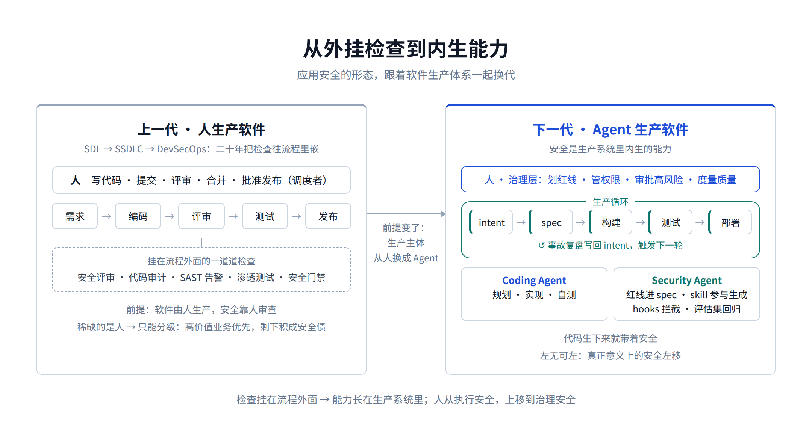
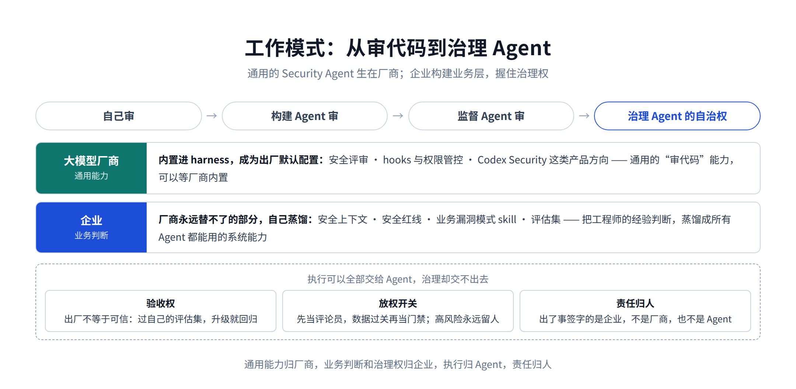
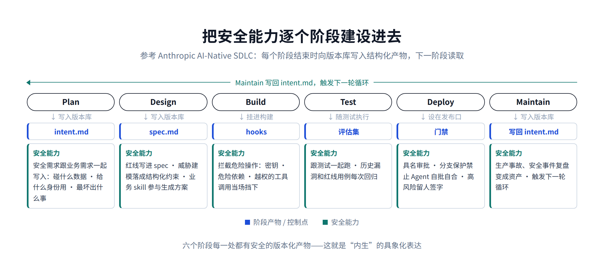
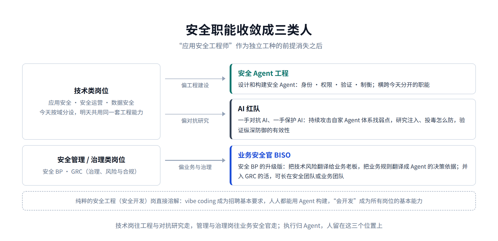

# 最后一代应用安全工程师的自白

[中文](../zh/02-appsec.md) | [English](../en/02-appsec.md) | [Article index](../README.md) | [Profile](../../README.md)

> **作者简介**：Max Luo（罗棋琛），Teloa 创始人，专注 AI Agent 工程与产品开发、AI Native Security。现任某全球头部加密货币交易所 AI 安全工程团队负责人，拥有 13 年以上网络安全经验，曾负责 SHEIN 全球应用安全、AI 安全中台、安全 BP 与红队等职能。开源书籍《AISecOps：AI 驱动的安全体系》作者。
>
> 公众号：白帽子罗棋琛 ｜ GitHub：cybermaxluo

标题里的"最后一代"，不是说人要失业，是"应用安全工程师"这个岗位形态，到我们这一代为止。我自己做了多年应用安全体系建设，SDL、DevSecOps、安全 BP 这套体系在真实业务里一层层落地实践过，去年还把它写成了一篇《互联网跨境企业应用安全架构指南》，从业务需求层一直写到运营服务层。这篇算自白，也算判断：要宣布走到头的，正是我自己践行多年、去年刚写完的那套体系。

上一篇《下一代 AI SOC 长什么样：SOC 版的 Codex》讲的是安全运营：对话取代工单，三线并成一岗，Agent 承担研判，人保留高风险审批。这一篇讲研发侧的同一场变化。

出发点还是同一个判断：软件生产的主体，正在从人变成 Agent。对应用安全（AppSec）来说，这个变化动的不是安全团队自己的工具，而是安全所依附的对象，也就是整个软件生产体系。地基动了，上面的房子要跟着动。

结论不卖关子：下一代应用安全不再是研发流程外面的一道道检查，而是软件生产系统里内生的安全能力。Security Agent 和 Coding Agent 一起跑在生产循环里，人从执行安全上移到治理安全：划定红线、管理权限、审批高风险、度量质量。

这场变化是有传导顺序的：生产体系先变，协作流程跟着变，然后依次传导到安全的工作模式和组织架构，存量工具的命运随之而定。下文就按这个顺序展开，最后讲应用安全从业者当下该做什么、未来往哪走。

## 1、上一代应用安全是围绕"人生产软件"设计的

把应用安全的日常拆开看：安全评审要开会，代码审计要排期，SAST 告警要人确认，漏洞要提单、催修、复测，研发侧要设安全接口人、做安全培训，上线前要过安全门禁。这些制度长相各异，可都默认了同一个前提：软件由人生产，安全靠人审查。从微软的 SDL 到 SSDLC 再到 DevSecOps，二十年其实都在把安全往"人生产软件"的流程里嵌。

再往下拆一层，CI/CD 也是在"人生产软件"这个前提上做提效，属于旧架构的正常演进。Commit、Branch、PR、Approval，这套词汇诞生在人类协同开发的年代：人写代码，人提交，人评审，人合并，人批准发布。机器执行了很多步骤，但整个系统的调度者始终是人。DevSecOps 把能规则化的检查塞进了流水线，发现高危就阻断，发现密钥就拦截，可它自动化的是动作，不是判断。这个接口该不该有这个权限、这次改动有没有破坏租户隔离，还是要找人。

归根结底，稀缺的是人。安全专家就那么几个，一天审不了几个系统，招人也追不上研发的产出速度，于是只能分级：高价值的业务优先投入、认真审，其余扫描器兜底，剩下的只能先欠着，积成安全债。这套设计跟它的年代是配套的：软件由人生产，安全就只能围绕人来做。现在变的，正是这个前提。

## 2、生产体系之变：流水线让位于生产循环

一个工程师可以同时驱动几个 Coding Agent 并行开发，代码产量不再受人的编码速度限制。Anthropic 公开过一个数字：截至 2026 年 5 月，合入他们自家代码库的代码，超过八成由 Claude 编写，合入前仍要过评审门禁。

于是一个新的速度差出现了：生产是机器级的，审查是人力级的。继续逐行人审，等于用人的速度给机器的速度设上限，结局要么是安全成为交付瓶颈被绕过去，要么是评审流于形式。出路不是取消人审，是换掉人审的对象和粒度：人不再看每一行代码，看红线、看证据、看高风险结论，后文工作模式一节展开。

跟不上的不只是评审，还有流水线的形态本身。流水线是预先画好的路径：Commit 之后构建，构建之后测试，A 完成后执行 B。Agent 拿到的是一个目标，比如"实现退款功能"，它会自己规划、并行尝试几种方案、测试、比较、推倒重来。流水线回答的是"下一步固定做什么"，Agent 回答的是"按当前状态，下一步该做什么"。

但 CI/CD 不会消失。Agent 擅长理解、规划、判断，流水线擅长确定性执行：构建、测试、签名、门禁、部署，这些恰恰必须可重复、可审计。合理的分工是 Agent 当大脑，CI/CD 当手脚，策略引擎当缰绳，Git 和证据库当账本。CI/CD 从"人的发布流程"，下沉为"Agent 的确定性执行底座"。

这套新的生产形态不是推演，已经有了成体系的样板。还是 Anthropic，他们发布的 AI-Native SDLC 实践指南把软件生产重排成 Plan、Design、Build、Test、Deploy、Maintain 六个阶段，整份指南贯穿一条主线：每个阶段结束时，向版本库写入一个结构化产物，下一个阶段读取它。需求写成 intent.md，设计落成 spec.md，实施方案是 plan.md，然后是代码、带评审结论的 PR，生产事故的记录最后又写回 intent.md，触发新一轮循环。协作的载体从会议、工单和口头同步，变成 Git 里的一条产物链；提交链本身就是审计记录，谁提了需求、Agent 产出了什么、谁批准的，全在版本历史里。它的出发点也直白：代码已经不是瓶颈，瓶颈挪到了代码左右两边，规划、评审、部署这些环节还跑在人的速度上。

把这几层放在一起：传统应用安全不是被 AI 优化了，是走到头了。它今天还有需求、还有价值，是因为大多数组织的 DevOps 和 CI/CD 还是旧的生产体系，安全只能跟着在旧模式上修修补补。生产体系换代到哪一步，旧模式的价值就消解到哪一步。这个换代不会齐步走：AI 原生公司和头部互联网两三年内就会走完，多数科技公司要五年，金融和政企可能十年；而且大厂里大量存量系统不会进入新循环，新旧双轨并行不是过渡期，是未来很多年的常态。所以接下来的每一分投入都要想清楚：是在给旧体系续命，还是在给新体系建地基。

这个判断对安全厂商同样成立，但要说准范围：压力最大的，是以检测能力为卖点的业务，通用的检测和修复能力在向 harness 集中，以人工工作台为核心的产品形态会越来越难卖；以合规背书为卖点的业务要稳得多：测评报告、第三方出具的检测证明，企业买的是资质和责任背书，harness 替代不了。而厂商新的结构性机会，就藏在同一场变化里：harness 内置的安全评审，本质是厂商在检查自己生产体系的输出，市场迟早需要独立的第三方来做验证——财报不能自己审自己，所以有了四大。跨 harness 的独立验证、统一评估和审计，就是一门天然的第三方生意。给 Agent 当数据源和执行器是过渡期的角色，做独立裁判才能长期立足。

## 3、协作流程之变：人靠工具协作，Agent 靠状态协作

Jira、PR、评审会、周会，这些东西存在的理由是人和人之间需要传递信息、对齐状态。Agent 之间不再主要靠提单和排期，它们通过共享的上下文、状态、证据和策略直接协作。安全和研发之间那堵墙，你提单我排期、你催修我复测，会先于组织架构消失。

安全在生产循环里的位置也跟着变。过去安全是流水线里的一个环节，代码写完才轮到它出场；以后它是常驻生产循环的一个角色：设计变了自动重做威胁建模，权限变了自动重查授权边界，依赖变了自动重查供应链。有意思的是，做了十几年的安全左移（Shift Left），反而是在这一步做成了：以前的左移，移的是检查和培训，无论怎么左移，安全还是研发之外的一道工序；现在红线写进 spec，安全 skill 直接参与生成代码，代码生下来就带着安全，左移一路移到了生成本身。这才是真正意义上的安全左移——左无可左，安全不再分左右，而是内生（Secure by design）。

Anthropic 这份指南值得每个应用安全团队仔细研读，因为它大概率就是下一代软件生产体系的雏形，而它给安全的方向指引就藏在这条产物链里：安全策略编码成 skill，在设计阶段就参与生成 spec；hooks 在构建阶段拦截危险操作；部署门禁要求具名审批，分支保护禁止 Agent 给自己放行；运维阶段的 Agent 只能在预授权的分级里行动。照这个形态推演，安全的输入输出也必须变成链上的版本化产物：红线进 spec，上下文供 Agent 读取，评审产出结构化证据，漏洞复盘的教训写回 intent.md、约束下一轮生成。安全不把自己的交付物改造成这个形态，就接不进下一代生产体系：还写在会议纪要和工单里的安全要求，从 Agent 的视角看起来太低效，远跟不上机器速度。

## 4、工作模式之变：从审代码到治理 Agent

应用安全的工作模式，跟所有业务一样会沿着通用路径走：自己审 → 构建 Agent 审 → 监督 Agent 审 → 治理 Agent 的自治权。特殊的地方在第二、三段：通用的 Security Agent，最早不是甲方或乙方企业构建出来的，而是大模型厂商先构建出来的。

厂商自己既是大规模的 AI Coding 使用方，也是软件生产体系变革方，必然最早遇到 AI 代码安全问题。八成代码由模型生成，"谁来审 Agent 写的代码"这个问题，他们必须最先回答。所以这类能力最早从厂商长出来，然后直接内置进 harness：Claude Code 自带安全评审，hooks 和权限管控是出厂能力；OpenAI 把 Codex Security 立成产品方向，定位就是理解整个代码库上下文、发现复杂漏洞、给出高置信修复。通用的"审代码"能力，会成为生产工具的默认配置。

企业要构建和监督的，是厂商永远替不了的那部分：你的红线、你的上下文、你家业务的漏洞模式、你的评估集。通用能力可以等厂商内置，业务判断得自己蒸馏。国内还有一层现实：受数据安全和合规约束，很多企业用不了境外 harness，走的是私有化模型加自研或国产 harness 的路线，内置的安全评审能力可能要弱上一到两代。分工的方向不变，但"等厂商"的那部分，国内团队短期要自己多补一块通用能力，这部分要提前规划。

### 4.1 构建 Agent 审：蒸馏的是业务判断

harness 出厂就会审 SQL 注入这类通用漏洞，审不出来的是你的业务：谁能看谁的订单，哪笔资金状态不可逆，哪些身份不能组合。所以企业要构建的不是 Agent 本体，是喂给 Agent 的业务判断。以前发现一个越权漏洞：提单、修复、关闭，经验留在发现它的那个人脑子里。现在的做法是：修完之后提炼漏洞模式，写成 skill，生成对应测试，加进评估集，让 Agent 回扫历史代码，后续的 Coding Agent 自动避免同类写法。一个高级工程师的价值，从"我发现了一百个漏洞"，变成"我把二十类业务漏洞变成了组织自动预防、发现、修复的能力"。这就是蒸馏：把工程师的经验判断，蒸馏成所有 Agent 都能用的系统能力。

### 4.2 从找漏洞到制定安全红线

Agent 写代码之后，安全要求的表达方式也要上移。"不能有 SQL 注入"是漏洞规则；"用户 A 永远不能读到用户 B 的订单""任何单一身份不能同时完成资金审批和执行"是安全红线（国外文献叫 Security Invariant）。Agent 的实现可以有无数种，人管不住每一种写法，管得住的是无论怎么实现都不许越过的线。红线落地，贯穿事前、事中、事后：事前，红线写进 spec，让所有 Agent 看得见，高风险域再用架构约束兜底，租户隔离、统一授权这些事不指望模型自觉；事中，策略引擎和 hooks 实时拦截，越线的操作当场挡下；事后，Security Agent 持续审计，找违例、做溯源。审计只能发现违规，保证不了不违规，所以核心的保障在事前。

### 4.3 监督 Agent 审：人看风险，Agent 看代码

人不再逐行看代码，改为抽检结论、纠偏误判，用质量数据去迭代 skill 和知识库；注意力上移到业务意图、权限变化、信任边界和最大损失上。

### 4.4 治理自治权：内置的能力也要独立验证

治理的对象一共三层：生产软件的那群 Agent，写代码的、做测试的、发部署的；内置在 harness 里的安全能力本身；还有承载它们的运行时，身份、凭据、工具、MCP。这三层都要纳入应用安全的治理范围。

不能让写代码的 Agent 自己批准自己上线。开发、测试、运维的职责分离是上一代的制度设计；生成 Agent、验证 Agent、审批主体的分离是这一代的。这一代还多了个新难点：生成方和验证方如果跑在同一个模型家族上，盲区是相关的，一边看不见的东西另一边多半也看不见。缓解要靠异构模型：让不同家族的模型交叉挑战、互相裁决，或者多模型独立研判再汇总。但提示词注入防御得靠确定性检查和架构约束。所以身份、权限、资金、多租户这些高风险域，多模型交叉挑战验证和确定性检查都要配上，最后一道审批留给人。

对厂商内置的能力，原则是出厂不等于可信。harness 自带的安全评审，本质是厂商在检查自己生产体系的输出，运动员不能兼裁判，验收方只能是企业：先过你自己的评估集，之后每次模型升级、能力更新，都拿历史漏洞和业务红线回归一遍，数据合格才放权。企业可以不构建通用能力，但验收权和放权的开关必须在自己手里。

所以执行可以全部交给 Agent，治理却交不出去：出了事签字的是企业，不是模型厂商，也不是 Agent。正因为签字的是你，红线才必须你来划，验收才必须你来做，放权的开关才必须握在你手里——治理，就是责任落到工程上的样子。

### 4.5 每块业务都在换形态

把应用安全的业务一块块过，没有一块能保持原样。而且每块变出来的分工都一样：通用的检测、验证、修复能力，越来越多由 harness 和安全工具原生提供；企业的角色是喂上下文、划红线、补业务漏洞模式，然后盯质量。

威胁建模，以前是立项时开一次评审会、画一次数据流图，之后架构改了也很少有人重画；以后设计一变，Agent 自动重建模型、重查信任边界，威胁建模从一次性活动变成持续状态，自动重建模的质量，取决于你喂的上下文和红线。

安全评审，以前评的是方案文档，质量取决于到场专家的经验；以后评审的输入是红线加上下文，常规校验自动完成，专家只出现在高风险的架构决策上。

代码审计，以前扫描器能做周期全量、发版增量的扫描，但误报噪音大，业务逻辑类漏洞看不见；人看得懂业务，却只能覆盖少数高价值业务。以后 Agent 两头都占：全量审，通用漏洞靠 harness 出厂的评审能力，业务漏洞靠自家蒸馏的 skill，人工只复核高风险结论。

工具运营，SAST/SCA 告警以前人工确认、提单、催修；以后 Agent 去重、验证、能复现的给出利用证据，能修的直接产出补丁交给验证 Agent，人看的是结论和质量数据。

渗透测试，以前一年一两轮、靠外包和红队排期；以后攻击型 Agent 常态化跑，重要变更都可以打一轮。

漏洞管理，工单流转降级成账本，修复在 Agent 之间闭环，人管理的是逃逸率和错误放行率；没人天天盯工单了，但记录反而要比以前更全，出了事定责、做合规审计，还要从账本取证。

## 5、组织架构之变：从评审团队到治理团队

团队定位从安全评审团队，变成安全能力工程团队。工程的对象不是再建一个安全平台，而是要提供给所有 Agent 的业务资产：上下文、红线、skill、评估集。KPI 也得重新制定：发现多少漏洞、关闭多少工单、评审了多少项目，度量的是人的产出；能力覆盖率、自治率、人工介入率、历史漏洞转化成 skill 和评估集的比例、高风险错误放行率，这些核心指标度量的是系统的能力。旧指标不换，团队一定被锁在旧模式里无法交付有效价值。

安全接口人的定位也变了。国内叫接口人或安全 BP，欧美叫 Security Champion，本质都是在研发团队里放一个懂点安全的人。"这个漏洞怎么修"这类问题 Agent 答得比人快，这个角色的价值不再是传播安全知识，而是维护本业务域的安全意图：支付团队的接口人负责说清楚哪些资金状态不可逆、什么操作必须双重授权、什么身份不能组合，然后让 Agent 去执行。

再往未来进一步推导：当安全 skill、红线、hooks 都内置进 Coding Agent 的默认行为，写代码的同时就把安全问题消化掉了，今天这种守在流程边上的应用安全团队可能就不存在了。不是安全没人管，是"审应用的人"这个形态消失了。留下来的活只有两类：一类是生产安全能力，红线、skill、评估集，喂给所有 Agent 用；一类是治理生产软件的 Agent 体系，身份、权限、验证、责任。岗位的名字大概也会跟着换：应用安全工程师，可能会变成 Agent 应用安全工程师或者 Agent 安全架构师，保护的对象从应用，换成了生产应用的 Agent。

而且保护对象不会停在"生产应用的 Agent"上，应用本身也在 Agent 化：未来研发交付的，很多就是一个个业务 Agent，接客服的、审额度的、调库存的。给这些业务 Agent 做安全架构和安全设计，会成为这个岗位最核心的技术工作：身份怎么发、权限怎么划、工具和数据的边界在哪、Agent 之间的调用怎么受控、出错时怎么止损。代码层的安全问题在生产循环里被内生消化，人的关注点整体再上移一层：从审代码，变成设计安全架构、审核设计和设计跑出来的结果。上一代工程师值钱在看得懂代码里的漏洞，下一代值钱在设计得出让 Agent 越不了界的权限架构。

## 6、工具平台之变：沉下去的，和长出来的

SAST、SCA、DAST、Secrets、IaC 都不消失，但下沉分两步，路径也各不相同。过渡阶段，它们从安全工程师每天登录的平台，降级为 Agent 的数据源和执行器：Agent 通过 API 调用扫描、读取结果、驱动处置，工具自带的控制台和工作流不再是工作面。生产体系换代完成后，再往下走一步：理解和判断类的能力，SAST 的语义检测、代码评审、渗透的攻击逻辑，会被 harness 的内生安全能力吸收，作为独立产品的意义随之消失；必须确定性的部分，密钥检测、依赖清单、IaC 策略校验、签名和门禁，以 hooks 和策略的形态长进流水线，成为执行底座的一部分。以人工控制台和告警运营为核心的平台形态，会就此衰落。

沉下去之后，上面长出属于企业自己的一层安全资产：安全上下文（这个服务是谁的、暴不暴露在互联网、涉不涉及资金、历史上出过什么安全事件，Agent 的判断质量取决于它知道多少，而不只是模型多强）、安全红线、安全 skill、评估集、Agent 的身份与权限、风险策略。上下文的价值，一个场景就能看清：同样一个 PR，没有上下文的 Agent 看到的是三百行改动；有上下文的 Agent 知道这是支付系统的退款接口，互联网可达，涉及资金，调用方是商户身份，这个模块历史上出过越权漏洞。两种输入，研判质量差一个量级。

这层资产的载体不是某个安全平台，就是版本库本身：红线是 spec 里的约束，skill 和评估集是仓库里的文件，跟代码一起提交、一起回滚、一起审计。模型会换，harness 会换，这层资产沉淀在企业内部。这里有个分类前提：把"源"和"编译产物"分开管。漏洞模式的描述、历史案例、评估用例是源，不挑形态；写成某家 skill、hooks 的具体文件是编译产物，跟着 harness 走。源在自己手里，换 harness 只是重新编译一遍。

应用安全还要重点保障的，是生产软件的系统本身。攻击者控制了 Coding Agent——提示词注入、投毒依赖、污染上下文、恶意 MCP、恶意 skill——就不需要直接攻击生产系统，他攻击的是"生产生产系统的系统"。Agent 的身份、权限、记忆、工具、凭据，都是新的攻击面，也都要纳入保护范围。harness 和模型的供应链本身也得算上：能力越是集中到厂商，厂商一旦被攻破，波及面就越大，这也是高风险域要保留多厂商模型验证和确定性兜底的另一个理由。其中最容易被忽略的两处：一是验证环节本身可以被注入，Security Agent 读的代码、注释、依赖包的 README 全是攻击者可控的输入，专门骗验证 Agent 放行的 payload 一定会出现；二是安全资产进了版本库之后，仓库写权限就等于安全策略写权限，被注入的 Coding Agent 可以顺手把红线改宽、把评估集污染掉。所以策略变更的权限必须严于代码变更：红线和评估集走独立的保护路径，改它们必须过人审。

## 7、当下该做什么

生产体系什么时候换代、先换哪条业务线，是研发的决策，安全定不了。安全能定的是三件事：换代前储备什么，换代时建设什么，全程怎么放权。

换代前能做的，是储备。上下文的图谱、结构化的安全知识、用历史漏洞和红队案例建的评估集，这三样不挑体系形态，储备得越早，换代时手里的资产就越多。存量工具顺手 API 化，过渡期还要靠它们当数据源和执行器。每样东西动手前先想一想：两年后用它的主要是 Agent 不是人，它有 API 吗，证据结构化吗，机器身份接得进来吗。

换代时，从第一天起就和研发一起搭新体系、推动架构演进，参考 Anthropic 的最佳实践，把安全能力逐个阶段建设进去。

1. Plan 阶段，安全需求跟业务需求一起写进 intent.md：这个功能碰什么数据、给什么身份用、最坏能出什么事，从源头就是需求的一部分。
2. Design 阶段，红线写进 spec.md，威胁建模的结论落成结构化约束，业务 skill 参与生成方案，让 Agent 在设计时就知道什么不能做。
3. Build 阶段，hooks 拦截危险操作，密钥、危险依赖、越权的工具调用当场挡下。
4. Test 阶段，评估集跟着测试一起跑，历史漏洞和红线用例每次回归。
5. Deploy 阶段，门禁要求具名审批，分支保护禁止 Agent 自批自合，高风险变更留人签字。
6. Maintain 阶段，生产事故、安全事件的分析写回 intent.md，触发下一轮循环，复盘变成资产。

建设完这一圈，六个阶段每一处都有安全的版本化产物，这就是产品研发安全"内生"两个字的具象化表达。这一步要是错过，等体系建完再补安全，就回到二十年前 SDL 要解决的老问题。

放权要一步一步来，先走观察模式，让评审 Agent 先当评论员，再当门禁：先只评论、不设卡点，跟工程师的结论对照，误报率、漏报率过关了再升级成阻断；低风险自动闭环，高风险永远留给人审批。

试点从小处切：挑一条正在引入 Coding Agent 的业务线，把它最常见的一类业务漏洞做成 skill 和评估集，把链路跑通，拿数据说话，打造成功案例和榜样效应，再复制到第二条业务线。

还有一个问题：怎么让自己的信息和方向一直跟在行业前沿？——关注大模型厂商在安全建设上的动态。厂商是这场变革的发起方，他们内部今天的实践，多半就是市场两三年后的默认配置。Claude Code 的安全评审和权限管控怎么演进，Codex Security 往哪个方向走，厂商发布的内部实践分享、自家安全团队怎么用 Agent 审自家代码，这些都值得当情报读。

## 8、总结

回到标题：为什么说是最后一代？因为这个岗位不会有下一代了。应用安全不会升级成一个新产品，也不会长成一个更强的团队：通用能力内置进 harness，确定性检查沉进流水线，业务判断变成产品研发链上的资产，剩下的职能是治理。

甚至再往后，"应用安全工程师"作为一个独立工种的前提都没了：vibe coding 会变成招聘的基本要求，就像今天没人会在简历上写"会用 Office"，人人都在构建，整个安全组织的岗位边界都会跟着模糊。纯粹的安全工程（安全开发）岗会直接消失：以前团队里要养一拨人专门写安全平台和工具，以后人人都能用 Agent 构建，"会开发"不再是一个岗位，而是所有安全岗位的基本能力。安全职能最后可能收敛成三类人。一类偏架构和工程，设计和构建安全 Agent，管身份、权限、验证和制衡，而且会横跨应用安全、安全运营、数据安全这些今天分开的职能，共用同一套工程能力。一类偏业务理解和风险治理，是安全 BP 的升级版，可以叫业务安全官（Business Information Security Officer，BISO）：精通业务，能把技术风险翻译成业务老板听得懂的话，反过来把业务规则翻译成 Agent 能执行的决策依据；今天 GRC（治理、风险与合规）做的事，多半也会并进这个角色。这个岗位可能长在安全团队，也可能长在业务团队。剩下的是 AI 红队，偏研究属性，一手对抗 AI、一手保护 AI：持续攻击自家的 Agent 体系找弱点，也研究注入、投毒这些新攻击面怎么防，替整个体系验证纵深防御的有效性。对应到今天的岗位：做技术的，往安全 Agent 工程和 AI 红队走；做安全管理和治理的，往业务安全官走。

视野再放宽一点。当检测响应侧也完成 Agent 化，从发现攻击到定位根因、修复、验证、上线复查，会接成一条不经过工单的闭环，每次事件沉淀成检测规则、测试、skill 和策略。安全从一串离散的检查，变成一个连续运转的系统。

对团队来说，以后的焦点就四个：上下文的完整度，决定 Agent 判断质量的上限；红线的覆盖度，高风险域有没有把"什么绝不能发生"说清楚；评估的可信度，Agent 的能力有没有数据背书；Agent 运行时的安全，身份、凭据、工具、供应链这层新攻击面有没有布防。预算和人力，就往这四个方向倾斜。

对个人来说，岗位的旧形态是在消失，坑位也确实会变少，这一点不必讳言：治理岗和能力工程岗要的人，比今天的执行岗少得多。但新岗位吃的正是老经验。审过几千个漏洞、在业务里踩过坑的人，才写得出 skill、划得准红线。经验留在脑子里，会跟着岗位一起贬值；蒸馏出来，就是下一个岗位的竞争力。

转型也不用等新体系到来，旧体系里就有得干：把审计、评审、渗透这些自己天天做的事，构建成依附在现有开发流程里的安全 Agent，自己从执行者变成它们的构建者和监督者。只守着纯手工执行的，代码审计、照单评审、按次渗透，岗位会最先消失，好在按前面的时间线，多数企业里这是个以年计的窗口，来得及转；在旧体系里就动手构建 Agent 的，积累下的 skill 和评估集直接带进新体系，最先拿到新体系的入场券。今天在旧体系里构建安全 Agent，和明天在新体系里治理 Agent，是同一条路的前后两段。

具体的动作也是三步，每一步都对着前面的判断。

第一步，把 harness 用成日常工具，但别停在会用：把它的身份、权限、工具调用这套运行机制摸透——生产主体换成 Agent 之后，这就是新一代的应用架构，看不懂它，谈不上给它做安全设计。

第二步，动手蒸馏：下次修完一个业务漏洞别急着关单，顺手提炼成 skill、配一条评估用例，这一步今天在旧体系里就能做。

第三步，往架构设计上走：挑自己业务里一个正在落地的 Agent 场景，完整做一次安全架构，身份怎么发、权限怎么划、生成和验证怎么分离、放权的开关设在哪。

这三步通向的正是这个岗位往后最有竞争力的两个位置：能把业务安全判断做成 Agent 能力的人，能给 Agent 体系设计安全架构和制衡机制的人。应用安全团队最终要回答的不再是"这段代码安全吗"，而是"我们敢不敢让一群 Agent，在设计好的权限、红线、验证机制和责任边界内，自主高效地生产软件"。

**软件生产的主体从人换成 Agent，安全从围绕人的流程，重构为围绕 Agent 的控制系统；通用能力归大模型厂商，业务判断和治理权归企业，执行归 Agent，责任归人。**

下一篇继续追问组织问题：当执行从岗位里剥离，安全团队的人类责任最终会收敛到哪里——《安全组织最后可能只剩三类角色》。

以上是我对 AI 时代应用安全建设的一些思考，欢迎关注我的公众号。

---

[Previous](./01-ai-soc.md) | [Next](./03-security-organization.md)
