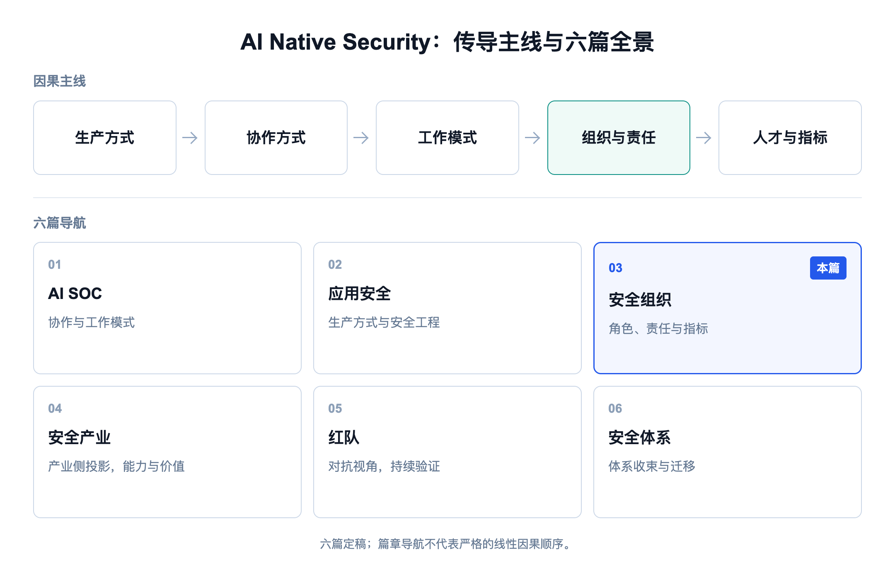
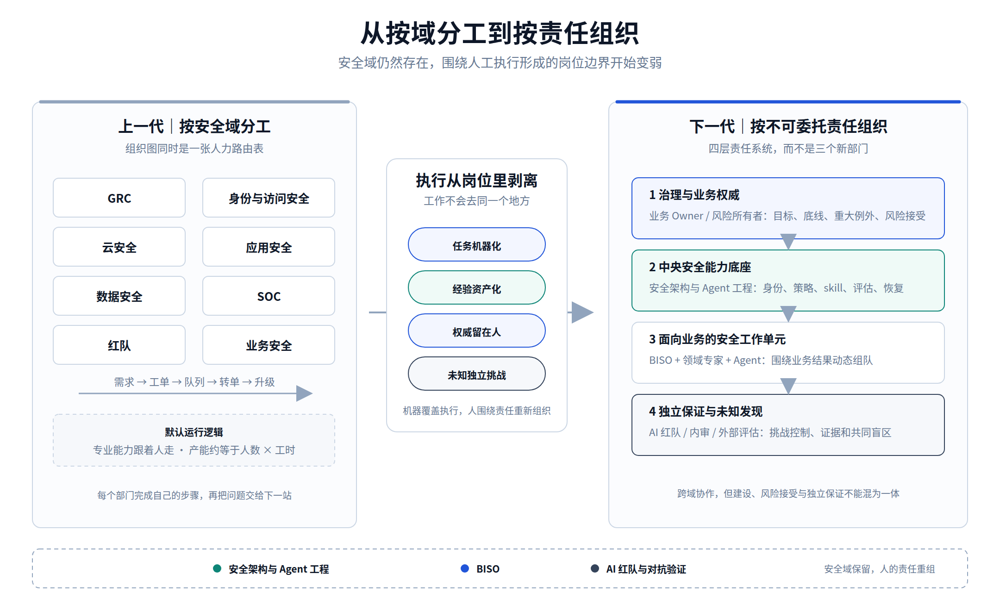
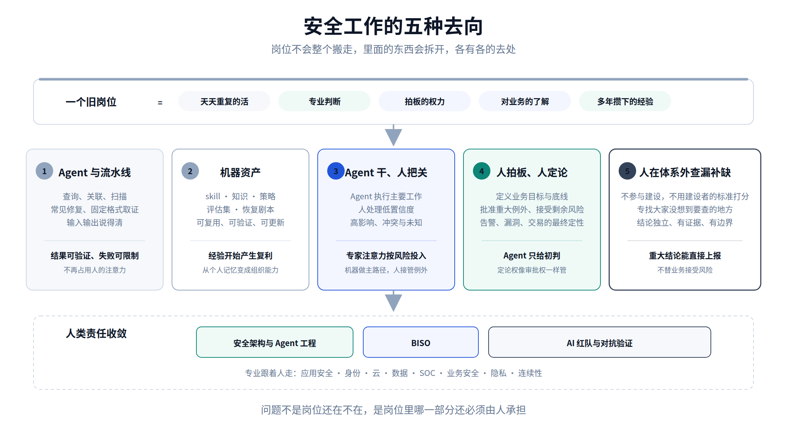
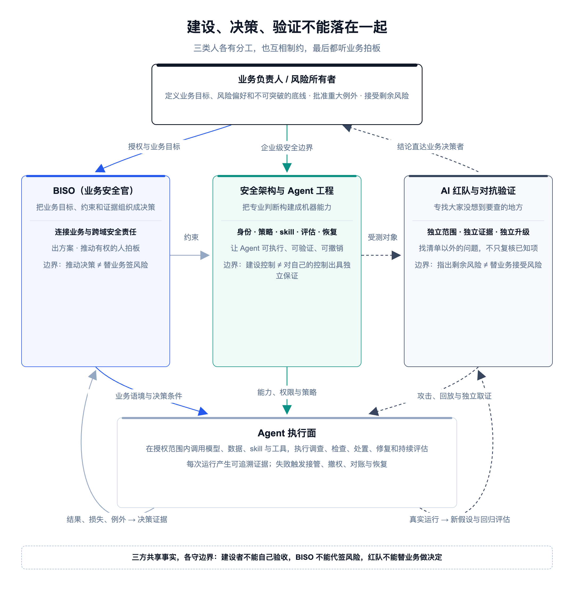

# 安全组织最后可能只剩三类角色

[中文](../zh/03-security-organization.md) | [English](../en/03-security-organization.md) | [Article index](../README.md) | [Profile](../../README.md)

> **作者简介**：Max Luo（罗棋琛），Teloa 创始人，专注 AI Agent 工程与产品开发、AI Native Security。现任某全球头部加密货币交易所 AI 安全工程团队负责人，拥有 13 年以上网络安全经验，曾负责 SHEIN 全球应用安全、AI 安全中台、安全 BP 与红队等职能。开源书籍《AISecOps：AI 驱动的安全体系》作者。
>
> 公众号：白帽子罗棋琛 ｜ GitHub：cybermaxluo

上一篇《最后一代应用安全工程师的自白》写到最后，我说未来安全组织里的核心人类角色可能只剩三类，安全架构与 Agent 工程、BISO（业务安全官）、AI 红队与对抗验证。这个判断值得单独写一篇。

前两篇走的是同一条传导链：

> 生产方式先变，软件由 Agent 生产、安全由 Agent 执行；协作方式跟着变，对话取代工单、状态取代交接；然后传到工作模式，从自己干到构建 Agent、监督 Agent、治理 Agent；最后传到组织架构、岗位职责、人才画像和考核指标。

这一篇接着往下走，讲的就是链条末端这四样：组织怎么分层、岗位剩下什么、要什么样的人才、怎么考核。

过去这些年我先后带过红队、应用安全、安全 BP、AI 安全中台、安全运营等多个职能，参与过甲方企业安全从 0 到 1 的体系建设。站在每个岗位里面看，工作差别很大；放在一起看，组织形态背后是同一个前提：安全工作主要由人执行，所以专业能力要按人分组，任务要在人之间流转，产能要靠加编制扩张。现在执行交给了 Agent，这个前提松了，前两篇讲的应用安全和 SOC 是这样，放到其余安全域里也一样，部门怎么划、人怎么配都会变。顺着推下去，我的结论是安全域不会消失，但围绕安全域形成的岗位和部门边界会逐渐变弱；机器覆盖安全域的执行，人围绕不能交给 Agent 的责任重新组织，最后收敛为三类跨域角色。

"只剩三类角色"不是说明天裁到只剩三个人。它说的是另一件事。当检查、调查、配置、修复和报告被机器接走以后，企业为什么还需要安全人员？想来想去只剩三个理由，有人把安全判断构建成机器能力，有人把业务目标和风险组织成决策，有人独立挑战整套体系、找所有人和机器共同看不见的东西。三类说的是人类责任的归宿，不是把各个安全域重新分成三个专业。各域里天天重复的活，告警研判、权限工单、代码审计，交给 Agent 和 AI 安全中台去做；人不再按域设岗，改按三类责任分工。一个 SOC 工程师可能不只做 SOC，他构建和运营 SOC Agent，也顺手把应用安全 Agent 一起管起来，横着做别的域；只做告警处置的纯执行岗没有了，他的岗位也可能不再挂在安全运营部门下面。

## 1、上一代组织：人力调度系统

今天常见的安全组织架构按专业域和工具链划分：SOC、红队、应用安全、数据安全、IAM、云安全、GRC，规模大了每个域里再拆。这种分法很适合过去二十年的生产条件，因为专业知识和经验沉淀在人身上，代码审计派给应用安全，登录异常找 IAM 或 SOC，复杂案件从初级升到高级，跨领域问题靠拉群、开会、转单。所以组织架构同时也是一张人力调度表，什么问题进哪个队列，由哪组人处理，处理不完往哪里升级，编制按工单量和人均产能申请。

按域设部门、按部门配人，过去这么算是合理的，但现在开始算不过来了。假设专业能力只能跟着人移动，复制一个高级工程师的经验只能靠招聘、培训和带教；现在经验可以蒸馏成 skill、策略和评估集，复制能力不再只能复制人。假设执行吞吐和人数近似线性，告警多一倍就要加人；现在 Agent 并行调查、构建、测试和回放，吞吐不再跟人数绑定。假设部门边界天然形成职责分离，画在不同框里就有了制衡；现在两个团队的验证 Agent 如果共享同一模型、同一知识和同一负责人，画在两个部门里也不构成独立。假设流程就是工单里的固定路径，A 做完转 B，B 做完找 C 审批；现在执行路径由 Agent 按上下文动态形成，工单只剩记录和审计价值。假设活动量可以代表安全产出；现在 Agent 一天可以生成一万条规则、一千份报告，旧的 KPI 指标已经完全不适用新的运行形态。整套运行方式都是围绕"人不够用"设计的，人一旦不再是瓶颈，它就没有理由继续存在。

## 2、岗位拆开之后

一个岗位其实是好几样东西捆在一起的：天天重复的活、专业判断、拍板的权力、对业务的了解、多年攒下的经验。Agent 进来以后，这几样不会一起走，各有各的去处。

重复执行进入 Agent、流水线和确定性控制：查询、关联、扫描、常见修复、固定格式取证，只要输入输出可描述、结果可验证、失败影响可限制，就没有理由长期占用人的注意力。稳定的专业判断被蒸馏成机器资产：SOC 工程师对某类入侵的判断，应用安全专家积累的越权漏洞模式，都可以变成规则、skill、评估集和恢复剧本，供所有 Agent 反复调用。需要大量上下文但可以评价的工作进入"Agent 干、人把关"的模式，Agent 做主要的调查和构建，人处理低置信度、高影响和未知，用真实结果校准机器。决策权留在人类组织里，谁定义业务目标，谁批准重大例外，谁接受剩余风险，不会因为 Agent 执行成功就转移给模型或平台供应商。未知问题也留给人：机器擅长把说清楚的能力规模化，也会把原来就没看见的问题一起规模化，总要留几个人在体系外面，专门帮大家查漏补缺。

还有一样东西容易跟着执行一起交出去，其实它是权力，就是定论权。一条告警最后算入侵还是误报，一个漏洞复测后算不算能利用，一笔交易最后算不算欺诈，这些要么等后果出来，要么由有权的人拍板，Agent 给的只是初判。这一条不能含糊，因为 Agent 下一轮的评估集、回归集和 skill 都是拿定论来校的，要是拿它自己的初判当定论，等于让它给自己打分。所以谁能拍板、多久才算板上钉钉、哪些定论对手能批量伪造（比如批量申诉、批量举报），都要像审批权一样单独管起来。

所以安全域仍然存在，岗位怎么变，账号被盗、数据泄漏、生产被打穿、欺诈损失这些锅还是要有人背。变的是安全域不再天然等于部门。SOC 仍是一类专业责任，但不一定要养一支专门盯告警队列、三班倒的队伍，应用安全同理。美国 NIST 的 NICE 网络安全人才框架早就区分了 Work Role 和 Job：工作角色是一组由个人或团队负责、问责的工作，不等于职位名称。它不是为 Agent 组织设计的，却给了一个好起点，先描述企业必须完成什么工作、承担什么责任，再决定由人、团队还是 Agent 承担，不要从岗位名称出发。OpenAI 公开过一项内部 Harness Engineering 实验，Codex 承担大量代码、测试、文档和工具构建之后，人的重点转向设计环境、表达意图和建立反馈机制。虽然这是 OpenAI 的环境跑出来的结果，我们不一定能照搬，但方向是一样的，机器承担执行以后，人的价值从"亲手完成每一步"转向"建设一套让机器可靠工作的系统"。

执行剥离之后，剩余的人类责任会跨越今天的安全域，向三个方向聚集。

## 3、AI Native 安全团队的三类角色

这三类角色是推导出来的，不是拍脑袋分的。起点是 2025 年初的一个观察：SHEIN 产品研发中心开始大规模用 Claude，到 Claude 3.7 Sonnet 出来的时候，一部分产品和前端开发工作已经可以交给 Agent 干了。开发能 Agent 化，安全的执行迟早也会，这是当时就能看到的趋势。我就顺着这条路往下推，执行交出去之后人剩下什么责任、组织会变成什么样，一步步推出了这三类角色。到了 2026 年，harness 的能力爆发，Codex、Claude Code 让 Agent 生产软件成了研发的常态，我把行业的变化和研发端的现象放在一起往上抽象，归纳出了开头那条传导链：生产方式先变，协作方式跟着变，再传到工作模式，最后传到组织、岗位、人才和指标。三类角色正好落在这条链的末端。2025 年逻辑推导出来的只是终点，完整的脉络是什么样子，我直到 2026 年才看清楚。

### 3.1 安全架构与 Agent 工程

这不是今天"安全开发工程师"的简单升级，也不是成立一支团队再造一个大而全的 AI 安全平台。它的工作对象是所有 Agent 都要复用的安全边界和能力：身份、数据、工具、策略、证据、恢复。以前这些判断分散在专家脑子、制度文档和各家产品控制台里，以后要做成 Agent 能直接使用、系统能强制执行、组织能持续评估的资产：每次委托的边界（谁发起、为什么、能做什么、做到哪、怎么停）写成任务边界，"冻结账户"这类高影响动作封装成能力接口，由接口代 Agent 持有凭证去调真实系统，再加上策略、skill、评估集、证据规范和恢复机制。

这个角色既要懂架构和安全工程，也要懂 Agent 的运行机制。只懂大模型 API，容易把"模型会回答"当成"系统可控"；只懂传统安全架构，画出来的图很漂亮，但落不到 Agent 每一步实际怎么调工具、怎么拿权限上。它最终要回答两个问题。一个是换掉模型、harness、MCP 或者某家安全产品之后，原来定好的权限和审批规则能不能直接沿用，还是要重做一遍；另一个是 Agent 做错了，能不能按预期回收权限、止损、回滚和兜底。

它的价值不按写了多少平台代码算，看的是把多少人类判断变成了跨业务复用的公共能力。但它有一条边界，构建这个控制系统的人，不能同时替业务拍板业务目标、替业务接受风险，更不能自己验收自己建的东西。三样都归一处，平台就没人能制约了。

### 3.2 业务安全官（BISO）

业务安全官（Business Information Security Officer，BISO）这个名字并不完美，国内更常见的叫法是安全 BP。过去这个角色经常被理解成安全团队派驻业务的接口人。Agent 时代它要往上走一层，从"协调安全工作进入业务"变成"帮助业务在明确边界内用 Agent 创造结果"。

一个员工权限审批 Agent 到底可以自主批到哪一级权限，不能由模型厂商决定，也不能由安全平台默认。业务负责人定义服务和最大权限范围，IT 服务台定义审批链和回收方式，法务与隐私判断适用义务，各专业团队各给约束。BISO 的工作是把这些意见组织成不矛盾的业务规则、自治边界和可选的处理方案，再推动有权的人作出决定。它不是"负责和业务搞好关系"的安全销售，也不是替业务说服安全放行。它要既懂商业模式和运营约束，也看得懂身份、数据、工具和 Agent 行动链，能把技术风险翻译成业务老板听得懂的话，反过来把业务规则翻译成 Agent 能执行的决策依据。

BISO 推动风险决策，但不默认成为风险所有者。这是最重要的一条边界。今天很多组织里，业务不愿意签风险，最后让安全 BP 或安全负责人兜底，出了问题又追问安全为什么批准。这种责任错位在 Agent 大规模行动之后会更危险。BISO 可以把几种处理方案摆出来，可以在不满足风险控制要求的时候叫停，可以盯着例外什么时候到期，但最终接受业务风险的人，必须是经过公司正式授权的业务负责人或风险所有者。所以这类人的核心产出不是开了多少协调会，而是关键业务有没有明确 Owner、底线和决策权，重大例外是谁批的、凭什么批的，出过的事故和客户投诉有没有整改。

### 3.3 AI 红队与对抗验证

AI 红队不是给传统红队名字前面加上 AI，也不是专门收集越狱提示词。要攻击的对象是模型、harness、skill、MCP、上下文、记忆、身份、工具、策略、业务流程和恢复机制拼在一起的完整系统。它一手对抗 AI，一手保护 AI：既用 Agent 大规模探索攻击路径、修完再反复打一遍，也攻击自家的 Agent 体系，外部内容能不能污染上下文，低风险工具组合后能不能形成高风险攻击路径，生成 Agent 和验证 Agent 是不是会犯同样的错，攻击者能不能改掉评估集、记忆和安全策略，让后续每一次运行都得到错误答案。它要做的不是多找几个漏洞，是发现检查清单以外的东西，拿出能复现、能说清业务影响、证据扎实的结论。

红队和蓝队背靠背对抗是行业里的老规矩，打哪、怎么打由红队自己定，打没打进去看系统里的真实状态，发现的问题直接往上报，结论不因为要赶上线就改口，Agent 时代照样适用，只是对象从人换成了 Agent，判定输赢的还是系统里的真实记录，不是 Agent 的自述。Agent 时代多出来的问题只有一个，两边的 Agent 同模型、同数据，等于让一个人左手打右手，打不出什么新东西。AI 红队同样不能替业务接受风险，它只负责说清楚在什么范围、什么版本、什么证据下发现了什么，还有哪些未知。

## 4、四层责任系统

### 4.1 四层责任

三类角色不该被画成三个新部门，那只是把旧组织架构换几个名字。下一代安全团队更像一套四层责任系统。最上层是治理与业务决策层，董事会、经营管理层、业务负责人和风险所有者定义目标、风险偏好、关键约束、重大例外和资源优先级。安全出意见，Agent 出方案，为什么做、哪条底线不能突破、什么风险可以接受，必须由有权的主体决定。

第二层是 AI 安全中台（海外常叫 COE，Center of Excellence）。安全架构与 Agent 工程在这一层建设跨业务复用的身份、委托、数据接入、工具代理、策略、skill、评估、证据和恢复能力。中台化的核心是两件事，一是降低重复建设的成本，二是把企业级的边界收到一处统一管，至于每项业务要什么结果，定义权还在各业务手里。2025 年我还在 SHEIN GSRM（全球网络安全与风险管理中心）的时候，CSO 就授权推动成立 AI Security COE 这个中台部门，由我牵头，负责规划整个安全中心的 AI 安全战略和技术储备，为向下一代 AI 驱动的安全组织转型提前探路。现在回头看，这一步走得很早。Anthropic 公开的 Agent 评估实践给了一个很有参考价值的分工，专门团队维护通用评估基础设施，最接近产品的领域专家贡献并运行评估任务。放到安全组织里，就是中台团队提供评估工具、历史案例重跑和证据底座，IAM、数据、应用安全、SOC 和业务专家定义"在我这个场景里什么才算正确"，他们判过的这批对错案例是最核心的资产，评估集就是拿它建的；AI 红队再去查评估本身有没有漏掉的地方。

第三层是面向业务的安全工作单元，围绕一条产品线、一条价值流或一项关键业务能力临时组队，谁参与不看部门归属，看当前的业务结果和风险。

第四层是独立验证，AI 红队、内审和必要的外部评估者，不参与被验证对象自己给自己的验收，专门盯三件事：控制到底有没有生效，评估漏掉了什么，大家会不会一起出错。

四层不等于四个部门，小公司可以由较少的人兼任，但兼任的人在每件事上以哪个角色出面、担哪份责，要事先定清楚。架构人员可以自己测，但自测不能当独立验证；同一个模型既生成又验证可以提高工程质量，但不能拿这个证明它没有漏。

受监管行业还要多一层现实。金融、支付、上市公司对职责分离、三道防线和安全人员配置有硬性要求，不会因为 Agent 研判准确率高就改。所以"三线并成一岗"在 AI 原生公司可以直接做，在银行里要做成另一种形态：人按监管要求持岗，Agent 承担执行，岗位职责重新定义为监督与定论，组织架构上的名字先不动，工作内容先换。

### 4.2 工作单元

这套组织的交付单元也不再是"某个安全组完成自己的评审"，而是围绕一个业务结果形成的人机工作系统。拿 IT 服务台的员工权限申请审批 Agent 举例。过去是产品开发完成后各域依次评审，各提各的意见，再靠工单和项目经理推动闭环。新的方式是从第一天建立一个工作单元。业务负责人定义审批 SLA、员工体验和这个 Agent 最多能批出去的权限范围；BISO 组织各域把要求翻译成关键约束，比如哪些系统的管理员权限永远走人审、临时权限多长时间必须到期回收；架构与 Agent 工程把约束构建成审批策略、能力接口、评估和撤销恢复；AI 红队专攻冒用申请人身份、伪造审批人、社工 Agent 放宽权限这几条路；最后由业务风险所有者决定哪些权限可以自动批、批到哪一级。

上线也不是工作单元解散。真实的审批结果、越权申诉、错批、人工接管和撤销的情况会不断反馈回来，每一次都要复盘根因在哪一个环节，是业务约束、能力接口、评估集，还是接管和补偿机制，然后对症下药整改。下一代团队最重要的产出，是每完成一次工作，下一次同类问题都更少依赖人。

## 5、指标的变化

组织形态跟着工作方式变了，指标也得跟着变。发现多少漏洞、关闭多少告警、评审多少项目，量的都是人的产出；现在执行交给了 Agent，这些数字随便就能翻倍，再拿它们考核，团队只会被拉回旧模式，堆出一堆没人维护的规则和没人看的报告。要度量的是系统的能力，看四层。

业务与风险结果：关键业务损失、客户伤害、错误放行、错误处置、恢复时间有没有下降，业务能不能在明确边界内更快交付。

机器能力质量：高频工作有多少被 skill、策略、能力接口和评估覆盖，Agent 的越界率、接管率、重复失败率是多少。

人的注意力和决策质量：人工队列里需要专家判断的比例，高风险例外是不是由正确的人及时决定。

组织学习和独立性：出了一次真实事故，多久能变成 skill 或评估用例、下次就能用上；沉淀下来的这些东西有没有人负责、有没有版本、过时了能不能下线；建的、跑的、签风险的、验收的是不是分开的人。

节省多少人力（FTE）可以用来统计降本增效的效果，但不能成为唯一目标，否则团队会先去自动化最好统计的那几步，真正卡业务的环节反而没人碰。更该问的是三件事：以前哪些业务因为安全跟不上做不了，现在能做到什么程度；人腾出来的时间花到了什么更值钱的事上；模型、评估、证据和供应商这些新成本加起来是多少。

## 6、对个人意味着什么

"只剩三类角色"对组织是职责重构，对个人是一次分流。做技术的人，大体会在安全架构与 Agent 工程、AI 红队与对抗验证之间选主方向；做安全管理、GRC、安全 BP 和业务协同的人，更可能向 BISO 走。一个人未来的竞争力可以描述成一个组合：横向的跨域职责方向 × 纵向的专业根基 × Agent 构建与评估能力。职责方向决定你对什么负责，专业根基决定你凭什么作出高质量判断，Agent 能力决定你能不能把判断规模化。所以未来不是通才取代专家。没有专业根基的"全栈 AI 安全专家"，很容易只剩会画流程、会调模型；只守着一个领域手工干活的专家，能干的活会越来越少。单一专才的路会越走越窄，比如以前精通二进制逆向是门槛很高的方向，靠这一门手艺就能在各大甲乙方的安全实验室立足；现在 Agent 已经能逆向挖漏洞，数量和质量都在成倍往上走，又快又省人，这条路会越来越难。更强的竞争力，是站稳原有的专业根基，再横向往别的域发展。

还有一个问题这个系列绕不开。初级岗位没了，资深专家从哪来？我反复说审过几千个漏洞的人才写得出 skill，同时又说初级执行岗会消失，那十年后谁审过几千个漏洞？自动化领域四十年前就有结论，人不再处理原始事件，判断力和接管能力会一起退化。有人会说，Agent 已经能自己从结果里学、自己迭代 skill，人退化了也没关系。问题是它学的依据是定论，定论是人判出来的；人的判断退化了，定论就不准，Agent 学到的就是错的，而且越学越自信。所以人不能完全脱离一线，这条要当成设计原则：强制人工处理一定比例的随机样本，不是为了效率，是为了保住定论的质量、保住人随时接管机器的兜底能力，也是新人长成专家的唯一路径。这部分人工看起来是多花的钱，其实是在培养下一批专家。

具体怎么开始，不用等公司先改组织架构。先把自己最近一个月的工作拆开，看哪些只是查询、归纳、生成、跟踪，哪些依赖专业判断，哪些涉及正式决策权。然后主动消除一项自己的重复工作，用 Agent 完成主要执行，但补齐任务边界、工具权限、评估、证据、人工接管和失败恢复，目标是把自己变成这项能力的 Owner，而不是做一个 Demo。接着把一次真实经验变成组织资产，修完漏洞提炼成漏洞模式和评估，处理完事件把判断写成 skill，解决完业务争议把底线写成可执行约束。最后跨过一个安全域，应用安全去理解 Coding Agent 的身份和工具，SOC 把调查接到资源侧响应和业务恢复，GRC 把合规要求接进生产，策略在系统里执行，证据自动从系统里出，红队从单点漏洞走向完整 Agent 行动链。以后最难的问题都是跨部门的，只守着自己一亩三分地的人，问题来了看不见，看见了也接不住。

## 7、总结

回到标题：安全组织最后为什么可能只剩三类角色？各个安全域的责任都还在，Agent 把它们连成一条动态行动链之后，专业责任只会更重。消失的是围绕人工执行形成的岗位边界、队列和交接。留下的三类人类责任，一类把专业判断构建成可执行、可评估、可恢复的机器能力，一类把业务目标、外部义务和风险组织成由正确的人作出的决定，一类专门找建设者和机器都没看见的问题。三类角色横跨安全域，却不能失去专业深度；密切协作，却不能抹掉建设、风险接受和验收之间的职责分离。

对 CISO 来说，下一步不是把所有岗位名称加上 AI，也不是先成立一个 AI 安全部门。先选一条真实的业务价值流，拆清楚工作、判断、决策权和结果，哪些交给 Agent，哪些沉淀成共同能力，哪些必须由业务负责人决定，谁负责独立挑战。跑通一个闭环，再改组织和指标。对个人来说，要回答的问题也不是"我的岗位会不会消失"，而是要问，如果有一天我不再亲手处理日常任务，组织为什么还需要我？我交付的价值是什么？答案不能只是"我干了很多年""我有经验"。经验留在脑子里，会跟着旧岗位一起贬值；把经验变成组织能持续运行的能力，同时承担机器接不走的责任，才是下一代安全岗位的入场券。AI 实现了知识平权，工作年限和履历不再是穿越周期的核心竞争力。

**安全域定义企业必须负责什么，三类角色定义人为什么负责，Agent 承担越来越多该如何执行。**

下一篇转向这条传导链在产业侧的投影：当人不再围绕控制台工作，安全厂商如何交付能力、结果与价值——《下一代安全产业的变化：从交付结果到交付价值》。

以上是我对 AI 时代安全组织和人才的一些思考，欢迎关注我的公众号。

**参考资料**

1. NICE 网络安全人才框架：https://www.nist.gov/itl/applied-cybersecurity/nice/nice-framework-resource-center/resources/occupations-jobs-and-work
2. Harness Engineering：https://openai.com/index/harness-engineering/
3. Agent 评估实践：https://www.anthropic.com/engineering/demystifying-evals-for-ai-agents

---

[Previous](./02-appsec.md) | [Next](./04-security-industry.md)
