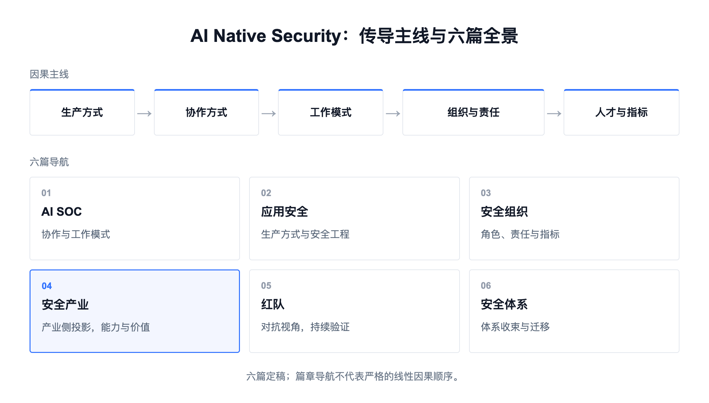

# 下一代安全产业的变化：从交付结果到交付价值

[中文](../zh/04-security-industry.md) | [English](../en/04-security-industry.md) | [Article index](../README.md) | [Profile](../../README.md)

> **作者简介**：Max Luo（罗棋琛），Teloa 创始人，专注 AI Agent 工程与产品开发、AI Native Security。现任某全球头部加密货币交易所 AI 安全工程团队负责人，拥有 13 年以上网络安全经验，曾负责 SHEIN 全球应用安全、AI 安全中台、安全 BP 与红队等职能。开源书籍《AISecOps：AI 驱动的安全体系》作者。
>
> 公众号：白帽子罗棋琛 ｜ GitHub：cybermaxluo

这几年从甲方视角看安全市场，几乎所有厂商都在讲 AI，但改变了交付物的不多。产品厂商在控制台里加聊天框，MSSP（托管安全服务商）给分析师配上模型账号，咨询公司用 Agent 更快生成报告，审计平台让模型自动整理证据。它们都有价值，却大多只提高了旧生产方式里的局部效率，客户买到的仍然是要人长期操作的控制台、照剧本干活的人和归档的报告。

我这些年参与建设和运营过很多安全平台，也买过、用过、替换过不少安全产品。每一类产品都有自己的控制台，SIEM 有告警和查询，EDR 有主机和进程树，DLP 有泄漏事件，SAST 有漏洞列表。稍具规模的安全团队，浏览器里同时开着十几个控制台并不稀奇。

我们总想要做平台整合，实际上的集成层往往还是人。分析师从一个页面复制 IP，到另一个页面查主机，再去第三个页面看身份，最后把结果贴进工单。整合难做，一半原因在组织。每个团队都想守住自己的系统和预算，集成完没多久又各自解耦，最后还是靠人把这些系统连起来。很多安全流程看起来数字化了，人还在做接口、搬运和对账这三件本该由系统自动化做的事。

甲方这边也没想清楚。做甲方安全这些年，我听过两个完全相反的答案。一种说核心能力必须全部自建，私有化部署才能保障数据安全；另一种说模型和平台迭代太快，企业没必要重复造轮子，最好的能力都该采购或托管。两个答案都有道理，也都把问题说得太简单。

今年三月我写过一篇《OpenClaw 火热的背后：软件正在从交付工具走向交付结果》，讲的是整个软件行业的交付逻辑在重写，厂商从交付一套要人操作的系统，变成交付一个能直接承接工作的行动主体，那篇停在交付结果。上一篇《安全组织最后可能只剩三类角色》写到，当查询、调查、配置、修复和报告交给 Agent，人的工作会上移到能力建设、业务风险治理和对抗验证。组织变了，产业跟着变。厂商卖什么，甲方买什么，钱按什么单位结算，这三件事看起来各是各的，其实是同一个变化。这一篇把三月那篇的判断落到安全产业，从交付结果再往上推一层。

变化的根子在两处。一是能力的消费者从人变成了 Agent。界面是给人用的，Agent 不用，于是围绕界面建起来的东西失去价值，能力本身、能力产生的结果、谁对结果负责，这三样成了可以计价的东西。二是结果第一次可以被验证。过去一次处置做没做成，只有工具自己的记录说了算；现在每次行动最后都要回到业务系统确认终态，账户是不是真的冻结了，会话是不是真的撤销了。结果能验证，才能按结果交付。

我的理解是：**安全产业正在从卖工具、卖人天走到交付结果。但结果不是终点，下一步是交付价值。安全第一次能正向说清自己值多少，并且决定企业敢把多少业务交给 Agent，也就是决定业务能跑多快。**

## 1、能力的消费者换了

控制台在过去二十年里同时解决了几个问题。人是安全数据的主要消费者，告警、漏洞、权限、策略和证据最终都要由人阅读、筛选、配置和批准，产品必须把底层复杂性翻译成表格、图形和按钮。商业模式也围绕控制台设计，席位、模块、数据量和高级功能构成产品边界，界面既是工作入口，也是黏性和追加销售的入口。所以过去安全产品的竞争路径是采更多数据、做更多分析、收更多工作流、做更大的屏。

这几个问题 Agent 一个也没有消掉，它改变的是机器不需要按人的方式消费能力。它不需要先进入"主机详情"，再点"进程"，复制哈希，切到威胁情报页，最后点"隔离"。它需要的是一组边界明确的能力，查询指定主机在某个时间窗的进程树，验证哈希的情报结论及来源，在携带任务、委托、对象、期限和审批结果的前提下执行隔离，最后返回资源侧的真实状态和证据。资源侧指的是账本、云控制面、身份平台这些最后真正发生改变的系统。

一款安全产品至少可以拆成八层。

1. 探针与采集
2. 规范化与状态
3. 分析与检测
4. 策略与决策
5. 执行与控制
6. 工作流与案件
7. 证据与评估
8. 人机界面

Agent 不会以同样的方式改变这八层。越靠近事实和副作用的能力，长期价值越强，比如端点探针看见了什么进程，身份平台是否真的撤销了会话，支付账本是否冻结了资金，这些不能靠模型推理出来。越靠近人工搬运的能力，越容易被重新组合，比如跨工具查询、告警分诊、证据关联、工单填写，Agent 可以把这些步骤放回一条任务链里，原产品继续提供数据和行动，却不再拥有日常工作入口。同一款 SIEM 的不同部分会往不同方向走，数据采集和历史查询被强化，人工告警队列被 Agent 吸收，重复的案件模块退出。

过去两年，我看到很多安全产品完成"AI 化"的第一步，在原控制台右侧加一个聊天框。它可以解释告警、生成查询、总结漏洞、推荐处置，体验当然比手工找按钮好。但如果关掉聊天框以后底层工作方式没有任何变化，它更接近一个 Copilot 外壳。最近一年不少产品又走了第二步，把接口封装成 MCP 开放给外部 Agent。看几家头部厂商的公开文档，多数封装是只读的，查告警、查漏洞、查资产，动作最多开到改案件状态和加备注；少数开放了隔离主机、改策略、停用用户这类真实副作用，要么没有任何审批，要么把确认框弹在 Agent 客户端，资源侧收到的仍然是一个带着账号全部权限的调用。判断是不是 Agent Native，可以看两个很朴素的问题。Agent 能不能不打开页面就拿到完整能力，而不只是查询能力？返回的 success 是 API 收到请求，还是资源真的改变、业务结果也得到确认？

人的界面仍然保留，但用途会变，重大事件、危机指挥、策略治理和独立抽查仍然适合图、表和时间线。控制台从日常生产中心退到监督、例外和治理的位置。采购时的检验标准可以很简单，去掉这块控制台，看企业失去的是核心能力，还是一种使用习惯。

## 2、产业的新分工

能力可以被 Agent 调用、结果可以被验证之后，产业的分工会重排。更可能的格局是，上游模型与 harness 提供通用大脑，平台型厂商提供覆盖面最广的数据源和处置能力，专业厂商专攻单个领域的深度，企业负责按自己的策略做集成，服务商负责托管运营和兜底责任，独立机构负责红蓝对抗和合规审计。

### 2.1 厂商的护城河

下一代安全产品至少有两种同等重要的界面，一种给人，用于重大调查、例外、治理和独立复核；另一种给机器，让企业 Agent 在受控条件下发现、读取、提案、行动、验证和恢复。把现有 API 自动包成 MCP 还算不上机器界面，它必须补齐能力边界、发起人与委托、参数约束、幂等、真实终态、证据和恢复。一个进入企业工作流的机器能力可能没有几个日活用户，却每天被多个 Agent 可靠调用，承担更核心的控制责任。

判断一家厂商的护城河，最直接的方法是把模型品牌和聊天界面拿掉，再问这家公司还剩下什么。只剩 Prompt、编排和几个连接器，壁垒很薄。剩下的东西会往五样上收。一是别人拿不到的数据，端点上跑了什么、账号现在什么状态、云上谁改了配置、一笔支付走到哪一步，只有探针装在资源旁边的产品才采得到。二是处置能力，隔离终端、踢掉会话、拦下一笔支付，能把动作做下去的还是这些产品。三是对客户环境的理解，通用模型知道什么叫漏洞、什么叫权限，不知道这家企业哪些资产连着哪些、信任边界画在哪、历史上留了哪些例外。四是证据，接口返回 success 不等于资源状态真的变了，拿得出证据的产品才进得了结果的账。五是敢担的责任，厂商不可能替客户扛全部风险，但对自己管得住的那部分要给承诺，"模型可能犯错"是事实，不能拿来当无限免责条款。

### 2.2 甲方保留的四类责任

Agent 供应商和传统厂商不一样。传统厂商卖的是工具或者人，事情还是甲方自己在做。Agent 供应商卖的是把事做完，从看懂任务、拿主意、调工具、动业务系统到出证据，一路都可能是它在做。甲方要是还按"采购评审过了、合同签了、API 通了"这套外包逻辑来管，业务目标、判断标准、动手的权限、对事实的解释和出事以后的恢复，就会一样一样地交出去。这种转移不是在采购时一次完成的，而是在上线后逐步扩大授权范围的过程中累积形成的。

NIST CSF 2.0 把供应链风险放进组织治理，美国银行监管机构的第三方风险指引明确使用第三方不减轻银行自身的责任，中国《个人信息保护法》第二十一条要求委托处理时约定目的和方式并监督受托人。这些都是 Agent 出现之前的老规矩，方向一致。供应商承担责任，不等于企业不再承担责任。合同可以约定赔偿和补救，却转移不了客户伤害、经营损失、牌照义务和董事会问责。

"不能交出去"不是让甲方亲手做所有事，它说的是四件。一是业务目标，追求什么结果，多大的损失和多少误拒可以接受，哪些场景允许自治，这些是经营上的选择，和模型聪不聪明无关。二是控制的设计和运行，身份平台、检测引擎、模型网关都可以采购，但每一项控制要有甲方自己的责任人，他要说得清这项控制防的是什么、在哪一层生效、有没有办法绕过去、用什么证据证明它在资源侧确实起了作用。供应商如果拿着长期管理员凭证，就能绕过企业策略直接改资源，甲方手里只有一份合同，没有控制权。人工审批也是同样的道理，审批的人如果看不到原始事实、没有替代方案、也没有否决的权力，审批就只是供应商自动化流程里的一个人工环节，不构成控制。

三是独立求证，验证要由建设者之外的人来做，供应商用自己的样本和日志出的报告只能算自证。四是重大例外和风险接受，改变风险偏好、接受超过阈值的残余风险、允许不可逆的大范围行动，这些权力不能落给模型或供应商，厂商的低风险评估和同行的普遍做法都不能代替企业自己的风险接受。

其余的可以广泛交出去。开头那两个相反的答案，问的其实是四个问题，谁建设能力，谁提供产品，谁运行日常流程，谁独立证明它有效。自建（Build）、采购（Buy）、运行（Operate）、保证（Assure）不是四选一，四个都要有答案。判断标准是这项能力是否包含企业独有的目标和决定权，供应商失效会不会拿走关键控制，企业能否独立验收和替换。自建不天然安全，采购也不天然失控，控制权来自边界、资产、证据和退出能力。

### 2.3 从人天到结果的定价

乙方有四类，产品厂商、MSSP 和 MDR、咨询实施、审计和红队，交付物都在往结果上移。产品厂商上一节说过，卖的从控制台变成数据源和处置能力。MSSP 和 MDR（托管检测与响应）的经济基础本来是一线分诊和报告需要大量标准化劳动，而 Agent 最擅长压缩的恰好是查询、关联、摘要和固定剧本，分析师人数和告警处理量越来越难成为价值证明。人不会退出服务，只会退出标准动作，未知威胁和重大事件指挥仍然需要经验丰富的人，而且会更贵。咨询公司的交付物从报告变成能被机器执行的资产，生成一份结构完整的报告越来越便宜，稀缺的一直是对客户所在业务和法域的判断，以及把隐性经验变成可执行能力。审计和红队的价值在于独立，做成持续的证据流是对的，但独立性来自第三方。保证要由没参与建设控制的第三方来出，结论才客观。

定价的单位应该是一个场景的结果，也就是你保障的那块领域不出事，以结果说话。负责账户安全，纳入范围的账户接管在规定时间内处置完，资金没有损失；负责入侵防护，攻击路径在到达业务前拦住，业务没有中断；负责漏洞管理，研判准确，该修的修了，不该修的没有打扰业务。做成了才算钱。结果的定义写在合同里，做没做成看真实业务场景里验证的效果，业务有没有停，钱有没有丢。

## 3、结果之上是价值

交付结果比卖工具和卖人天更接近客户要的东西，但它有边界。结果是供应商能控制、能证明的那部分终态，会话撤销了，账户冻结了，配置改回去了。供应商对这些负责是对的，客户如果拒绝提供数据、从不修复、随意改策略，供应商不可能对事故率承担无限责任。

三月那篇的结论是，软件交付的终局不是把工具交给人，而是把结果交给人。对广告、销售、客服这些行业，这句话已经是终点，它们的结果直接就是成交额、投放回报、转化率，结果和价值是一回事，按结果定价在这些行业也已经先行。安全不一样。安全的结果是"没出事"，结果和价值之间隔着一层几十年没算清的账。别的行业走到交付结果可以停，安全必须再往上走一层。

安全的价值以前只有一种表达方式，避免了多少损失。这个数字是虚构的。没发生的事故算不出金额，发生了的事故又说明不了如果没有这道控制会怎样。所以安全预算一直是成本中心的逻辑，按合规要求配，按同行比例配，按去年的续费清单配，从来不是按产出配。安全部门在企业里的位置也由此决定，它在业务旁边做防护，业务把它当成必须过的一道关，价值只能用没出事来证明。

## 4、交付价值

这次不一样，原因有三条。

第一，终态可查。每次行动最后都回到业务系统确认发生了什么，有了确认的终态，才有可归因的结果。

第二，完全成本能算到单位结果。模型、工具、人工接管、误伤补偿、供应商切换，这些加起来除以经过验证的合格结果数，是个真实的单价。过去安全的成本只能按部门和许可证摊，算不出一个结果花了多少钱。

第三，也是最要紧的一条，安全第一次可以正向表达自己的价值。企业能把多少业务交给 Agent 去做，取决于能不能证明这些行动可授权、可验证、可撤销、可恢复。做不到，自治就上不去，业务只能停在"Agent 给建议、人来执行"这一层。我们自己在做的安全智能体框架，目标是八成安全任务由 Agent 独立闭环，两成高风险场景留给人，这条线就是按这个逻辑划的。安全决定企业敢把多少行动权交出去，也就决定了业务的产能上限。从拖慢业务的部门，变成决定业务能跑多快的部门，安全这个职能在企业里的位置就变了。

价值算得清，甲方和乙方的账都会变。

甲方按价值买。过去安全最容易拿出来的数字是告警数、漏洞数、工单数和自动关闭率，这些数字帮助管理容量，不等于安全结果。正向的账可以只记四条，四条都能从运行证据里直接取。业务开放了哪些原来不敢开放的自治动作，可数。每个合格结果的完全成本，可算。从异常发现到停止、撤销、影响封闭的时间，可测。误伤和补偿的成本，可核。

预算的顺序也要反过来，过去的起点是续费清单，去年买了什么，今年涨多少；以后先定义业务目标和风险敞口，再问需要什么控制结果，现有能力缺在哪一层，最后决定建设、采购、组合还是退出。只投 Agent 不投边界和证据，会扩大错误；只投平台不投真实工作，会得到昂贵的基础设施；只买新工具不退出旧能力，控制台换成了 Agent，重复建设还是重复建设。

乙方按价值卖。乙方以前承诺的是处理了多少告警、响应有多快，以后承诺的是帮客户把哪些事放心交给 Agent 自动做。比如账户接管这个场景，乙方承诺纳入范围的事件由 Agent 自动撤销会话，出错能回退，人只处理例外，客户因此敢把这一段业务放开跑。这种承诺能写进合同，做没做到、花了多少钱、出错怎么办都查得到。乙方要是只用 Agent 省自己的人，收费还按原来的人天，客户迟早会要求分这部分省下来的钱。合同结束以后，客户还能看懂之前发生了什么，关键控制还能自己跑，这才算托管。

## 5、总结

能力的消费者从人变成 Agent，结果第一次可以被验证，交付物就从工具和人天走到了结果。甲方保留四类责任，其余交出去；四类乙方的交付物都往结果上移，产品厂商的护城河往五样东西上收，钱按场景的结果算。再往上一层，结果对业务意味着什么，这是价值，安全第一次可以正向记这笔账，并且决定企业敢把多少行动权交给机器。

**界面决定人怎么用产品，能力决定机器能不能安全地用产品，结果决定钱按什么算，价值决定安全在企业里站在哪。**

以上是我对 AI 时代安全产业的一些观察和思考，仅代表个人观点，不构成针对任何企业的法律意见。欢迎关注我的公众号。

**参考资料**

1. 罗棋琛，《OpenClaw 火热的背后：软件正在从交付工具走向交付结果》，公众号"白帽子罗棋琛"，2026-03-09
2. MCP：https://modelcontextprotocol.io/specification/2026-07-28/architecture
3. NIST CSF 2.0：https://www.nist.gov/cyberframework
4. 第三方关系风险管理联合指引：https://www.occ.treas.gov/news-issuances/news-releases/2023/nr-ia-2023-53a.pdf
5. 个人信息保护法：https://www.cac.gov.cn/2021-08/20/c_1631050028355286.htm
6. SentinelOne Purple AI MCP：https://github.com/Sentinel-One/purple-mcp
7. Microsoft Sentinel MCP server：https://learn.microsoft.com/en-us/azure/sentinel/datalake/sentinel-mcp-application-card
8. Palo Alto Networks Cortex MCP Server：https://www.paloaltonetworks.com/blog/security-operations/introducing-the-cortex-mcp-server/
9. CrowdStrike Falcon MCP：https://developer.crowdstrike.com/falcon-mcp/modules/overview/
10. Okta MCP Server 2026 release notes：https://developer.okta.com/docs/release-notes/2026-okta-mcp-server/

---

[Previous](./03-security-organization.md) | [Next](./05-red-teaming.md)
