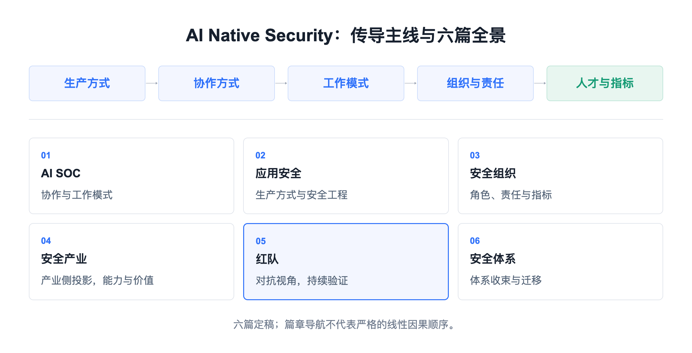
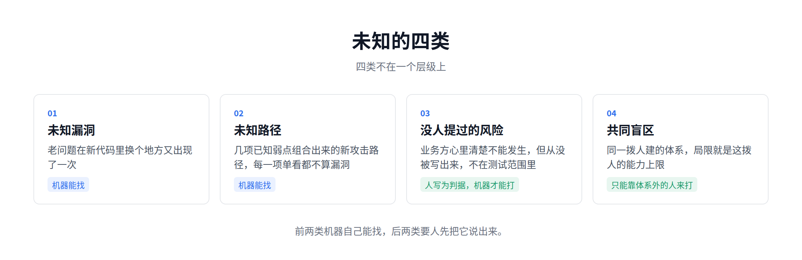
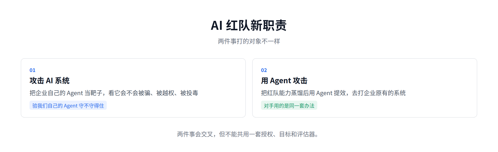
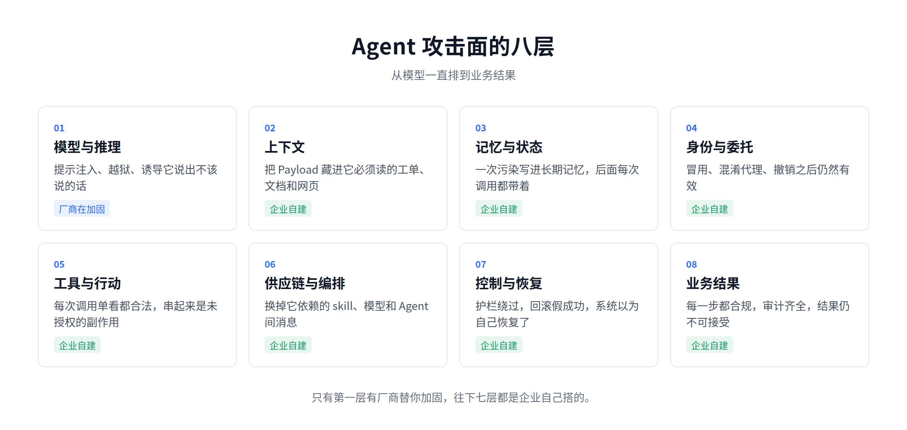
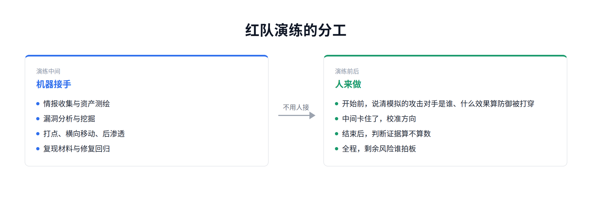
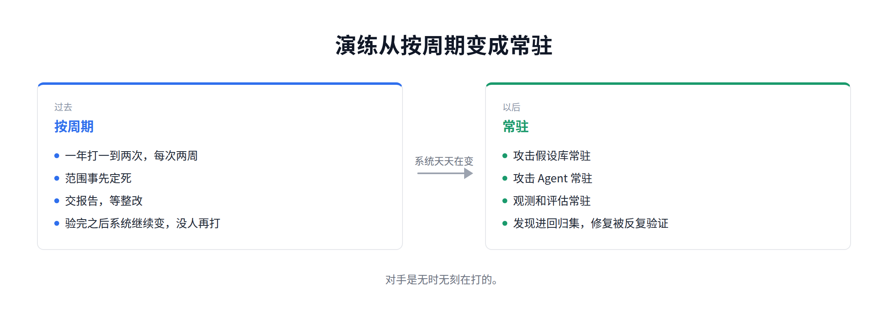
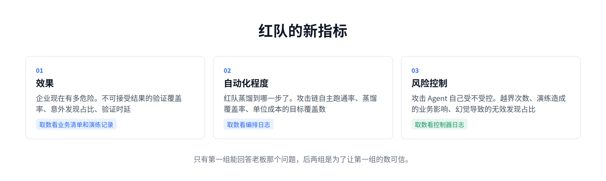

# 攻击方 Agent 化之后，红队的出路在哪里

[中文](../zh/05-red-teaming.md) | [English](../en/05-red-teaming.md) | [Article index](../README.md) | [Profile](../../README.md)

> **作者简介**：Max Luo（罗棋琛），Teloa 创始人，专注 AI Agent 工程与产品开发、AI Native Security。现任某全球头部加密货币交易所 AI 安全工程团队负责人，拥有 13 年以上网络安全经验，曾负责 SHEIN 全球应用安全、AI 安全中台、安全 BP 与红队等职能。开源书籍《AISecOps：AI 驱动的安全体系》作者。
>
> 公众号：白帽子罗棋琛 ｜ GitHub：cybermaxluo

红队怎么自动化，业内探索了很多年。漏洞扫描器、BAS（入侵与攻击模拟）、攻击面管理、自动渗透测试，一代比一代进步，但都停在验证已知的风险上。

从今年发生的几个 AI 自动化入侵事件以及行业的研究成果来看，攻击这一侧的 Agent 已经接近全自动。

但让我改变判断的是攻击者那边的成本，不是红队这边的工具。防守方每加一道控制，付的是建设、运营和误伤；攻击方每绕过一道，付的是人、资源、时间和重复。安全防线能撑住，很多时候靠的是攻击方算下来不划算，而不是它本身多严密。

攻击这一端的成本正在被 Agent 压缩。摸清资产、找利用点、写 PoC 做武器化、被检出以后持续对抗，这些过去要靠人、靠时间、靠一支有分工的队伍，现在一个人操纵一支 Agent 入侵军团就能并行地做。

红队存在的理由，是替企业提前扮演真实对手。以前红队和攻击者是同一类人，一样要找路径、写工具，一样会因为成本收着打。现在对手把进攻智能化了，24 小时不知疲倦，同时开几十条线，试错成本极低。

我在第一篇讲 SOC、第二篇讲应用安全，说的都是防御端还停在人工研判和人工评审上，对上这样的对手已经是降维打击。红队如果不把进攻这一侧同样智能化，下一个就是红队自己。

这一篇的核心判断是：**攻防之间差的不再是技术细节，是智能化的程度。对手用 Agent 规模化进攻，红队还在用手搓技战术的上古打法，只会被动挨打。**

## 1、对手的打法变了

2025 年 11 月，Anthropic 披露了首例被报告的、由 AI 主导的网络间谍行动。攻击者越狱 Claude Code，对全球约三十家机构发起入侵，八到九成的攻击动作由 AI 自主执行，人只在几个关键节点拍板。

2026 年 9 月最新的威胁情报报告里，这样的案例已经不止一个。

一个团伙用 Agent 把约一百八十万个安卓安装包反编译，扫出硬编码的密钥。其中一次入侵，从一个令牌到云管理员权限只用了约三小时，侦察、提权和数据外带几乎全由 Agent 完成，人负责入口凭据的获取和最后变现。

另一个团伙的 Payload 被安全工具检出以后，Agent 自己改写重编译，绕过检测再接着跑，整个免杀对抗的循环没有人参与。

手法还是老一套，改变的是规模和速度，报告把它总结成一句话，能力和资源脱钩了。一个单干的黑客和一个有国家背景的 APT，现在用同一套打法并行打多个受害者，这在过去要一支有分工的队伍。

红队过去按对手的分级，脚本小子一档，有组织的团伙一档，国家级一档。这个分级快要失效了。

## 2、漏洞工厂

同一份报告里还有一个团伙值得单独说。他们把模型接进逆向工程流程，针对某款主流安全产品做持续的漏洞研究，一个月产出十几个疑似 0day，多个子 Agent 并行拆不同目标，报告称这条流程 7×24 运行、几乎无人介入，人主要在最后审一遍。

可以把它理解成一条漏洞产线，它描述的是持续的自动化挖掘，不是一次成功的挖掘。

防守方一直靠时间差活着。一个漏洞从公开到被用出来，过去有几周，补丁、缓解、应急演练都排在这个窗口里。产线压缩的就是这个窗口，新版本发布当天重跑一遍，补丁还没打完，针对它的武器化工具已经出来了。

这个能力不是只有攻击方有。Google Project Zero 的 Big Sleep 用 Agent 在 SQLite 里发现过一个此前未知的栈缓冲区下溢，研究团队也说明结果仍在实验阶段。2026 年 Anthropic 的 Claude Mythos Preview 在主流操作系统内核和浏览器里自主发现过此前未知的漏洞。

武器化这一侧的效率更高。给 Firefox 的 18 个补丁，产出 8 个可用 Exploit，第一个在一小时内；给 Windows 内核的 21 个 CVE，产出 18 个 PoC，第一个用了 31 分钟，单个成本约两千美元。成功率不是 100%，但补丁窗口已经被压缩了。

攻防两端的资源不对等，攻击方找到一个入口漏洞，防守方要把所有围绕这个漏洞的面都补上，成本是攻击方的数倍。同一条产线在攻击方手里是直接收益，在防守方手里跑出来的可能是一份修不完的清单。红队夹在中间，既要建这条产线，又要替防守方回答哪些纵深防御点优先级最高。

红队接下来要面临的问题是，机器都能挖洞了，你们能不能挖到 AI 挖不到的。所以先得把"未知"拆开，它至少有四类，不在一个层级上。

前两类机器已经能找，而且只会越来越快。一类是未知漏洞，老问题在新代码里换个地方又出现；一类是未知路径，几项已知弱点组合出来的新攻击路径，每一项单看都不算漏洞。

第三类是没人提过的风险。业务方心里清楚哪件事绝不能发生，但从没在评审或需求里被提出来，也就不在测试范围里。这一类不是机器找不到，是没人把它写下来，安全工程师写成一条能判对错的规则，机器就能打。

第四类是共同盲区。同一拨人建的攻防体系，它的局限就是这拨人的能力上限。如果缺乏高强度、高水平的持续对抗，安全水位会惯性滑坡，而身在山中的人看不见自己的山，所谓"不识庐山真面目，只缘身在此山中"。这一类你定义不了一个自己都看不见的东西，只能靠体系外的人来打。

## 3、红队的痛点

对手在高速变化的时候，红队自己这边的老问题一个都没解决，而且每一个都被放大了。

第一个痛点在交付端。报告交出去，整改是别人的事，红队没有强制力。同一个根因第二年再发现一次，第三年还在，报告越写越厚，风险没降多少。做久了红队会变成一个出报告的部门。过去整改慢一点还撑得住，因为对手也慢。现在对手的迭代按天算，整改周期比对手长，报告交出去的时候就已经过期。

第二个在范围。关键系统常以"影响生产"为由被排除，能打的多是测试环境和边缘业务，对核心业务点到为止。报告里写的"未发现高危"，准确的说法是"在允许打的范围里没发现高危"。对手不认这个范围，它能并行打几十个目标，被排除的那部分恰恰是它最先去的地方。

第三个在价值。红队不缺硬成果，拿到域管权限、进核心数据库、把靶标数据带出来，复盘会上都很震撼。但老板接着问安全水位提升了多少，这个答不上来。打下来的是我们能打进去，不是企业现在有多危险，换一批人、换一个范围，结果就不可比。红队的预算往往要靠一次真事故才争得到。攻击方的 Agent 随着大模型的进步而进化，而且攻击面还在扩大，一年两次的覆盖占比只会越来越小。

还有一个是人。红队培养周期长，技术练到手要么跳槽，要么转去做应用安全和 SOC，团队长期在补人。

新的痛点也出现了。对手把进攻自动化、规模化了，自己还在按项目排期；上面要求用 AI 做红队，却没人说得清怎么衡量，做着做着变成跑工具。

这几条里，交付和价值这一篇能答，范围和人答不了。关键系统让不让打、红队向谁汇报、编制和预算给多少，是授权和治理问题，红队自己动不了，得 CISO 出面。

## 4、AI 红队新职责

行业里说 AI 红队，其实在说两件不同的事。

一件是攻击 AI 系统，把企业自己的 Agent 当靶子，看它会不会被骗、被越权、被投毒，目标是模型、记忆、工具、身份和它能动的业务行动。另一件是用 Agent 攻击，把红队能力蒸馏后用 Agent 提效，用它去打企业原有的系统，红队这么用，对手也这么用。

两件事会交叉。用攻击 Agent 生成带间接注入的供应商文档去打付款 Agent，再看 SOC 能不能识别，就是一起做。但不能用同一个"发现多少注入"验收，也不能共用一套授权、目标和评估器。

这两件事投入的比重也不一样。大多数企业的 AI 红队做的是第一件，而且停在最浅的一层，只测提示注入和越狱；第二件更多是在原来的工具平台上加上 Agent 提效。

这一篇主要讲第二件。但第一件的攻击面得先摆出来，不然不知道要打的东西有多大。一个企业级 Agent 从接到任务到产生后果，中间至少有八层。

1. 模型与推理。提示注入、越狱、诱导它说不该说的话，这一层最好测，工具和榜单也最多。
2. 上下文。Agent 要读工单、文档、网页和代码仓库，攻击者不用说服模型，把 Payload 放进它必须读的那份材料就行，入口不在对话框，在业务流程里。
3. 记忆与状态。一次污染写进长期记忆，之后每次调用都带着，跨会话、跨任务，严重时跨租户。
4. 身份与委托。Agent 靠一段委托干活，拿到它就能以它的名义做事。传统 IAM 管账号有没有资格，管不了这次委托用在哪。
5. 工具与行动。每个调用单看都合法，串起来是一次未授权的副作用，防守方通常只校验单次调用，这一层红队最容易出成果。
6. 供应链与编排。Agent 依赖的 skill、模型、插件和 Agent 间消息，任何一处被替换或投毒，上面五层白做。
7. 控制与恢复。护栏能不能绕过，停止指令停不停得住，回滚报告成功但状态没回去，出问题时系统以为自己恢复了。
8. 业务结果。退款、付款、生产变更每一步都合规，审计齐全，结果仍然不可接受，这一层没有技术漏洞，只有业务漏洞。

这八层里模型那一层性价比最低。越狱和拒答是模型厂商每一代都在加固的，乙方厂商也有成熟产品；提示注入至今没有通解，但单点测它的产出有限，杠杆在下面几层。

## 5、工作方式的变化

情报收集、代码审计、漏洞挖掘、打点、横向移动、后渗透，这些活过去大多有成熟工具，扫描器、C2、各种脚本都有，但每一段之间要人来判断和串联，读输出、判断下一步、换工具。按现在的水平，Agent 已经能接管其中几段，代码审计和漏洞挖掘最明显。

攻击者那边跑得比红队快，不是技术更强，是他不用管破坏性。打挂了目标不影响他收益，红队打挂了生产就要背事故。同样一条攻击链交给 Agent，攻击者可以放开跑，红队不行。

整个软件产业都在发生同一个变化，生产方式先变，执行交给 Agent，岗位跟着从自己干活变成建设 Agent、监督 Agent 干活，开始前给方向，中间卡住了校准，结束后判断结果质量。我在讲 SOC、应用安全和安全组织的几篇里说的都是这条链路，红队也不例外。

红队在这条链路上多两件别的岗位没有的事。一件在前面说过，每一步都要有紧急终止和兜底预案。另一件在开始之前，得有人说清模拟的攻击对手是谁，什么效果算防御被打穿，谁会攻击我们，他们有什么资源，他们的目的是什么。

过去红队按周期做，一年一到两次，定范围、打两周、交报告、等整改。前提是被测的系统在两次演练期间基本没有什么变化。

业务自己也在用 Agent 做研发，代码 Agent 写，发布 Agent 推，一个系统一周迭代的次数可能比过去一个季度还多。等整改做完，当初验过的那个系统已经不是同一个了。

以后要换成持续演练。攻击假设库常驻，攻击 Agent 常驻，观测和评估常驻，发现进回归集，修复被反复验证，不再有一次演练结束了这个时点，随时都在演练，因为你的对手也随时在打你。

过去红队的一天，大部分时间花在跑工具、手打命令、调试漏洞、复现、截图、写报告。这些正在被 Agent 替代。以前拼的是能不能打进去，现在拼的是打的东西对不对、结论站不站得住，核心就是判断能力。

## 6、红队的新定位

我在讲安全组织那一篇里写过，执行交给 Agent 之后，安全组织的核心人类角色可能只剩三类，安全架构与 Agent 工程、BISO（业务与风险治理）、AI 红队与对抗验证。

这三类是不能互相替代的责任，不按部门划分。架构与 Agent 工程把 Agent 能力建起来，定义 Agent 能做什么、在哪一层拦、怎么停；BISO 说清业务上什么结果不可接受；红队证明前两者是否知行合一。

红队能独占一席，核心竞争力是相对前两者的客观验证能力以及攻击技术门槛。建设方能证明工程按安全标准构建，证明不了实战中拦不拦得住；业务方能定义什么不可接受，无法量化当前的风险水位。

### 6.1 新指标

旧指标衡量的是活动量，本月发现多少漏洞、覆盖多少系统、演练做了几次、整改关闭率、防守方建设的 ATT&CK 覆盖率。人力有限的年代这些大体等于工作产出，也大体等于覆盖。到了 Agent 时代，这些数字只反映花了多少 Token，反映不了企业安全上有什么变化。

新指标分三组。

1. 效果，量企业现在到底有多危险。不可接受结果的验证覆盖率，业务方登记了多少条绝不能发生的事，其中多少条被真打过一遍，登记 20 条打过 12 条就是 60%，分母来自业务方，分子来自演练记录。意外发现占比，本期的高影响发现里有多少条不在已有的回归用例里，长期偏低就是在反复测已知的东西。验证时延，一个系统从发布变更到被重新打一遍中位数多少天，大于业务自己的平均迭代周期就是没跟上。
2. 自动化程度，量红队自己蒸馏到哪一步了。红队比攻击者慢是必然的，每一步都要考虑业务连续性，还要考虑不能影响利益相关方的 KPI。攻击链自主跑通率，一条链从开始到判定不用人介入跑完的比例，取数看编排日志里的人工介入次数。蒸馏覆盖率，红队手上的攻击手法有多少已经沉淀成可复用的 Agent 能力。单位成本的目标覆盖数，同样预算能并行打几个目标，去年多少今年多少。
3. 风险控制，量攻击 Agent 自己受不受控。越界次数，打到排除项、超出影响预算、动了不该动的对象，每次都记成企业自己的事故。演练造成的业务影响，中断多少分钟，误伤多少真实工单。幻觉导致的无效发现占比，报上来但复现不了的条数除以总发现条数。

### 6.2 新能力

攻击链思维、漏洞原理、绕过与对抗、痕迹与取证，这些仍然是核心竞争力。要重点提升的能力分两部分。

一部分在工程上。会构建自动化攻击 Agent，了解上下文工程、工具、记忆和子 Agent 编排怎么调优。会把攻击规则写成约束，这部分需要结合企业内部的业务场景和业务特点来构建，但架构和方法论是通用的，跳槽下一家也能复用。

另一部分是 AI 系统本身的攻击面，这个有现成的资源，免费的比如 OWASP 的《GenAI Red Teaming Guide》、LLM Top 10 和 Agentic Applications Top 10，收费的 OffSec OSAI+ 认证、HTB COAE 等。MITRE ATLAS 把 AI 系统的攻击手法整理成了 ATT&CK 式的矩阵，可以拿来盘覆盖率。

## 7、总结

红队的出路是三个方向。

一是把进攻这一侧同样智能化，同时承认自己会比对手慢。每一步要考虑对业务的影响，还要考虑利益相关方的 KPI，这是企业红队和攻击者的结构差别，不是能力差距。

二是演练从按周期改成日常动作。业务自己在用 Agent 做研发，一个系统一周迭代的次数可能比过去一个季度还多。

三是持续学习。攻击链思维、漏洞原理这些是基本盘，新要学的是怎么构建和调优攻击 Agent，以及 AI 系统本身的攻击面。模型每隔几个月换一代，攻击 Agent 的构建方式和对抗手法也在动态变化。

攻防一直是螺旋上升的，一方往前一步，另一方跟上一步，没有哪一方一直遥遥领先。持续对抗本身就是这个行业维持平衡的客观规律。

所以不管数字化和人工智能走到哪一步，总会有一群人去研究它、对抗它、保护它。我对红队（蓝军）这个岗位有信心，因为它代表的是合法的黑客精神。

这一篇只留了现象和判断，四类未知的展开、持续演练的完整部件和真实度分档，我写进了新书《AI Native Security》的第 16 章。

以上是我对 Agent 时代红队变化的一些思考，仅代表个人观点，不构成针对任何企业的法律意见。欢迎关注我的公众号。

**参考资料**

1. Google Project Zero 的 Big Sleep 案例：https://projectzero.google/2024/10/from-naptime-to-big-sleep.html
2. OWASP Agentic Applications Top 10：https://genai.owasp.org/resource/owasp-top-10-for-agentic-applications-for-2026/
3. Anthropic 威胁情报报告（2026 年 9 月）：https://www.anthropic.com/threat-intelligence-report-september-2026
4. Anthropic 披露的首例 AI 主导网络间谍行动（2025 年 11 月）：https://www.anthropic.com/news/disrupting-AI-espionage
5. CSA MAESTRO 分层威胁建模框架：https://cloudsecurityalliance.org/blog/2025/02/06/agentic-ai-threat-modeling-framework-maestro
6. Hack The Box AI Red Teamer 路径（与 Google 合作，对齐 SAIF）：https://academy.hackthebox.com/path/preview/ai-red-teamer
7. OffSec AI-300 与 OSAI+ 认证：https://www.offsec.com/courses/ai-300/
8. OWASP GenAI 安全项目 AI 红队方向：https://genai.owasp.org/initiative/red-teaming-evaluation/
9. MITRE ATLAS：https://atlas.mitre.org/

---

[Previous](./04-security-industry.md) | [Next](./06-ai-native-security.md)
