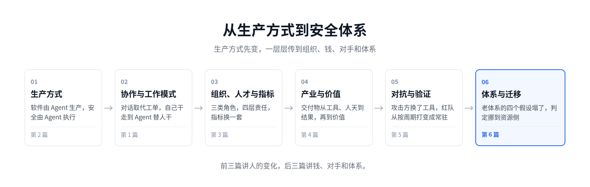
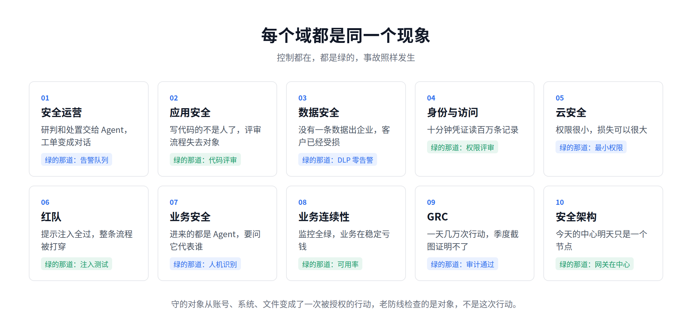
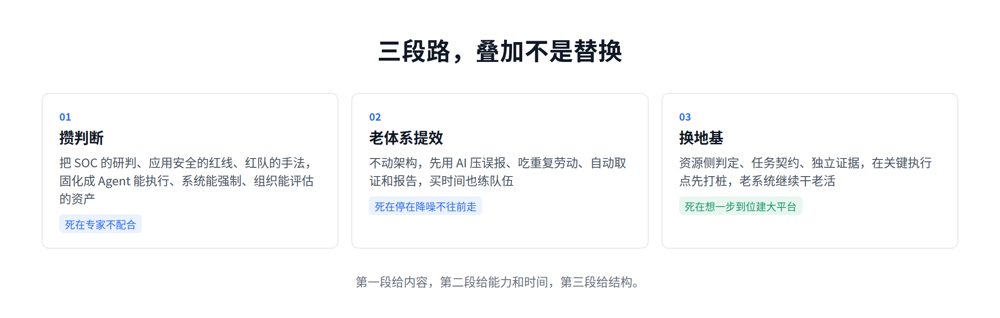
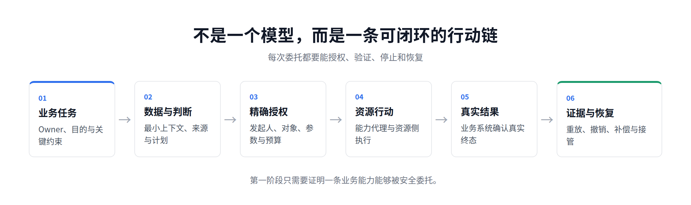
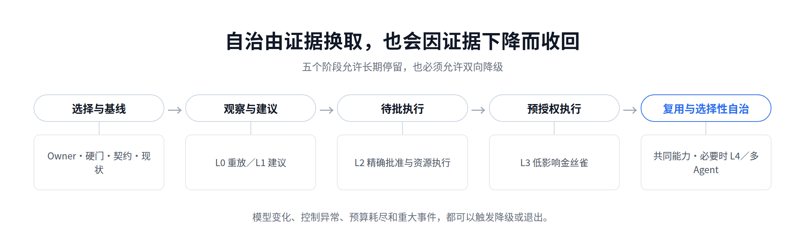

# AI Native Security：安全体系最后会长成什么样

[中文](../zh/06-ai-native-security.md) | [English](../en/06-ai-native-security.md) | [Article index](../README.md) | [Profile](../../README.md)

> **作者简介**：Max Luo（罗棋琛），Teloa 创始人，专注 AI Agent 工程与产品开发、AI Native Security。现任某全球头部加密货币交易所 AI 安全工程团队负责人，拥有 13 年以上网络安全经验，曾负责 SHEIN 全球应用安全、AI 安全中台、安全 BP 与红队等职能。开源书籍《AISecOps：AI 驱动的安全体系》作者。
>
> 微信：neteyes ｜ 公众号：白帽子罗棋琛 ｜ GitHub：cybermaxluo

这是这个系列的最后一篇。

前面五篇各讲了一处。

第一篇讲安全运营，对话取代工单，研判交给 Agent。第二篇讲应用安全，软件由 Agent 生产之后，围着人设计的评审失去了对象。第三篇讲组织，执行交出去以后岗位重新拆分，最后收敛为安全架构与 Agent 工程、BISO、AI 红队三类角色。

第四篇讲产业，能力的消费者从人变成 Agent，交付物从使用权、人天走到结果和价值，同时有四类责任企业交不出去。第五篇讲红队，攻击方 Agent 化之后，进攻这一侧也得智能化。

五处看起来是五件事，底下是同一件。这一篇把它收口，回答三个问题，安全体系最后会长成什么样，从现在的样子怎么走过去，以及这得花多大代价。

这一篇的核心判断是：**老体系默认做事的是人。Agent 做事之后这个默认没了，所有控制都还在，但都证明不了安全。以后只能认一件事，这次行动最后改变了什么。**

## 1、五篇落在一条链上

这条链在第三篇写全过，这里只说结论。生产方式先变，然后是协作方式、工作模式，最后传到组织、岗位、人才和指标。

五篇各占一格。

第一篇讲安全运营，对话取代工单，落在协作和工作模式；

第二篇讲应用安全，软件生产的主体从人换成 Agent，落在生产方式；

第三篇讲组织和人；第四篇是这条链在产业侧的投影；

第五篇是对手先走完了这条链，逼着红队跟上。

链的终点不是某个岗位消失，也不是多买几个 AI 产品。终点是安全体系赖以成立的那个前提变了。这一篇讲的就是这件事。

## 2、老体系整体失效

先把现在的体系摆出来。企业安全防线从来不是一个东西，是几十年叠出来的一堆，按我的分法大致八类。

网络边界，防火墙、WAF、分区、堡垒机。终端，EDR、DLP 客户端、准入。身份，IAM、SSO、MFA、PAM、权限评审。资产与漏洞，清单、暴露面、扫描、补丁、SCA。数据，分类分级、加密、出口管控、数据库审计。软件生产，SDL、DevSecOps、SAST、门禁、制品签名。检测与响应，SIEM、检测规则、研判、应急、红蓝。治理与合规，GRC、制度、审计、风险评估。

这八类长相各异，底下只有一个共同前提，做事的是人，或者人写的、行为固定的程序。从这个前提派生出四个假设，八类里每一个控制都至少靠其中一条站着。

一是量有限。一个身份在一段时间内能做的事是有限的，所以限速、配额、异常阈值可以按人的手速设。

二是模式稳定。人和程序都有惯例，所以行为基线和异常检测才成立。

三是关键点有人。审批、评审、研判，都是按这个设计的。

四是日志可信。日志是被动记录的，不是参与者写的，所以事后能还原。

Agent 进来之后，这四条同时不成立。而且它是从两头一起塌的，一头是企业自己的 Agent 不受控，一头是对手的 Agent 更快。

量那一条，自己这边一个身份十分钟内可以发起几万次行动，所有按人的手速设的阈值全部失准；对手那边，上一篇写过，一个团伙能让 Agent 7×24 跑漏洞挖掘，一个月产出十几个疑似 0day。

模式那一条，自己这边同一个任务换个模型版本、换个 skill、上下文里多一句话，执行路径就变了；对手那边，Payload 被检出以后 Agent 自己改写重编译，整个免杀循环没有人参与。基于基线的检测两边都对付不了。

人那一条，一天几万次行动人看不过来，而且他看到的是 Agent 写给他的摘要，不是原始事实。攻击者不需要骗过人，只需要骗过那个写摘要的 Agent。OWASP 2026 年的 Agentic Applications Top 10 把这一条单列成第九项，叫人与 Agent 之间的信任滥用，并且明确要求强制确认必须展示原始动作本身，不能只给 Agent 写的摘要。

日志那一条最狠。Agent 自己写日志、自己写记忆、自己生成评估结果，日志从被动记录变成了参与者的产出。对手在这一层的收益也最大，改掉评估集，后面每一次运行都会得到通过；污染一次长期记忆，后面每一次调用都带着那个结论。谁能改证据，谁就能决定结论。

所以现在的状况不是哪一层坏了。八类的物理存在都还在，也都还在报绿灯，但它们赖以成立的依据没了，那个绿不再代表安全。

这解释了各个域里同时出现的那类新事故。一个客服 Agent 把"疑似薅羊毛"的判断写进长期记忆，整个过程没有一条数据离开企业，DLP 一条告警都没有，客户已经受了真实损失。一个只拿到项目权限、凭证十分钟过期的 Agent，在十分钟内并行把几个服务缩到零，从 IAM 看它没有越权。一个没宕的工单 Agent，因为过期策略持续错误关单，监控面板全绿，业务在稳定地产生损失。检查项都过了，事故发生在检查项之间。

## 3、新体系建在哪

既然是这四条塌了，新体系就只能建在不依赖它们的地方。一条条换。

不能靠量，就按影响封顶。不再问一个身份一段时间做了多少次，改问一次任务最多能改多少对象、涉及多少钱、跑多长时间，超了就停。而且这个上限必须在执行者之外记账，子任务从同一份总账里扣，否则主 Agent 拆出十个子 Agent，每个都合规，合起来十倍越界。

不能靠模式，就看结果。不问这个调用模式正不正常，问这次行动最终改变了什么，那个改变在不在允许范围内。检测的对象从行为换成结果。

不能靠实时有人，就把人的判断提前固化。人一次性定义什么结果不可接受，机器每一次去比对。人从实时审批退到事前定义和事后抽检。

这一条容易被读成人不用判了，要说清楚。第三篇讲过定论权，一条告警最后算入侵还是误报、一个漏洞复测后算不算能利用，这个板还是人拍，而且要强制人工处理一定比例的随机样本，图的不是效率，是保住定论的质量和人随时接管的能力。变的是人不再在每一次行动上实时批，不变的是最后算不算数由人说。不可逆、超阈值的那些动作，照旧留人签字。

不能靠日志，就从不参与执行的系统取证。副作用落在哪个系统，就从哪个系统读。冻结看账本，配置看云控制面，会话撤销看身份平台，工具返回的 success 只说明 API 收到了请求，Agent 的汇报不算结果。

第一篇讲 SOC 的时候说过一个判断，模型和 harness 这一层会被大厂收走，企业真正该攥在手里的是自己的数据、判断和引擎。这一条在这里得到印证。判定和证据如果建在某一家 harness、某个 MCP 网关或者某个安全产品里面，它换代你就得跟着换代。

这四条指向同一个位置，结果发生的地方。落到工程上是账本、云控制面、身份平台这些最后真正改变状态的系统，下面统称资源侧。

所以体系的重心从入口移到了结果侧。过去防线的重心在入口，谁能进来、能连哪、能调什么。以后重心在结果侧，这次行动最终改变了什么，那个改变在不在允许范围内。

入口那八类不是不要了。它们继续拦掉大部分明写的攻击，继续管资格、管暴露面、管数据外发，工作量只会更大，因为对手也把进攻自动化了。变的是它们的位置。过去它们既是入口也是判定者，以后只当入口，判定权在资源侧。它们的产出从"我批准了"变成"到达资源侧的流量更少、更干净"。

这就是 AI Native 的实际含义，安全不再是挂在流程外面的一道道检查，而是长在执行路径里的约束。第一篇讲的 SOC 版 Codex、第二篇讲的把安全能力做进 skill 让左移真的发生，都是这件事在各自位置上的样子。

有一类例外必须点出来。上面整套推导有个前提，副作用落在企业看得见的系统上。业务侧和研发运维侧的 Agent 满足，终端侧的不满足。员工桌面上那个 Agent 继承他本人的全部权限，读本地文件、读邮件、用已登录的会话，很多副作用根本不经过企业任何资源系统，资源侧在哪儿都找不到。这一类现在是真空，而且数量最大、扩散最快。

它的办法只能往回退到供给侧，企业统一提供 Agent 和统一的模型出口，而不是让每个人自己装。这不是技术问题，是管理问题。

除了终端，还有三个洞是行业公认没解的。RSAC 2026 上五家厂商同时发了 Agent 身份框架，这三条全都没覆盖。Agent 自己改写了策略之后怎么在运行时发现，Agent 之间委派怎么建立信任（OAuth、SAML、MCP 都没有这个原语），以及已经不用的 Agent 留下的凭证怎么注销。承认这三个洞比给一套完美方案更接近现状。

这个方向也不是我一个人的判断，欧美那边在往同一处走，只是话被拆开说了。Forrester 在 2026 年提了 AEGIS 框架，核心是从保护基础设施转向保护意图，里面的 least agency，最小代理权，跟这里说的按影响封顶是同一件事。Gartner 把这一层叫 Securing AI，预测到 2029 年针对 AI Agent 的成功攻击里，过半会利用访问控制缺陷和提示注入。

但真正主张判定要挪到副作用落地处的是少数派，而且每家只说自己卖的那一层。做策略引擎的说只在网关判一次是判得太早，授权要跟着请求一路走到数据层；做端点的说观察真实动作是个可解的问题，分析意图不是；做身份的说授权是执行期的持续判定，不是登录时的一次性确认。三家说的是同一条原则的三个片段，没有一家讲得完整，因为每家只卖一层。

甲方没有这个包袱。完整的说法是，能力可以集中授予，判定必须下沉到产生不可逆副作用的那个资源上。

## 4、这得多大工程

讲到这里，甲方的第一反应通常是这得改多少系统。先把代价说清楚，不然后面的路没法排。

不是重写系统。资源侧判定不需要重做付款系统或者云平台，做的是在它们已有的执行入口前面加一次校验，看这次行动的发起人、对象、参数和累计影响在不在契约允许的范围内。技术上最接近的类比是给一个接口加一层策略中间件，不是重构业务逻辑。

工作量集中在三件事。一是把契约写出来，谁授权、能影响多大、结果怎么确认、怎么停。二是在执行入口接一次校验。三是把结果确认的来源从 Agent 的汇报改成资源系统的真实状态。三件里前两件是工程活，量可以估；第三件往往最小，因为那些系统本来就有状态可读，只是过去没人去读。

难的不是技术，是拿到业务方的答案。契约里最关键的一条是"什么结果不可接受"，这个只有业务负责人能定，而多数业务方从来没被这么问过。第一次问下去，得到的回答通常是"都不能出事"。把它逼成"这三条绝不能发生"，是这件事里最花时间的部分，也是第三篇里 BISO 这个角色存在的理由。

还有一层更难。第五篇讲过未知的四类，最后一类是共同盲区，同一拨人建起来的体系，局限就是这拨人的能力上限。业务方列出来的不可接受结果，必然漏掉他们自己看不见的那部分。所以契约不是一次写完的东西，要靠红队持续去打、去撬，把没人提过的风险变成写下来的条目。这也是第三篇里红队那类角色不能被建设方吸收掉的原因。

所以成本结构跟传统安全项目不一样。传统项目的成本大头在采购和部署，这件事的成本大头在跨部门的定义工作。买不来，也外包不掉，第四篇讲的四类不可委托责任说的就是这个。

最后说收益，不然这件事在预算会上过不去。第四篇写过，安全第一次可以正向表达自己的价值。企业能把多少业务交给 Agent 去做，取决于能不能证明这些行动可授权、可验证、可撤销、可恢复。证明不了，自治就上不去，业务只能停在 Agent 给建议、人来执行这一层。

我们自己在做的安全智能体框架，目标是八成安全任务由 Agent 独立闭环，两成高风险留给人，这条线就是按这个逻辑划的。所以资源侧判定对外的说法不该是又加了一道控制，而是把业务能开放的自治动作往上抬一格。这笔账可以记四条，业务开放了哪些原来不敢开放的自治动作，每个合格结果的完全成本，从异常发现到影响封闭的时间，误伤和补偿的成本。四条都能从运行证据里直接取。

## 5、三段路怎么走

方向清楚、代价清楚，路要一步步走。我把它分成三段，三段是叠加不是替换，多数企业会长期同时跑着三段。

第一段，把判断攒出来。把人脑子里的判断固化成机器能执行的东西。SOC 的研判逻辑、应用安全的红线、红队的攻击手法、风控的处置规则，这些过去散在专家脑子、制度文档和各家产品控制台里，现在要变成 Agent 能直接用、系统能强制执行、组织能持续评估的资产。

这一段主要靠第三篇说的安全架构与 Agent 工程那类人推动，它最容易死在专家不配合上。一线专家会觉得这是在教一个要取代自己的东西，如果绩效上不认这件事，配合度就到不了。解法是把"把多少人类判断变成了可复用的公共能力"直接写进考核，开会动员没用。

第二段，先在老体系上提效。不动架构，用 AI 把误报压下去、重复劳动吃掉、取证和报告自动化。这一段的价值不只是省人，是买时间和练队伍。团队在这一段学会怎么构建 Agent、怎么监督它、怎么判断它的输出算不算数，这些经验是第三段的前提。

这一段最容易死在停在这里不往前走。降噪的收益立竿见影，季度汇报好看，后面两段短期看不到数字，很多企业就停在这儿了，三年之后还是同一套老架构加了几个聊天框。

第三段，把地基换掉。新的平台和系统，安全长在执行路径里。资源侧判定、任务契约、独立证据，这三样是新体系的地基。这一段不用把老系统推倒，在关键的执行点上先把地基打下去就行，老系统继续干老活，只是不再由它说了算。

这一段最容易死在想一步到位建大平台。先立项做一个覆盖全公司所有 Agent 的统一管控平台，做一年半，上线的时候业务已经换了三轮 Agent。正确的做法在下一节。

三段的关系是，第一段提供内容，第二段提供能力和时间，第三段提供结构。缺一段都走不通。

推动这件事需要三方到齐。安全架构与 Agent 工程把能力和判定点建起来，BISO 去业务侧要回那句"什么结果不可接受"，红队独立验证这两者是不是真的成立。CISO 的活是把这三方凑齐，并且保证第三方的独立性不被前两方吸收掉。三类角色第三篇讲过，它们在这里第一次同时上场。

## 6、从一条链开始

不要从平台开始。

从一条能闭环的行动链开始，选的标准有三条，有明确的业务 Owner，有真实的副作用，能停能回滚。比如改供应商银行账户、删除生产资源、冻结用户账户，挑一个你们现在最疼的。

九十天大致这么排。前两周把 Owner 定下来，和业务方一起写清楚这条链上什么结果不可接受。接下来一个月，把这条链接进资源侧判定，只做这一个动作，其余动作继续走老路。

再一个月跑起来收证据，看四条指标。高影响动作里有多少真的经过了资源侧那一道，有多少结果是从业务系统确认的，从停止指令发出到影响封闭要多久，一个季度里绕过去的有几次。最后两周复盘，决定扩第二条链还是先把第一条做扎实。

跑通一条，第二条会快很多，因为契约的格式、判定的位置、取证的方式都是复用的。

还没大规模上 Agent 的企业，我的建议是现在就开始，不要等。Gartner 2026 年的调研说只有一成七的组织已经部署了 AI Agent，六成以上预计两年内部署，多数企业现在还在窗口里。

这件事有个很实际的时间差。地基在几个 Agent 的时候铺，和在几十个 Agent 都已经上线、各自接了不同系统之后再回头铺，工作量不是一个量级。前者是设计，后者是改造，而改造要挨个去动别人已经跑起来的业务。第一段那些判断也一样，会做这些判断的人现在还在，等到初级执行岗大量消失，源头就没了，第三篇讲初级岗位消失之后资深专家从哪来时说的是同一件事。

## 7、关于这本书

先说清楚跟《AISecOps》的关系。那本讲的是安全运营怎么 AI 化，对象是现有的体系，问题是怎么让它跑得更快更准。这本讲的是体系本身被重建成什么样，对象是前面说的那四个假设塌掉之后要重新搭的东西。一本是提效，一本是换地基，不是改版。

书里有三样东西是这六篇装不下的。

一是十个安全域的对照表。数据、身份、云、业务安全、业务连续性、应用安全、安全运营、合规、架构、供应链，每一个域各写一章，回答同样三个问题，老防线在检查什么，新防线要守什么，这个域的判定点落在哪个资源上。这六篇只给了三个例子，书里是十个域挨个过。

二是行动授权的完整模型和契约模板。这篇里的四件事，谁授权、能影响多大、结果谁确认、怎么停，在书里展开成七条契约和六个共同控制面，每一条给了字段、取数位置和失效模式。契约是可以直接拿去改的。

三是迁移路线和它的验收标准。三段路在书里拆成五个阶段，每个阶段有进入条件、退出条件和可以双向降级的判据。自治权是靠证据换来的，证据不够也要能收回去，这一条书里写得比这篇细得多。

怎么读。CISO 和安全负责人看第一部分和第六部分就够，那是判断和路线。工程师看第二、三部分，十个域和六个控制面在那里。红队看第 16 章，第五篇里那些没展开的东西都在。做产业和乙方的，第五部分讲交付物和定价。

## 8、总结

这个系列从头到尾讲的是一条链。生产方式先变，协作、工作模式、组织和人跟着变，产业的交付物跟着变，对手也跟着变。

链的终点是安全体系赖以成立的前提变了。所有控制底下只有一个前提，做事的是人，由它派生出量有限、模式稳定、关键点有人、日志可信这四个假设。Agent 进来之后四条同时不成立，一头是自己的 Agent 不受控，一头是对手的 Agent 更快，所以控制都在、都是绿的，事故照样发生。

**不能靠量，就按影响封顶；不能靠模式，就看结果；不能靠实时有人，就把判断提前固化；不能靠日志，就从不参与执行的系统取证。四条都指着同一个地方，行动最后改变了什么，就在那里判。**

代价不在采购，在跨部门把"什么结果不可接受"定下来。路分三段，攒判断、老体系提效、换地基，叠加着走，三段各有各的死法。起点不是平台，是一条能闭环的行动链。

最后留一个还没答案的问题。判定既然要在运行时做，人又看不过来，那执行判定的大概率也是机器。Gartner 预测到 2030 年，专门做看护的 Agent 会占到整个 Agent 市场的一到一成半。真走到那一步，安全体系就是 Agent 管 Agent，而这一篇讲的所有东西都建立在一个前提上，管别人的那个 Agent 自己不会被打。这个前提现在还站得住，因为它只比对事先写好的契约、不做判断。往后会怎样，我没有答案。

也要说一句冷的。Google Cloud 的 Anton Chuvakin 在 2026 年 RSA 之后写过一句话，AI 带来的加速只会杀死靠运气的安全。不存在的漏洞，再强的 AI 攻击者也利用不了。这一篇讲的换地基，前提是老体系的基本功本来就在做。基本功没做的企业，先补基本功，别指望新架构替你补。

写到这里，这个系列的公众号部分结束了。六篇给的是方向和判断，落地的部分在新书《AI Native Security》里，获取方式放在文末。

以上是我对 AI Native Security 的一些思考，仅代表个人观点，不构成针对任何企业的法律意见。欢迎关注我的公众号，或联系微信：neteyes 加入我们的微信群一起交流。

<!-- 发布前替换：《AI Native Security》获取方式（GitHub 地址 / 电子版链接 / 二维码），以及纸质版信息 -->

**参考资料**

1. OWASP Agentic Applications Top 10：https://genai.owasp.org/resource/owasp-top-10-for-agentic-applications-for-2026/
2. Anthropic 威胁情报报告（2026 年 9 月）：https://www.anthropic.com/threat-intelligence-report-september-2026
3. NIST 零信任架构 SP 800-207：https://csrc.nist.gov/pubs/sp/800/207/final
4. NIST SP 800-53 Rev. 5.1 AC-6 最小权限：https://csrc.nist.gov/pubs/sp/800/53/r5/upd1/final

---

[Previous](./05-red-teaming.md) | [Next](./07-teloa.md)
