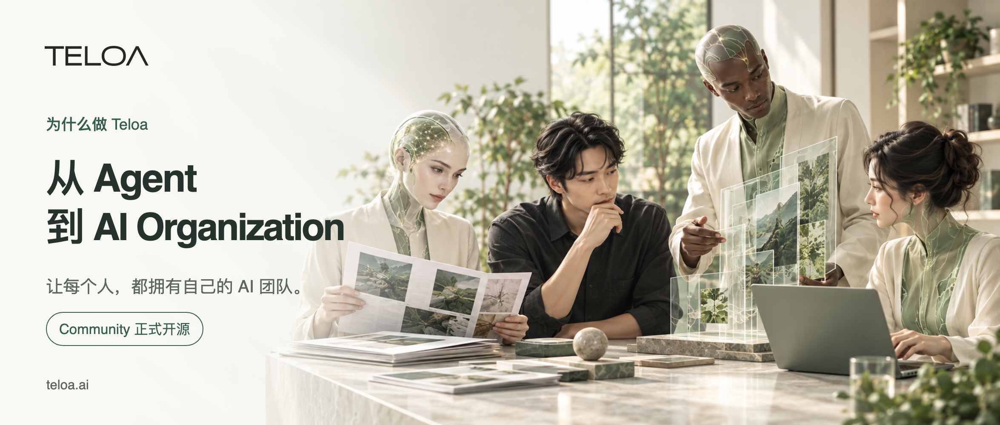
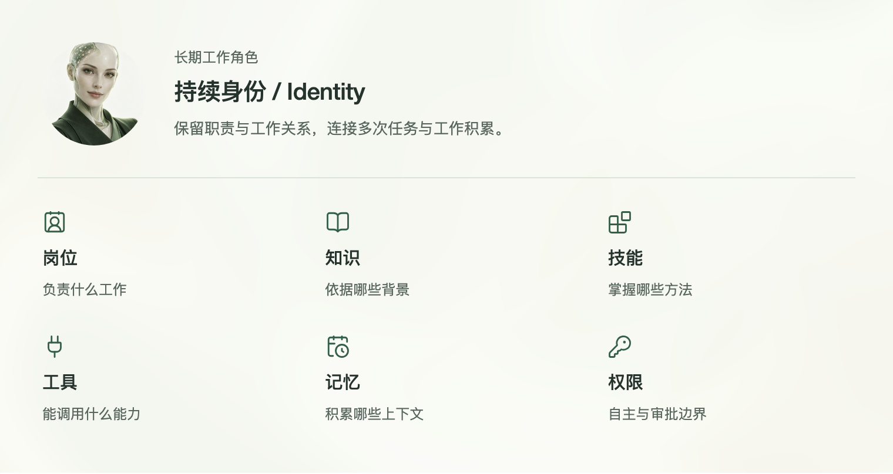
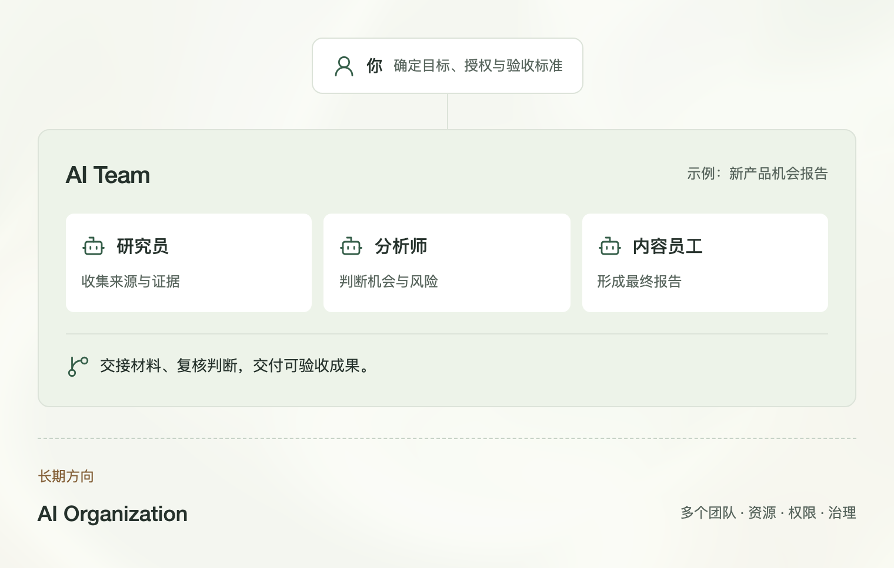
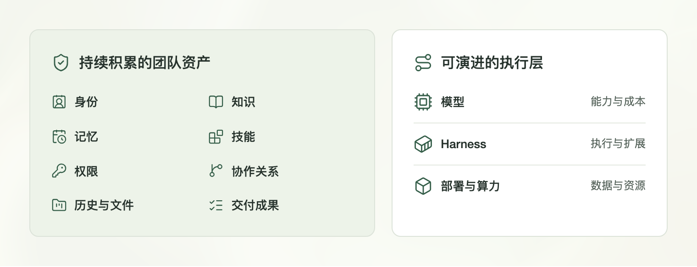
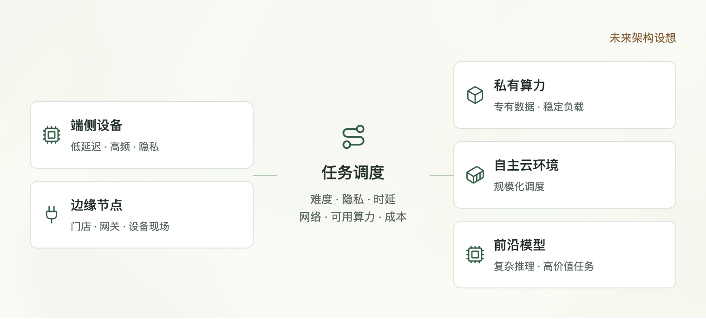
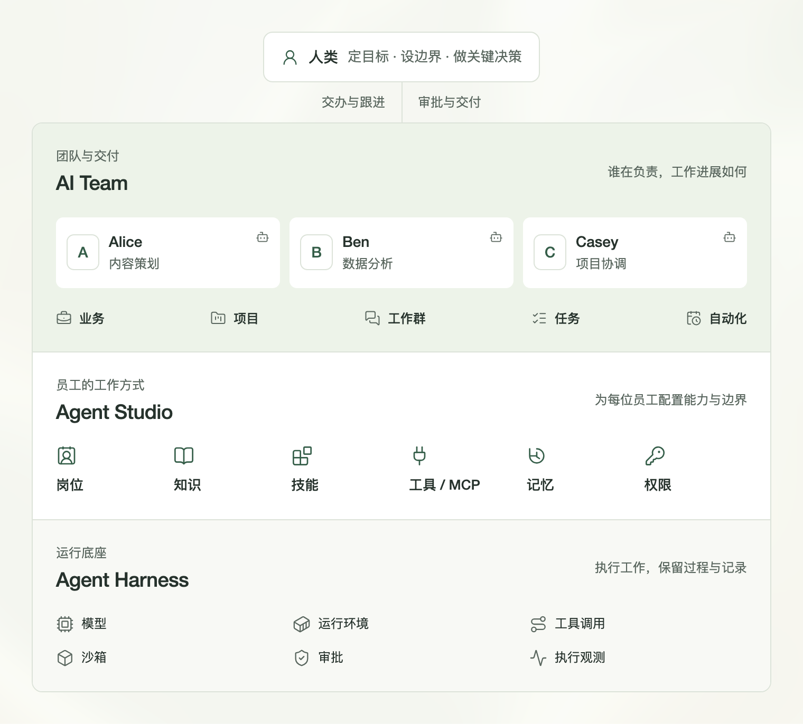
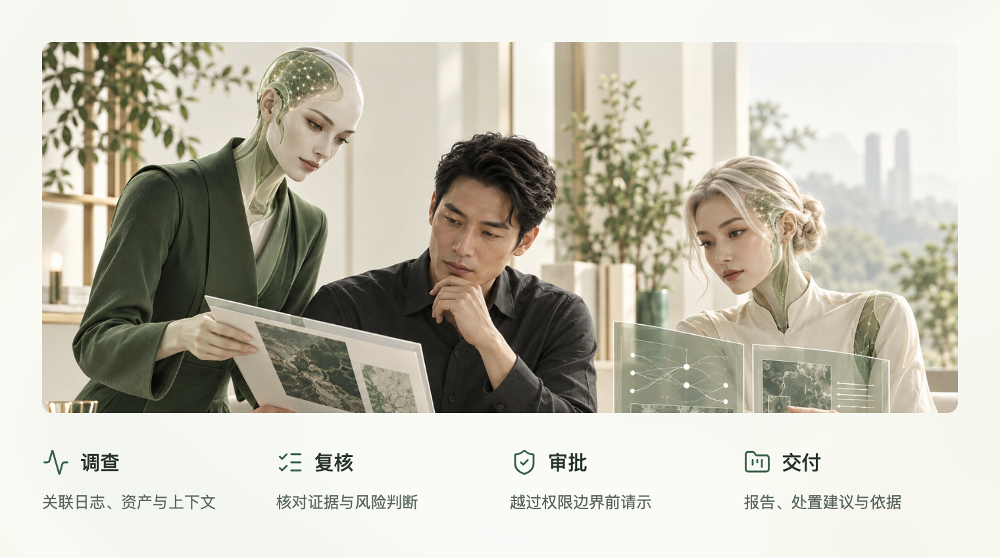
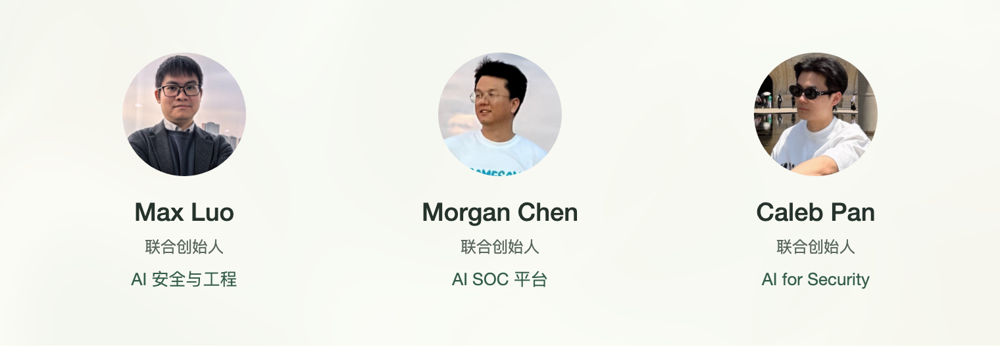
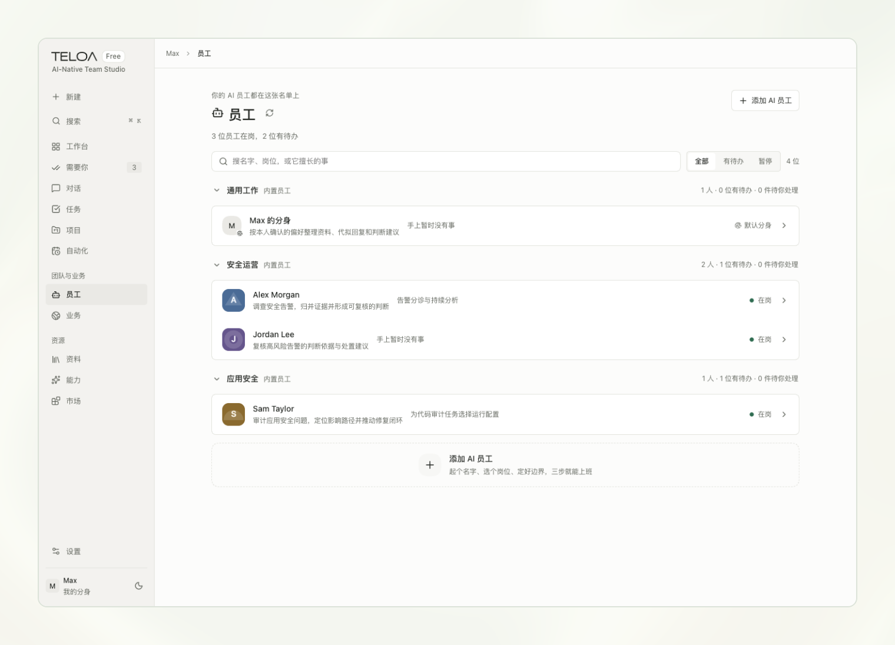
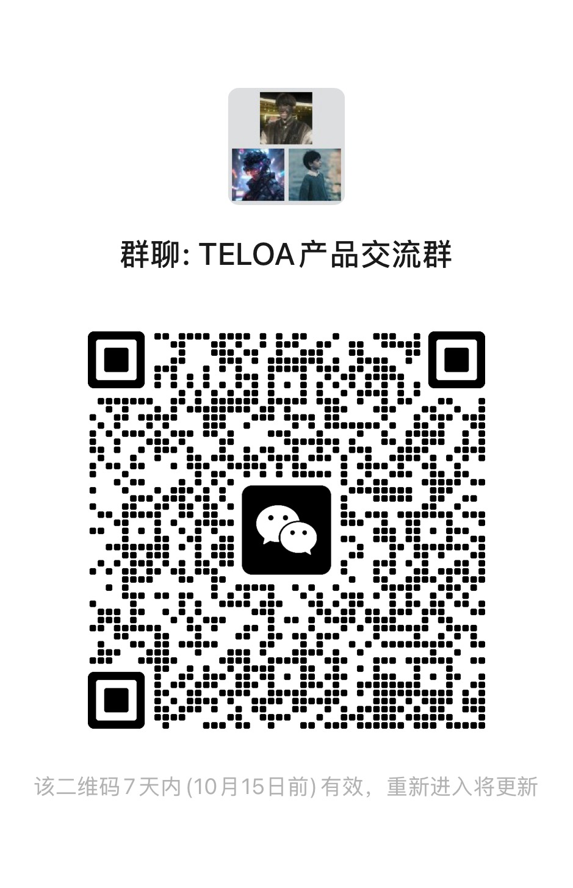

# 从 Agent 到 AI Organization：我们为什么做 Teloa

[中文](../zh/07-teloa.md) | [English](../en/07-teloa.md) | [Article index](../README.md) | [Profile](../../README.md)

**Teloa Community 正式开源**

<!-- 封面图 开始 -->

<!-- 封面图 结束 -->

如果把这几年 AI 产品的发展连起来看，会发现一条越来越清晰的演进路线：AI 正在从“回答问题”，一步步走向“接手工作”。

最早，我们和 AI 的关系是聊天框。人提出问题，AI 给出答案。后来出现 Copilot，AI 开始进入 IDE、Office、浏览器和各种工作软件，人仍然掌握操作权，但 AI 已经开始跟着人一起工作。

再往后，是 Dify、n8n 这一类 Workflow。人开始把一整段流程交给系统，但流程本身主要还是提前设计好的：下一步做什么、调用什么工具、失败怎么办，大部分逻辑需要预先定义。

Agent 改变了这件事。人开始不再告诉 AI“第一步做什么、第二步做什么”，而是直接告诉它：我要什么结果。剩下的事情，由 Agent 自己拆解任务、制定计划、调用工具、访问网页、操作文件、执行代码，并根据中间结果决定下一步。

真正发生变化的，不只是模型越来越聪明，而是越来越多的任务规划权和执行权，正在从人转移给 AI。

## 01｜从 Agent 到 Harness：AI 开始真正接手工作

一个 Agent 如果只运行几分钟，并不难。但如果它要完成一个小时、一天，甚至持续更久的任务，仅靠一次模型调用远远不够。

它需要管理上下文、保存状态、调用工具、操作文件和浏览器、执行代码、处理失败和重试，还要知道哪些动作可以自主完成、哪些必须经过人工审批。

于是，Agent 背后开始出现一层越来越重要的基础设施：Agent Harness / Agent Runtime。

> **模型决定 Agent 有多聪明，Harness 决定 Agent 能不能真正把事情做完。**

Harness 最早大规模证明价值的场景之一，是 Coding。Claude Code 和 Codex 让开发者可以把越来越完整的软件工程任务交给 Agent：理解代码库、修改文件、执行命令、运行测试、调用工具，并通过反馈不断修正。

Coding 是一个天然适合验证 Harness 的环境：任务复杂、工具丰富，而且编译、测试、Git diff 等机制能够不断提供反馈。可以说，Coding Agent 是 Harness 最早成熟起来的试验场之一。

随后，OpenClaw 又把这种运行方式从 Coding 带到了更广泛的个人计算环境。Agent 不再只存在于 IDE 或终端里，而是可以常驻在自己的电脑和通信渠道中，拥有 Workspace、Session、Memory、Skills、Automation 等能力，持续推进任务。

如果说 Claude Code 和 Codex 证明了 Harness 可以让 Agent 在复杂的软件工程环境里真正工作，那么 OpenClaw 让更多人看到：这种运行方式并不只属于 Coding，它同样可能成为 Personal Agent 的基础。

到了 2026 年，Harness 本身又开始被进一步显性化和基础设施化。Codex harness、Claude Agent SDK，以及 DeepSeek Harness（DSH）的出现，都在说明同一件事：Harness 正在从具体产品内部的工程实现，逐渐演变成一个可以独立选择、扩展和演进的软件层。

DSH 更进一步，把 Harness 做成独立的开源项目，通过插件化方式组合模型、工具、Session、文件访问和 Agent Loop。

我们判断，继大模型之后，Agent Harness 很可能成为下一轮 AI 应用基础设施竞争中的关键一层。

Teloa 当前使用 DeepSeek Harness 作为 Agent Runtime，但在产品层面，我们希望 AI 员工能够尽量与具体模型、具体 Harness 解耦。模型和 Runtime 可以演进，但 AI 员工长期积累的身份、记忆、能力和工作关系应该能够延续。

## 02｜从一次性 Agent，到长期存在的工作角色

Agent 的下一步，不只是“能跑得更久”，而是“会持续成长”。

Hermes Agent 这一类产品开始强调 Persistent Memory、Skills 和持续学习。Agent 可以跨会话记住用户、项目和环境，也可以把解决问题的过程沉淀成 Skill，在后续工作里复用。

这让 Agent 开始从一次性的任务执行器，变成一个长期存在、不断积累经验的工作角色。

与此同时，AI 也开始真正进入办公环境。豆包办公、千问办公（QwenWork）等产品，正在把 AI 从“问答工具”推进成“工作的入口”：用户描述目标，Agent 自己处理文档、表格、网页、代码，并调用 Skills、Connectors 和其他工具完成交付。

Personal Agent 又往前走了一步。Meta 的 Muse 开始长期理解用户、连接应用、持续处理项目和目标；WorkBuddy 用 Expert、Skills、Memory、权限和并行任务来组织工作；Manus 2.0 的 Cue 更进一步，让 Agent 开始拥有邮箱、电话号码、钱包和电脑，并可以在群聊中分工、交接任务，甚至代表用户完成部分现实服务。

到这里，Agent 已经不只是一个“会调用工具的程序”。它开始拥有身份、通信能力、账户、资源和行动边界。

Muse Gadgets 又把这条路线从软件世界继续向设备和物理环境延伸。通过 Raspberry Pi、ESP32、传感器、显示器和执行器等接口，Personal Agent 开始具备连接现实世界的可能。

AI 的边界正在从信息世界进入软件世界，再逐步走向物理世界。

## 03｜从 Agent，到 AI 员工

在 Teloa 里，我们把这种长期工作的 Agent 定义为 AI 员工。

因为一个真正进入工作的数字角色，需要的不只是一个 Prompt，而是一套完整的工作属性：

> Role + Identity + Knowledge + Skills + Tools + Memory + Permissions

Role 决定它负责什么；Identity 让它成为长期存在的主体；Knowledge 提供工作的背景和依据；Skills 是它掌握的方法；Tools 让它真正执行工作；Memory 让它持续积累上下文；Permissions 则决定哪些操作可以自主执行，哪些必须经过人工审批，以及什么时候需要升级给人类处理。

Agent 描述的是技术能力，“员工”描述的是它在组织中的位置。

一个长期存在、有职责、有身份、有权限的 Agent，开始接近一个 AI 员工。多个拥有不同角色的 AI 员工协作，就开始形成一支 AI Team。

<!-- 配图 01-AI员工的七项要素 开始 -->

<!-- 配图 01-AI员工的七项要素 结束 -->

## 04｜Personal Agent 的下一站，是 AI Team

如果一个人只有一个长期存在的 Agent，我们很自然地把它理解为 Personal Agent。

但当一个人同时拥有研究分析师、产品经理、开发工程师、内容运营、安全工程师等多个 AI 员工，它们拥有各自的职责、知识、技能、工具、记忆和权限，并能相互讨论、协作、交接任务，产品形态就开始发生变化。

它不再只是一个 Personal Agent，而开始成为一支 AI Team。

这正是 Teloa 当前正在解决的问题：

> 如何让一个人真正拥有、管理和运行一支 AI 团队。

今天的 Teloa，首先是一个 AI-Native Team Studio。我们从 AI Employee 开始，通过职责、知识、技能、工具、记忆和权限定义长期工作的 AI 角色，再通过任务、项目、群协作和自动化，让多个 AI 员工组成一支真正能够工作的 AI Team。

## 05｜AI Team 之后，可能是 AI Organization

AI Team 可能还不是终点。

一个真正的组织，不只是很多人一起工作，它还意味着角色、职责、层级、资源、预算、权限、流程、治理，以及长期形成的组织记忆。

当 AI 员工越来越多，仅靠一个群聊很难承载长期协作。不同 AI 员工之间会逐渐形成任务委派、上下游关系、资源分配、审批链、权限边界和责任归属；多个 AI Team 之间，也可能形成研发、安全、运营、销售、客服等不同职能。

群聊只是协作表象。真正的组织还需要角色、权限、资源、审批、治理和组织记忆。

从更长期看：

> AI Employee → AI Team → AI Organization

AI 的下一阶段，可能不只是团队化，还会进一步走向组织化。

未来的 AI Organization 也不会只存在于聊天框和办公软件里。它会连接模型、数据、SaaS、支付和通信网络，也可能进一步连接设备、IoT、传感器、机器人和现实服务。

Digital World + Physical World，可能会共同成为未来 AI Organization 所连接和运行的世界。

<!-- 配图 02-从员工到团队到组织 开始 -->

<!-- 配图 02-从员工到团队到组织 结束 -->

## 06｜AI 越自主，安全、身份与治理越重要

当 AI 只是聊天机器人时，我们最担心的问题通常是：它会不会回答错？

但当一个 AI 拥有邮箱、钱包、浏览器、电脑和业务系统权限以后，问题完全不同：它是谁？谁授权它？它能代表谁？可以访问什么数据？哪些动作可以自主执行？哪些必须审批？出现异常以后如何停止、隔离和恢复？

Agent 越有用，它需要的数据越多；Agent 越自主，它需要的权限也越大。

所以，AI 员工不仅是一个生产力问题，同时也是身份、权限和治理问题。

对 Teloa 来说，下一代 AI 基础设施不仅要让 Agent 更自主，也要让这种自主始终发生在明确的身份、权限、审批和审计边界内。

安全、身份、权限和数据所有权，不是 AI 做完以后再补上的能力，而是 AI 真正进入生产环境的基础。

## 07｜AI 团队到底属于谁

今天换一个聊天模型并不难。GPT 换成 Claude，Claude 换成 DeepSeek，大多数时候只是换一个模型。

但如果一个 AI 员工已经和你工作了一年，它可能积累了长期 Memory、业务知识、Skills、工具连接、历史任务、文件、账号权限，以及和其他员工之间形成的协作关系。

这时迁移的就不再是一份聊天记录，而是一个已经懂你、懂业务、知道怎样工作的数字员工。

如果你拥有的是一整支 AI Team，需要迁移的甚至可能是一整个数字组织。

所以 Teloa 很关注一个问题：AI 团队到底属于谁？

> **模型可以替换，Harness 可以演进，部署可以迁移，算力可以选择，但你的 AI 团队始终属于你。**

真正需要长期延续的，是 AI 员工和 AI Team 自身的 Identity、Memory、Knowledge、Skills、Tools、Permissions、Tasks 和协作关系。

私有部署只是其中一种实现手段。更重要的是 Ownership。

<!-- 配图 03-团队的所有权与选择 开始 -->

<!-- 配图 03-团队的所有权与选择 结束 -->

## 08｜从 Token 依赖，到算力自主

今天绝大多数 AI 产品的智能主要来自云端模型 API。每一次推理、每一个 Agent Loop，都意味着 Token 消耗。

对于聊天产品，这个成本也许并不明显；但当 Agent 开始长期运行，当一个人同时管理 5 个、10 个甚至更多 AI 员工以后，Token 会逐渐成为 AI Team 的重要生产成本。

我们判断，未来更可能出现一套分层、混合的智能架构：

> Device → Edge → Private Infrastructure → Cloud → Frontier Model

端侧小模型负责低延迟、隐私敏感和高频任务；边缘节点服务门店、工厂、家庭网关、车载设备和机器人；本地 GPU 与企业私有模型承载专有数据和稳定工作负载；用户自己的云负责更大规模的统一调度；真正复杂的推理和高价值任务，再按需调用最强的 Frontier Model。

Harness 的角色，是根据任务难度、数据敏感度、实时性、网络条件、可用算力和成本，在这些层级之间动态选择模型和运行环境。

随着开放模型、小模型、推理优化和端侧算力继续发展，越来越多今天必须通过 API 完成的工作，会逐渐可以运行在个人电脑、AI PC、工作站、企业服务器或用户自己的云环境里。

这个变化不仅意味着数据更可控，也会改变 AI 的经济模型。

今天，我们通过 Token 不断向模型提供商购买推理能力；未来，越来越多推理可能运行在自己拥有的算力上，成本结构也会从持续购买 Token，逐渐转向拥有和调度自己的计算资源。

> 从租用 Token，到拥有智能。

这也是 Teloa 对 Ownership 的另一层理解：数据自主、模型自主、Harness 自主、算力自主。

<!-- 配图 04-未来的混合算力选择 开始 -->

<!-- 配图 04-未来的混合算力选择 结束 -->

## 09｜Teloa：从 AI Team 开始

沿着这条演进路径，Teloa 的方向也逐渐清晰。

当前，Teloa 是 AI-Native Team Studio。

下一阶段的方向：

> Open AI Team Infrastructure for the Real World

面向个人与企业，连接数字世界与现实世界。

对个人、独立开发者、一人公司（OPC）和小团队来说，可以拥有自己的 AI 员工，组建自己的 AI Team，把大量重复执行工作交给它们。

对企业来说，AI Team 会进一步进入企业知识、身份体系、权限、审批、审计、业务系统和组织治理，逐渐形成新的 AI Workforce。

Teloa 从 AI Team 起步，长期方向是支撑 AI Organization 的开放基础设施：

> Open Infrastructure for AI Organizations

这意味着让 AI 团队能够长期运行，并为组织编排与治理提供基础。

<!-- 配图 05-Teloa工作架构 开始 -->

<!-- 配图 05-Teloa工作架构 结束 -->

## 10｜AI Team 的价值，是释放人的生产力，放大人的创造力

随着 Agent 获得越来越多行动能力，人的位置会从具体执行逐步上移到目标、规则、授权、风险边界和最终责任。

人不需要盯着 AI 完成每一步，但一些关键问题始终应该由人决定：目标是什么，什么风险可以接受，谁能够访问哪些数据，什么操作可以自动执行，什么操作必须审批，什么结果可以进入生产环境，以及最终责任由谁承担。

AI 可以承担越来越多重复、耗时和执行性的工作，人类则把更多精力放在目标、判断、创造与责任上。

Teloa 希望 AI Team 带来的，不只是效率提升，而是对人的能力边界的重新扩展：让一个人能够调动更多智能、管理更大的工作规模，并把时间重新投入到真正需要人类创造力的地方。

> **让 AI 释放人的生产力，也放大人的创造力。**

## 11｜网络安全，是我们选择的第一块高强度试验场

Teloa 最先选择从网络安全方向验证 AI 员工和 AI Team。

网络安全本身就是一组高度复杂、强协作、强权限约束的生产体系，覆盖安全运营与威胁响应、应用与软件供应链安全、数据安全、云与基础设施安全、身份与访问安全、内部威胁与数据防泄漏、漏洞与攻击面管理，以及安全治理、风险与合规等关键领域。

不同安全角色需要持续处理告警、代码、资产、身份、数据、配置、漏洞、证据和风险，并在多个系统之间协作完成判断、处置与治理。

例如，在安全运营与威胁响应中，AI 员工可以调查告警、补充上下文、关联证据、分析攻击路径并形成研判与处置建议；在应用与软件供应链安全中，可以参与代码审计、漏洞挖掘、威胁建模、依赖与供应链风险分析、修复建议和整改验证；在数据安全、云与基础设施安全、身份与访问安全中，可以围绕敏感数据、云资产、配置、账号、权限和异常行为持续识别风险；在安全治理、风险与合规中，则可以辅助控制项检查、证据收集、风险评估、整改跟踪和持续审计。

网络安全既是 Teloa 的首个行业落地方向，也是一块检验 AI 员工能否真正进入复杂生产环境的高强度试验场：数据敏感、权限复杂、工具众多，判断错误可能产生真实风险，关键动作还必须可控、可审计。

如果 AI 员工能够在这样的环境中可靠工作，这套围绕 Role、Knowledge、Skills、Tools、Permissions、Approval 和 Audit 形成的工作模型，也有机会迁移到研发、财务、运营、客户交付等更多真实业务。

<!-- 配图 06-安全场景的交付与边界 开始 -->

*安全工作场景示意。*

<!-- 配图 06-安全场景的交付与边界 结束 -->

## 12｜为什么是我们

Teloa 的几位联合创始人长期工作在 AI、机器学习与安全工程的交叉领域，来自头部金融与互联网企业，分别负责或参与过 AI 安全、AI SOC、安全工程与 AI for Security 等生产体系建设。

这段经历让我们看 Agent 的视角和很多纯 AI 产品团队不太一样。

我们关注的不只是模型够不够聪明、任务能不能完成，还会继续追问：它以什么身份执行？能访问哪些数据？拿到了什么权限？哪些动作可以自主完成？哪些必须经过人工审批？执行过程如何留痕和审计？一旦出现异常，如何停止、隔离、恢复并回到人类决策？

因为我们长期面对的，本来就是高权限、高敏感数据和高风险生产环境。

所以对 Teloa 来说，安全不是 Agent 做完以后再补上的一层能力，而是 AI 员工进入生产环境的基础设计。

从 AI 安全与治理，到 AI 驱动安全生产，再到今天的 AI Team，我们一直在做同一件事：让 AI 真正进入生产，同时保持可控、可审计。

别人首先思考的是怎样让 Agent 做更多事；我们同时思考的是，怎样让 Agent 在真实世界里更安全、可控地做更多事。

Teloa，就是这些工程实践和思考逐渐汇聚出来的产品。

<!-- 创始团队图 开始 -->

<!-- 创始团队图 结束 -->

## 13｜为什么选择开源

AI Agent、AI Team 甚至 AI Organization，都还处在快速演进阶段。

Agent Runtime 应该长什么样？Memory 和 Skills 应该怎样沉淀？多个 Agent 如何协作？身份和权限怎么设计？哪些操作应该自动化？人在什么位置介入？一个长期成长的 AI 员工应该怎样迁移和被用户真正拥有？

这些问题还没有最终答案。

因此，我们选择以开源方式推进这条路线，让开发者、AI Builder、安全工程师、创业者和真实用户一起使用、讨论和改进。

今天，我们正式开放 Teloa 社区版（Teloa Community）。

当前版本为 0.2.0-alpha.7，采用 Apache License 2.0。社区版面向个人、自行部署；一个用户可以在自己的电脑上，通过 Web 工作空间管理多位 AI 员工，并使用自己选择的模型服务和 API Key。

今天，我们先从 AI 员工、AI Team、任务、知识、技能、工具、权限和自动化这些基础能力开始。长期 Identity、通信能力、现实世界设备接入、端侧模型调度等，是接下来希望继续探索的方向。

Teloa 选择沿着一条开放、可扩展、可私有部署的路线继续前进。

<!-- 配图 07-社区版真实工作空间 开始 -->

*Teloa Community 工作空间，使用示例数据。*

<!-- 配图 07-社区版真实工作空间 结束 -->

## 14｜Teloa Community，正式开源

如果你愿意一起探索，可以从这里开始：

- GitHub：https://github.com/teloa-ai/teloa
- 官网：https://www.teloa.ai/
- Documentation：https://docs.teloa.ai/
- Teloa Market：https://market.teloa.ai/

欢迎 Star、Fork、提交 Issue，也欢迎直接参与代码贡献。

未来，我们也希望通过 Teloa Market 分享 AI 员工、Skills、Connectors、任务模板、业务看板，以及把这些能力组合起来的完整解决方案。

你不一定需要从零开始构建自己的 AI 团队。未来，也许可以像今天安装软件一样，直接“招募”一个已经具备岗位能力和工作方式的 AI 员工。

Teloa 取自希腊语 “telos”——目的、终点与最终指向。我们希望 AI 不只是回答问题，而是围绕目标组织能力、协作执行，并真正把事情完成。

从更长时间尺度看，这条演进路线可能是：

> Chat → Copilot → Workflow → Agent → Harness / Runtime → Personal Agent → AI Employee → AI Team → AI Organization

今天，Teloa 从 AI Team 开始。

这次开源，是这条路线的起点。

---

## Teloa

AI-Native Team Studio

**让每个人，都拥有自己的 AI 团队。**

**模型可以替换，Harness 可以演进，部署可以迁移，算力可以选择，但你的 AI 团队始终属于你。**

<!-- 联系方式 开始 -->

---

### 联系我们

邮箱：[hi@teloa.ai](mailto:hi@teloa.ai)

Max 微信：**neteyes**

### TELOA 产品交流群

扫码加入，交流产品体验、使用问题与建议。

*二维码失效后，可添加 Max 微信 neteyes 入群。*

<!-- 联系方式 结束 -->

---

[Previous](./06-ai-native-security.md)
